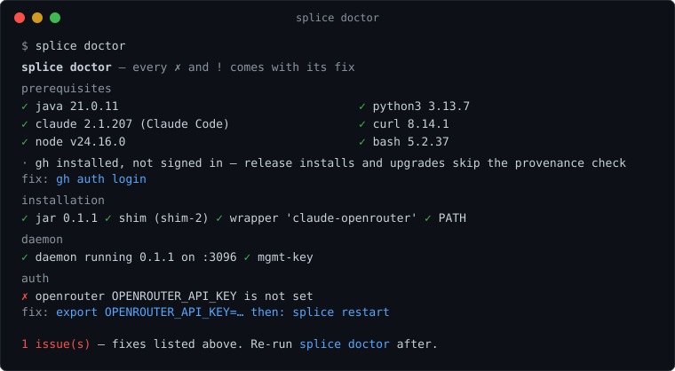
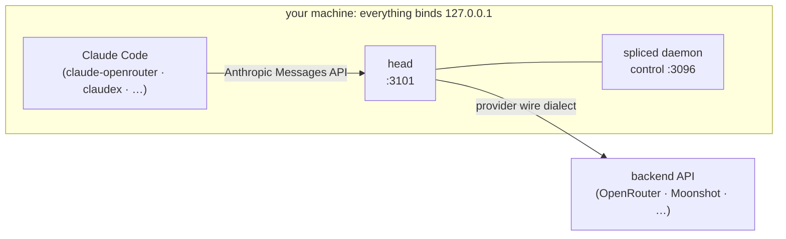

<div align="center">

<h1><picture><source media="(prefers-color-scheme: dark)" srcset="docs/assets/splice-horizontal-night.svg"></picture></h1>

**Use [Claude Code](https://docs.anthropic.com/en/docs/claude-code) with the models and subscriptions you already use.**

ChatGPT · Grok · Kimi · Muse · API backends · Claude

[Why splice](#why-it-exists) · [Install](#install) · [Quick start](#quick-start) · [Providers](#provider-support) · [Trade-offs](#why-you-might-not-want-splice) · [Changelog](CHANGELOG.md) · [Security](.github/SECURITY.md)

[](https://github.com/torad-labs/splice/actions/workflows/ci.yml)
[](https://github.com/torad-labs/splice/releases/latest)
[](https://github.com/torad-labs/splice/attestations)
[](LICENSE)

</div>

```text
splice puts Claude Code in front of the backend you choose.

  Requests are translated for your chosen backend.
  Interrupted compactions can resume from their saved answer.
  Retries stop at a set limit, and keys and sign-ins are never saved half-written.
  Your tools, permissions and shared Claude Code configuration stay yours.
  You see usage and what priced turns would cost at API rates.
  Doctor gives a remedy for failing checks.
  Sessions on different heads can discover and message each other.
```

Type `claudex` instead of `claude` to work with a ChatGPT-backed model inside Claude Code. Use `claude-grok`, `claude-kimi` or `claude-muse` for those subscriptions, or connect an API backend such as OpenRouter. You keep Claude Code itself: its tools, permission checks and terminal, your hooks, skills, agents, commands, CLAUDE.md and permissions, and a session's history when you resume it on another head (`claude-grok -r`). Each head can have its own system prompt, and each provider its own tool handling; splice connects it all to the backend you choose.

The gateway runs locally on your machine. Model requests go to the chosen provider, including a local runtime when you configure one. Subscription connections run on the plan you already pay for; API-key connections use ordinary pay-per-token access.

Signing in happens on each company's own page: `claudex login`, `claude-grok login`, `claude-kimi login` and `claude-muse login` open the sign-in page of OpenAI, xAI, Kimi or Meta. Claude uses Claude Code's own `/login`. Credentials stay on your machine: OAuth logins in `~/.config/splice/auth/`, API keys in `~/.config/splice/keys.toml`, and plain claude’s login and claude-splice’s own login in their separate Claude Code directories. Additional Claude accounts have separate folders under `~/.splice/state/claude-accounts/<head>/`; saved copies of the commands' own logins live under `~/.splice/state/claude-logins/`. Your requests go from your machine to that provider, and splice also connects to a webhook URL if you save one for budget alerts, and to GitHub: to download a release when you install or upgrade, and to fetch rig's installer if you choose a local model in `splice setup` (rig then downloads the model itself). [Credential locations](#credential-locations) and [What splice keeps on your disk](#what-splice-keeps-on-your-disk) have the details.

## Why it exists

Choosing a different model shouldn't mean rebuilding your coding workflow around a different client. splice lets you keep Claude Code while working across backends and makes those sessions useful together.

- **Use the subscriptions you already pay for.** Connect ChatGPT, Grok, Kimi or Muse through dedicated commands, or choose a pay-per-token API route. [Provider support](#provider-support) spells out the differences.
- **Let different models work together.** A ChatGPT-backed session can find and message a Grok-backed session using Claude Code's own agent tools. [Shared session discovery](#heads-that-see-each-other) is enabled by default, with isolation available when you need it.
- **Spend less time recovering long sessions.** More reliable compaction means fewer interruptions and less repeated work. If the client disconnects, an identical compaction retry can pick up the work already underway. [How recovery works](#long-session-reliability).
- **See usage without leaving the session.** Provider-reported plan usage appears in Claude Code's status line. [`splice status`](#manage-your-sessions) prints whether each head is ready, and the one command that would make it ready.
- **Get a fix, not just an error.** [`splice doctor`](#troubleshooting) checks the installation, configuration and authentication, and prints the remedy for each failing check. Release installs verify checksums before going live, and build provenance whenever the GitHub CLI is signed in.

### A workflow across models

After configuring and signing in to the matching providers, open each command in a separate terminal:

```bash
claudex       # Claude Code using your ChatGPT subscription
claude-grok   # Claude Code using your Grok subscription
```

For example, ask one session to implement a change and the other to review it. They can discover each other with `ListAgents` and exchange findings with `SendMessage`; you don't have to copy messages between terminals. Each session still uses Claude Code's own tools and permissions.

Each named backend connection is called a **head**. You choose which heads to configure and launch; the commands above do not configure providers for you.

**In [v0.4.0](https://github.com/torad-labs/splice/releases/tag/v0.4.0):** a launched session holds a turn key, never the management key; `splice upgrade` with rollback; per-head account pools with automatic switching on ChatGPT, Grok, Kimi, Muse and Claude; first-class local models; and [code mode](#code-mode-for-chatgpt) on by default for ChatGPT. Coming from 0.3.x? Read [the upgrade notes](CHANGELOG.md#upgrading-from-03x) first.

## Install

The release installer checks your prerequisites, verifies the downloaded jar and launch shim against the release's checksums, and finishes with `splice doctor`. No GitHub account is needed.

### Requirements

**Platforms:** Linux and macOS natively; **Windows via WSL2** (run `wsl --install` in PowerShell
once, then do everything below inside the WSL shell; it behaves exactly like Linux). Native
Windows shells are refused by the installer with the same guidance: the launch shim and daemon
are Unix programs.

On macOS, splice identifies sessions from launcher-written process records; sessions launched outside splice remain unknown.
Hosted MCP servers have no memory cap or OOM protection on macOS.
The per-turn write bound still runs on macOS, without the kernel acknowledgement count.

| Dependency | Why | If missing |
| --- | --- | --- |
| **Java 21+** | the spliced daemon ships as a fat jar | `apt install openjdk-21-jre-headless` · `brew install --cask temurin@21` · [adoptium.net](https://adoptium.net) |
| **Claude Code** | splice wraps it; `claude` must resolve on PATH | `curl -fsSL https://claude.ai/install.sh \| bash` (the native installer; no Node needed) |
| **curl** + **bash** | the installer, and the launch shim, which is plain `sh` and `curl` | preinstalled almost everywhere |
| **GitHub CLI** (optional) | signed in, it lets release installs and `splice upgrade` also verify each asset's build-provenance attestation | [cli.github.com](https://cli.github.com), then `gh auth login`; without it the install still verifies checksums and prints the command that checks provenance later |

You don't have to pre-check any of this: `install.sh` verifies every dependency up front, prints
the exact fix for your machine's package manager. When you run `./install.sh` with both input
and output attached to a terminal, it also offers to run each fix, with consent. `splice doctor` re-verifies everything at any time.

### Install a release

```bash
curl -fsSL https://github.com/torad-labs/splice/releases/latest/download/install.sh | bash
```

The downloaded jar and launch shim are checked against the release's `sha256sums.txt`. If the GitHub CLI is installed
and signed in, the installer also verifies each asset's build-provenance attestation; if not, it
prints the `gh attestation verify` command that does it later.

To pin one version instead of following `latest` (prereleases never become `latest`):

```bash
curl -fsSL https://github.com/torad-labs/splice/releases/download/v0.4.0/install.sh \
  | env SPLICE_VERSION=v0.4.0 bash
```

**Upgrading.** `splice upgrade` fetches and verifies the latest release the same way (or one
version with `--to vX.Y.Z`), stages it beside the current one under
`~/.local/share/splice/releases/`, waits up to 30 minutes for every head's in-flight turns to finish (`--now` skips
the wait; a count it cannot read is waited out the same 30 minutes and then refused), repoints the live jar, restarts the daemon and runs doctor.
Before anything stops, the new release's own `doctor` must answer and `check-config` must accept your
config, so a release that refuses your config is never activated. Before the restart, a running compaction is waited
on for up to 15 minutes, the daemon's own cap on a turn, so it is not cut (`--now` skips that too). A command whose
`upstreamTimeoutMs` is raised past 15 minutes is still waited on for only 15. After it, `/health` must report the new version within 15 seconds. If the wait expires, the
release stays staged in `releases/<version>` and the command exits 1. A second upgrade while one runs is refused. The live launch shim is replaced to match the jar. An edit to a recorded
release's shim is saved as `splice-launch.edited` beside that release, with its diff printed;
a flat install's live launcher is kept as `splice-launch.edited`, because splice cannot tell whether it was edited. It is also recorded as the rollback copy. `splice upgrade --rollback` puts the previous release back, waits for in-flight turns the same way, and refuses when that release would refuse your config; it is kept
until the next successful upgrade. Config and credentials are never touched. On Linux x86-64, a release that lists
the MCP hub's `splice-mcp-holder` and `splice-mcp-front` has both checked and staged like the jar, swapped in with it,
and put back by a rollback. A running front reloads onto the new program, and the hub's units are left as they are.
0.3.x has no
`splice upgrade`: re-run the pinned installer above, then follow
[the 0.4.0 upgrade notes](CHANGELOG.md#upgrading-from-03x).

<details>
<summary>Other installation options: from source or with a coding agent</summary>

**From source:**

```bash
git clone https://github.com/torad-labs/splice.git
cd splice
./install.sh
```

**Let your agent do it.** Give this prompt to any coding agent with shell access:

```text
Install splice (https://github.com/torad-labs/splice) on this machine and verify it works:
1. Check prerequisites: bash, curl, Java 21+, and Claude Code
   (`claude` on PATH). Install anything missing with this machine's package manager:
   show me each install command and ask before running it.
2. Install from source: `git clone https://github.com/torad-labs/splice && cd splice
   && ./install.sh` (or use the release one-liner from the README instead).
3. Make sure ~/.local/bin is on my PATH (add it to my shell rc if not).
4. Ask me for an OpenRouter API key (I can create one at https://openrouter.ai/keys),
   store it with `splice key set OPENROUTER_API_KEY --stdin`, without printing it, then run
   `splice add openrouter --yes`. The key store also works with a systemd-managed daemon.
5. Run `splice doctor` and fix anything it flags. Every failing check prints its own
   fix command. Repeat until it reports no blockers.
6. Tell me it's ready and that `claude-openrouter` launches Claude Code through OpenRouter.
```

The agent can drive that loop for the same reason you can: `splice doctor` prints the fix for
every failing check.

</details>

## Quick start

### Guided setup

`splice setup` is what the installer tells you to run next. It says what it finds on the machine, then asks where to start (OpenRouter, a ChatGPT, Grok, Kimi or Muse sign-in, or the topology you already have), which other commands to add, and whether plain `claude` itself goes through splice or a separate `claude-splice` sits beside it. It also asks whether sessions share MCP servers, and, on a Linux machine with an NVIDIA card, whether to run a local model. It shows a summary and writes nothing until you confirm; without a terminal it takes every default. The sections below are the same steps by hand.

### API-key starter: OpenRouter

This is the zero-config provider path. It uses a paid API key, not a subscription allowance.

```bash
export OPENROUTER_API_KEY="…"     # vendor-issued pay-per-token API key
splice add openrouter             # sign in, add the head and install its command
claude-openrouter                 # launch it; splice status shows its loopback port
```

The daemon offers every text-producing, tool-capable model OpenRouter serves, read at start and every hour after. `splice add openrouter` writes `model_slots` to keep the opus, sonnet, haiku and fable tier mappings without restricting the picker, and ten `[[providers.openrouter.models]]` rows. Each model keeps its own window and price. Add or edit a row when you want your own label, window or rates.

`models` remains an explicit serving allowlist. Existing heads keep theirs until you edit it. To keep a discovered roster while choosing tiers, use `model_slots` under the existing head's table instead of a slotted `models` list:

```toml
[heads.example]
provider = "example"
port = 3105
discovery_prefix = "claude-example--"
pinned_model = "vendor/model-a"
model_slots = { opus = "vendor/model-a", sonnet = "vendor/model-b" }
```

Use your existing head key and fields in place of the example. Slot names are opus, sonnet, haiku and fable, with one model per slot. One model may fill several slots, as in `model_slots = { opus = "gpt-6.1-sol", sonnet = "gpt-6.1-sol" }`; the picker still lists it once. A `models` list names each model once, so put one model behind two tiers with `model_slots`. Do not combine `model_slots` with slots inside `models`. An unslotted `models` allowlist can have a separate tier map, but its tier ids must be allowed. A mapped model the endpoint does not list stays unmapped, with a boot-log explanation, rather than selecting another model. Restart after changing tier mappings.

Each of the ten rows carries the rate card read on September 29, 2026, and keeps it until you edit the row. A model the daemon discovers with no row is priced from the card OpenRouter lists for it, read when the daemon starts and every hour after. Either way its turns show a dollar figure on the status line and count against a budget. A model OpenRouter lists no price for reads `no rate card`. A `rates = { input = …, cache_read = …, output = … }` line on the row wins over the listed price.

No export handy? There are two other ways to get the key in. Both land in
`~/.config/splice/keys.toml` (0600), which the daemon reads on every request, so a saved key needs no restart:

- `claude-openrouter login`: a masked terminal prompt (the key never hits shell history, `ps`, or a
  session transcript).
- Inside a `claude-openrouter` session, while the key is missing, splice offers to capture it: paste the
  key as a **bare message** (nothing else in the text) and it is stored and blocked before it
  reaches the model. It never travels upstream. The session transcript still records the paste,
  so the masked `claude-openrouter login` stays the zero-trace path.

An explicit `OPENROUTER_API_KEY` in the daemon's environment always wins over the store.
`splice key set|list|unset` manages the store directly (`--stdin` for scripts).

### Subscription setup: ChatGPT, Grok, Kimi or Muse

Run `splice add codex`, `splice add grok`, `splice add kimi` or `splice add muse`. It adds the provider and head, chooses a free port, signs you in, links the command and offers to restart the daemon. Then launch `claudex`, `claude-grok`, `claude-kimi` or `claude-muse`.

If the daemon is already running, finish pending work before a full `splice restart` to load topology changes; a `context_window` edit needs none (see [Long-session reliability](#long-session-reliability)). A head restart alone does not reload TOML. splice keeps its own credentials; you don't need to share the vendor CLI's credential file. See [credential locations](#credential-locations).

### Claude

`claude-splice` routes Claude Code through splice and keeps its own Claude Code config directory. Sign in with `/login` inside that command. Plain claude’s login and claude-splice’s own login are separate. A Claude head can also hold additional subscriptions in separate splice-owned folders and select between its available logins per request ([More than one Claude login](#more-than-one-claude-login-on-claude-splice)). Splice reads the commands' live access tokens for selection but never refreshes their credentials. It refreshes only the added accounts whose folders it alone owns.

### The billing word in Claude Code's header

Claude Code's header prints a billing word beside the model. On `claude-splice` signed in with a Claude subscription, it names that plan, for example `Claude Max`. On every other head it reads `API Usage Billing`: Claude Code only has names for Anthropic's plans and the clouds that sell Claude, so it prints that for any other service. It does not mean Anthropic is billing you. Each head uses the plan, key or GPU you set it up with, and splice's status line shows an estimate at API rates, never a charge, where splice has a rate card for the model.

## Manage your sessions

Admin verbs go through the `splice` command:

```bash
splice status         # per-head status
splice setup          # guided setup: pick a plan or key, add commands, sign in
splice doctor         # check the whole install; every failing check prints its fix
splice doctor --json  # the same as a redacted, shareable report (--with-logs, --out FILE, --live)
splice add <profile>  # add a provider + head without editing TOML (codex|grok|kimi|muse|deepseek|openrouter|claude|local|api-key)
splice add-model      # put more of the curated OpenRouter models on an OpenRouter head
splice models         # what each provider ACTUALLY serves, against your declared rows (--all, or one provider)
splice upgrade        # verified upgrade to the latest release (--to vX, --now, --rollback)
splice sessions       # the Claude Code sessions on this machine, joined to their heads
splice perf           # per-head latency, failure and cache summary (--window 1h|24h|7d)
splice wire <head>    # the request bodies a head sent upstream; only once you opt that head in
splice trace <head>   # a head's full request/response trace from disk (--turn ID, --purge); on for every head
splice restart        # restart, after waiting for running compactions; --now skips the wait; a supervising systemd unit supplies its own environment
splice init           # write a starter config with no head; install.sh already runs it
splice install --all  # (re)link the wrapper commands
splice key set|list|unset  # the API-key store, ~/.config/splice/keys.toml
splice logs           # the daemon log (--head <key>, --tail N, --follow)
<head> login          # sign in a subscription head (claudex, claude-grok, claude-kimi, claude-muse)
```

`splice add` asks only for what a profile cannot know (a base URL and models for a generic
OpenAI-compatible endpoint), signs in through the same flow as `login`, checks the candidate
before writing anything: the file parses, the credential is present, the endpoint answers, and
models and published window sizes agree where available. It appends the tables through a temp
file and one rename, links the command and handles the restart. `--live`, or yes at the optional
prompt, checks the saved head through its installed command. A failed check diagnoses the
failure and leaves the head saved. A refusal before the save leaves your file byte-identical.

The control plane's data and control API need a secret key and answer only on this machine. `/health` reports the version without a key. Sessions get a weaker turn key shared across the install, which opens every head's turn, status-line and resume-hook routes, but not management routes. The key lives at `~/.splice/state/mgmt-key` (installs made before v0.4.0 keep theirs at `~/.claude-codex/state/mgmt-key`, which splice keeps reading in place).

### Projects and Compare in the console

Sessions and Teams group their rows by project, and a session whose directory belongs to no project sits
under **No project**. Requests keeps its rows in time order, and its project pick filters them: picking No
project shows only the requests that belong to no project, and Compare models sends have their own pick.
Usage lists No project among its choices too. Its project tiles total every project, and its chart and
breakdown narrow to the project you pick.

**Compare models** sends one prompt to up to four models, each on one of your commands, and shows the
answers side by side with what each costs at API rates: your declared rate card where you set one, else the
vendor's published price. A send a plan covers shows its value at API prices, and one with no figure says
why, such as No price. A send is a real request: it goes out on that command's own login,
counts against its budget (a send over budget is refused), and leaves a row on Requests flagged Compare,
with no session and no project.

### Plan usage in Claude Code

splice passes provider-reported usage into Claude Code's status line, including usage windows, and shows a window's reset time once it reaches 60%. On Claude heads, the reading comes from the account the pool has selected; without one, it comes from the carrying login's quota, then from the next selectable login.

The status line marks a rate-limit reading with `⚠` once it reaches the `usageWarnPct` setting, 80 by default; a setting of `0` turns that early mark off, and a reading at 98% or more is marked whatever the setting. The plan-window bars carry no mark; they turn yellow at 60% and red at 85%. The warning is advisory; it does not block requests.

Subscription heads poll their own provider every five minutes while the daemon is running so usage can appear before the first turn. ChatGPT reads its usage endpoint, Kimi its usages endpoint, Grok its billing endpoint, and Muse the usage in its key-mint response, using that head's own credential. Claude logins that splice reads, added accounts included, are polled on Anthropic's usage endpoint, each with its own token. Heads using an API key do not poll, and a login forwarded from Claude Code gets no usage reading. Set `CLAUDEX_QUOTA_POLL=off` in the daemon's environment to disable polling, then restart the daemon after pending work finishes; usage can still arrive in each turn's rate-limit headers.

### Daily budgets

A command can carry a daily budget in dollars, set on Accounts from its Day meter (**Set budget**), with
the action **Warn** or **Block**. It is kept in `budgets.json` in the state directory, and an edit there
takes effect within a second, with no restart. The budget weighs that command's estimated API-rate cost
for the day, which starts at local midnight in the daemon's time zone. Turns on a plan account do not
count against it, and a turn on a model with no rate card is counted as unpriced rather than added in, so
the budget can read low.

- **Block** refuses each new turn on that command once the day's spend reaches the budget. Claude Code
  shows splice's refusal, which names the spend and the budget and says new turns are refused until
  midnight, local time. A turn already running finishes. Raising or removing the budget lets the next turn
  through, and a Compare models send over budget is refused too.
- **Warn** serves every turn. When the budget is reached, splice writes one line to the daemon log,
  `[<command>][budget] WARN reached`, once a day for that command, and posts a sentence to the webhook URL
  saved in the alert settings, if there is one. On Accounts, the command's Day meter fills and shows its
  bell. Nothing else announces it: desktop alerts are not delivered, and the status line shows no budget.

## The splice manager

The composer at the bottom of the console is the door to one Claude Code session, the splice manager. It runs in `manager/`, a folder inside splice's global settings folder (the one that holds `splice.toml`, usually `~/.config/splice`), and its job is to help you run splice: read its status and logs, explain what it sees, change its configuration when you ask, and message your other sessions for you through Claude Code's own `ListAgents` and `SendMessage`. The composer itself never messages other sessions. There is one manager: the console resumes it when it exists, and asks before starting it the first time, along with the head it runs on. Changing the head later keeps the conversation.

With the conversation open, the foot of the sheet shows what a Claude Code status line shows and the controls a composer needs. A bar gives how full the manager's context is, tokens used of its window in the status line's colours, with Compact beside it, and two more bars give how much of its account's 5-hour and 7-day windows is spent. Below them sit three chips: the head it runs on, its model and its reasoning effort. The model and effort chips type Claude Code's own `/model` and `/effort` into the manager's terminal and press the plain Yes on the "Switch model?" or "Change effort level?" question Claude Code asks while its cache is warm, so the session, its transcript and its cache stay, and the one cost is that the whole conversation is read again after a change. The model menu lists the models the head offers; Claude Code refuses any other name and the composer says the manager did not switch. Claude Code also saves a typed model or effort as its head's default, and in a test splice's next launch of that head wrote the file again, so the saved value did not reach later sessions. Stop ends the turn in flight and keeps the conversation, and the Up arrow in an empty field brings back what you last said. The chips rest while the manager works.

The installer creates the manager's files in `manager/`: a `CLAUDE.md` with its standing instructions, a `.claude/settings.json` that fences what it may read and run, and the `splice` skill under `.claude/skills/`. `splice init` prints where the folder is, and every daemon start refreshes the files from the running release, so an auto-update brings the new ones. A file you edit is never overwritten: splice keeps your copy and stops updating that file.

The settings folder one level up holds your secrets: `keys.toml`, `key-ledger.json` and the login tokens under `auth/`. The manager's messages go to the head you pick, which can be a hosted provider, so it works one level down, where nothing secret is kept, and Claude Code asks you before it reaches outside `manager/`, `splice.toml` included. Its settings also deny reads and edits of those files and of splice's state folder, which holds the management key, and keep Claude Code's default permission mode, so a command you have not allowed asks you. Its instructions tell it never to read, print or send a key. This is a fence, not a vault: a command you approve can still read what it names.

## Heads that see each other

Ask a session on one backend to get a review from a session on another. Both appear in Claude Code's `ListAgents`, and `SendMessage` carries the request and reply. This works across splice heads and plain `claude` sessions on the same machine.

Underneath, Claude Code discovers peers through a `sessions` directory. Without sharing that directory, each head's separate config would hide the other heads' sessions.

On the first launch of each head, splice links its `sessions` directory to the shared registry under `~/.claude/sessions`, creating that registry if plain `claude` has never run. That shared registry is what makes cross-head discovery possible.

There is nothing to configure. `sessions` is in the default `[claude].share` list. Put it in a head's `isolate` list to wall that head off, or remove it from `share` to turn the feature off everywhere. Release tests check this on a clean install.

Transcripts are shared the same way: `projects` is in the default `share` list, so `-r` and the resume picker on any head see the sessions every head wrote. A bare `-c` stays with its head. It resumes the newest session that head started or resumed in the folder, and when there is none it starts a new session and says so, instead of picking up another head's. `-r <id>` of a session another head wrote, whose replies name a model this head does not serve, goes on as a copy under a new id, with the copy's replies moved onto this head's model. The original stays as its head wrote it, and the launch names the new id. A session you choose from the picker, or with `/resume` inside Claude Code, is picked before splice sees it, so splice moves that one onto the head's model in place, after keeping its original. A head with `isolate = ["projects"]` keeps its own transcripts, and `-r` of another head's session copies it in under the same id.

A team is created with `PUT /api/teams` on the control plane. Give it a repo, a goal and role slots, each with a role, a head, its own instructions and a session. On its next turn through splice, a session bound to an active team gets its role, the team goal, the slot's instructions and where to reach the lead. A slot marked to join by rule (`bind_by_rule`) takes the next session started on its head inside the team's repo while the slot has no running session, so a member joins without being bound by hand. The teams API reports each slot's role, head, model, account, instructions, bound session and earlier sessions, plus the team's hand-offs and sampled activity for a day. The economics API, `GET /api/teams/{id}/economics`, aggregates turns, tokens and estimated dollars at API rates per slot, and each slot's turns and tokens in the last 5 hours and 7 days on each plan account it used. A plain `claude` session can hold a slot, but its own messages don't pass through splice, so the teams API shows only what it receives.

## Troubleshooting

`splice doctor` checks prerequisites, install integrity, config, daemon, and auth, then prints
the exact fix under every failing check. `splice doctor --json` writes the same findings as a
report you can share: versions, the topology's shape (never a credential, an account id or a
working directory), every check with its fix, and the last perf rows; `--with-logs` appends the
last 500 daemon lines through the same redaction, `--out FILE` writes it. Nothing is uploaded.

`splice sessions` lists the Claude Code sessions on the machine with the head that launched each
one and whether it is live, stale or gone, plus the `SendMessage` line that reaches it.
`splice perf --window 24h` shows, per head, how long turns wait before the first byte and how long
they stream, the failure share by outcome, retries, cache hit ratio and peak concurrency.

When a session's Claude Code is newer than the version this splice release was tested with,
doctor, `splice status` and the status line say so once; equal or older is silent.



The daemon reads API-key env vars from **its own** environment. Export a key *after* the daemon
has started and the shell sees it but the daemon does not: launches warn, requests fail upstream. `splice restart` uses your current
shell's environment unless a systemd user unit runs the daemon, when the unit's environment applies; `splice doctor` detects this state explicitly. Keys in
`~/.config/splice/keys.toml` sidestep the whole class: the store is re-read per request, so a
`claude-openrouter login` or `splice key set` lands on the next request, no restart required.

## Credential locations

Each of these is a **password-equivalent secret**: anything that can read the file (or the environment variable) can spend against your account. Keep files `600`, never commit them, never paste them.

Splice signs in on its own. Each OAuth head keeps its own credential file under `~/.config/splice/auth/`, written by `splice login <head>`, and it may be a different account from the one the vendor's own CLI or desktop app uses. The native apps' files (`~/.codex/auth.json`, `~/.grok/auth.json`, `~/.kimi/credentials/kimi-code.json`, `~/.config/muse/auth.json`) are never read unless you name one in `auth.file`, or, for Codex and Grok, in `CODEX_AUTH_PATH` or `GROK_AUTH_PATH`. Sharing a file lets both programs rewrite the same credential, so a refresh or replacement can leave the other program using stale bytes. `splice doctor` warns when a head still names one.

| Backend / route | Auth kind | Location | Notes |
| --- | --- | --- | --- |
| Claude (`claude-splice`) | `client` | Plain claude’s login and claude-splice’s own login in separate Claude Code directories; additional accounts under `~/.splice/state/claude-accounts/<head>/<label>/` | Claude Code performs sign-in; splice never refreshes the commands' own credentials and refreshes only the added folders it owns |
| codex (ChatGPT) | `chatgpt-oauth` | `~/.config/splice/auth/codex.json` | splice's own OAuth tokens (`splice login claudex`); `~/.codex/auth.json` only by explicit `auth.file` or `CODEX_AUTH_PATH` |
| grok (xAI) | `grok-oauth` | `~/.config/splice/auth/grok.json` | splice's own OAuth tokens (`claude-grok login`); `~/.grok/auth.json` only by explicit `auth.file` or `GROK_AUTH_PATH` |
| kimi (Moonshot) | `kimi-oauth` | `~/.config/splice/auth/kimi.json` (+ `device_id` beside it) | splice's own device-flow token (`claude-kimi login`); the app's file only by explicit `auth.file` |
| muse (Meta) | `muse-oauth` | `~/.config/splice/auth/muse.json` | splice's own device-flow account token plus minted inference key (`claude-muse login`); the Muse Code CLI file only by explicit `auth.file` |
| OpenRouter | `api-key` | `$OPENROUTER_API_KEY` (env) or `~/.config/splice/keys.toml` | API key; password-equivalent |
| Moonshot (pay-per-token) | `api-key` | `$MOONSHOT_API_KEY` (env) or `~/.config/splice/keys.toml` | API key; password-equivalent |
| splice api-key store | - | `~/.config/splice/keys.toml` (0600) | env wins over the store; password-equivalent |
| splice control plane | - | `~/.splice/state/mgmt-key` (pre-0.4 installs: `~/.claude-codex/state/mgmt-key`) | control API key; password-equivalent |

### More than one ChatGPT, Grok, Kimi or Muse account

An OAuth head (ChatGPT, Grok, Kimi or Muse) can hold several accounts of its kind and switch between them when one runs out. Claude heads also have per-head pools, with different credential ownership and sign-in ([More than one Claude login](#more-than-one-claude-login-on-claude-splice)).
`splice login <head>` without `--label` always signs in the primary account in the file above,
so a revoked primary is replaced in place; every further `splice login <head> --label <name>` lands
beside it under `<primary directory>/<kind>/<primary file>/<name>.json`, for the default primary
`~/.config/splice/auth/chatgpt-oauth/codex.json/<name>.json` (its quota state in `<name>-quota.json`
next to it). A custom `auth.file` moves the pool beside that primary credential. `--label auto` derives the name from nothing personal: the ChatGPT plan plus a short
hash of the account id, or `grok-2`, `kimi-3` by ordinal. A file is only ever used by the provider
whose kind it carries inside; a mislabeled file is refused at boot, never silently used. A head
holding one account has no pool and behaves exactly as before: nothing extra on the status line,
in `splice status` or in `splice doctor`. Inside a head, `/login` signs in the primary and
`/login --label <name>` adds an account the same way; a `/login` while an earlier sign-in is still
waiting for its browser cancels one started by the hook and starts over. A terminal-started login is named and left alone.

A pool does not lift a plan's limits: it lets a session continue on another account you hold while
one is exhausted.

Selection is sticky per session. A manual pin goes first. A saved
order then gives explicit priority; without one, a session keeps its usable account and fallback
prefers an available account whose weekly quota resets soonest, with the five-hour reset breaking
ties. Missing or expired quota does not outrank a usable current reading. The session changes
accounts when its quota is exhausted, its credential is rejected or a provider hold makes it
unavailable; it does not return to the primary just because that account's window reset. When a login refuses a turn
with a limit that waiting cannot clear, and no output has reached the client yet, that same turn moves to a free login. The first turn after a switch pays one cold prompt-cache read, and its perf row says
so and names the account. When every account is out before a turn starts, the turn is refused
and names the earliest reset across the pool. If every login runs out during a turn, it ends with the refused login's own limit message. When the head holds more than one login, the status line names the one the session runs on. `splice status` and `splice doctor`
show the head's accounts and its last switch, a pinned one included, with its reason; the daemon log
records each switch once under `[<head>]`.

### Sign in to a ChatGPT account from the console or the terminal

In the console's Accounts page, a ChatGPT head's sign-in uses the device code. The daemon starts the
flow and the page shows a verification address and a code. Open the address on any machine, enter
the code, and the page finishes when you approve. The code lives 15 minutes. A code not approved in time
leaves the login Not completed on the page, with Try again. Pick a label when you sign in, or leave it unnamed:
an unnamed login reads as its plan word ("Max"), then "Max 2" and so on, counted per provider in the order splice
first saw each. "Sign in again" on a head's first account replaces it in place under its own label.
No page and no API answer shows an email address or an account id: every login is shown by its label, and
splice keeps an opaque eight-character reference for it (`ref`) that the console and the API use to point at one.

To name a login, press "Name it" or "Rename" on its row, or send `PUT /api/accounts/names/<ref>` with
`{"name": "..."}` and the management key. A name is trimmed, at most 48 characters, and has no `@` or
control character; a blank name sent to the route clears your choice (on the page, a blank field keeps the old name). Chosen names live in `account-names.json` in the state
directory (`~/.splice/state/`, mode 0600) with the numbers given to unnamed logins, and apply on the next
request with no restart. A login that has no reference yet is renamed in its own file instead.

In a terminal, `splice login claudex [--label <name>]` opens the browser flow, as before. Kimi and
Muse use the device code in both places.

### Pin a head or a session to an account

Selection is automatic (see above), and you can override it. On the Accounts page, "Use now"
pins the head to that account and the pin button on it releases the pin. The same two calls are on
the control API, with the management key as the bearer:

```sh
curl -X POST   -H "Authorization: Bearer $KEY" -d '{"label":"work"}' \
     http://127.0.0.1:<control port>/api/auth/codex/switch                    # the whole head
curl -X POST   -H "Authorization: Bearer $KEY" -d '{"label":"work","session":"<session id>"}' \
     http://127.0.0.1:<control port>/api/auth/codex/switch                    # one session only
curl -X DELETE -H "Authorization: Bearer $KEY" \
     "http://127.0.0.1:<control port>/api/auth/codex/switch?session=<session id>"
```

A session's pin outranks the head's pin for that session only. `DELETE` without `session` drops the
head's pin and answers `{"ok":true}` on a head with an account pool; a head with no pool answers 400. A label the head does not hold (400), or an account with no
credential file (409), is refused and nothing is pinned. A pin on an account that is out of quota falls
back to the automatic rule and stays set. To see a pin: `GET /api/auth` shows a head's pin as `pinned_label`, and `splice sessions` and `GET /api/sessions` show each session's account and, when it has one, its pin (`account` and `account_pin`). The pin takes effect on the next turn, and a daemon
restart clears every pin. Without any pin, a session keeps its account until a limit, then moves to
the next free login in your saved order, then the primary; with no saved order, to the login whose weekly window resets soonest.

### API keys on the Accounts page

An API-key head's key appears as an account: its variable name (for example `DEEPSEEK_API_KEY`) and the
last four characters of the key; once it has replaced an earlier key, the day splice first saw it too.
Rotating a key keeps the one card for that variable, with the key it replaced listed on it as Replaced, with its own day.
The API reports a fingerprint and first-seen day for every key. Only the first and last four characters of a long key appear on `/api/auth`; the key itself is
never logged; `splice key set|list|unset` or `PUT`/`DELETE /api/keys/<VARIABLE>` manage
the store. If the ledger (`key-ledger.json`) cannot be written, the list still answers, a key first
seen at that moment shows no day, and the daemon log says so once.

### Reading the configuration answer

`GET /api/config` (add `?head=<key>` to fold in that head's overrides) answers one entry per knob in
`knobs`: its `value`, the `scope` that set it (default, toml, head, file, env or runtime), its
`disposition` (`live` takes effect on running sessions, `restart` needs a daemon restart), and
`editable`. A knob that cannot be changed carries a `read_only_reason`. A head-only knob is set in
`[heads.<key>.overrides]`: `PATCH /api/config?head=<key>` edits that table (comments kept, backup first), while a `PATCH` without `?head=` refuses it. `mirrorReasoning` is pinned false: it reads `restart`, a `PATCH` for it answers under `applied` with
`false`, and any value written for it, in TOML or by `CLAUDEX_MIRROR_REASONING`, is dropped.

### A second head on the same provider

`splice add <profile> --name <key>` adds a second head for a profile you already use, for example a
second ChatGPT or OpenRouter head with its own models. It asks whether the head sends with the provider's
key (`--key provider`, which adds only a head) or a new one (`--key new`, which adds a provider and a head);
under `--yes` it refuses until one is given. The key takes lowercase letters, digits and dashes and must
be new. splice picks a free port and keeps the command the profile ships with, such as `claude-openrouter`,
so a second head on such a profile needs `--command`; only the local and api-key profiles name it
`claude-<key>`. A new API-key provider reads `<KEY>_API_KEY`, dashes written as underscores.
`--model <id>` sets the head's models in place of the profile's starter ones; on a provider the file
already holds, a model it does not declare is dropped, unless none is declared. A key, a command or a table that already exists is refused with a
sentence naming it, and a duplicated TOML table is reported by name and line, never by value.

### Test homes and loopback-only endpoint overrides

The sign-in and usage endpoints can be pointed at a stand-in for tests: `CODEX_OAUTH_ISSUER`,
`CODEX_OAUTH_TOKEN_URL`, `CODEX_OAUTH_AUTHORIZE_URL`, `GROK_OAUTH_ISSUER`, `GROK_OAUTH_AUTHORIZE_URL`,
`GROK_OAUTH_TOKEN_URL`, `KIMI_OAUTH_HOST` and `CLAUDE_OAUTH_USAGE_URL`. Those endpoints receive your
token, so splice accepts an override only when its host is `localhost`, `127.0.0.1` or `::1`.
Any other host is ignored, the vendor's address is used, and the daemon log names the variable
once. The rule is on the host, not on which home the daemon runs in, so a test home answers from a
stand-in on its own machine.

### More than one Claude login on `claude-splice`

A Claude head can hold multiple subscriptions. `POST /api/auth/<head>/login` on the control plane
adds one through Claude Code's own browser sign-in into a new folder under `~/.splice/state/claude-accounts/<head>/<label>/`, never
replacing another login. Once filed, it can join a running head through membership publication.
The pool is per head, and uses the same pin, saved order, sticky default selection and same-turn
hand-off on a refusal described above. Plain claude’s login and claude-splice’s own login are separate
selectable places on `claude-splice`: splice reads their live access tokens without refreshing
or replacing their credentials during selection. It can refresh an added folder's credential
because no other program uses that folder.

Removing or renaming
a Claude login requires its explicit target kind and stable id; a saved display name never
chooses between a command's own login and an added account with the same name. Removing a
command's own login is refused while its sessions are active or their state is unknown, and its
credential is backed up before removal.

The labelled-copy CLI is separate from automatic pool selection. `claude-splice` still holds one
own login at a time in its config directory; `splice login claude-splice --label <name>` saves or
switches copies of that login:

- **Save.** With a login the label has never seen, it saves the head's live login under `<name>`
  and selects it. With the label the head already holds, it saves the newer copy over the old.
- **Switch.** With another saved label, it first saves the head's live login under its own label,
  then puts `<name>`'s copy in the head. The next session of `claude-splice` signs in with it.
- **Add an account.** With a new label while the head's login is already saved under another, it
  saves that one and signs the head out. Start `claude-splice`, `/login` with the new account,
  exit, and run the same command again.

A saved login can become stale after the head refreshes it. A launch never copies a saved login
into the head, and `splice login` changes the head's login only under four rules:

1. **Save before switching.** The login being replaced is saved under its own label first, so
   every saved copy is its account's newest. If that save fails, nothing is switched.
2. **Never under a running session.** While any session of `claude-splice` runs, or while splice
   cannot tell, it changes nothing and names the session.
3. **Filed by account.** Each label records its account's id and email from the head's
   `.claude.json`, never a token; this labelled-copy operation copies the credential file byte for byte and never calls Anthropic with it. A login
   is filed only under the label of its own account. A `/login` to another account inside the head
   is refused under the selected label, which the refusal names without naming either account: save it under a new label, or add
   `--discard` to a switch to drop it.
4. **Fail closed.** If splice cannot read whose login the head holds, it changes nothing.

A saved copy that may be older than its account's last refresh is never put back. That covers a
label whose login left the head without being saved first (a `/login` to another account, or a
`/logout`), and a copy saved before splice recorded accounts. Re-save it from a live login: sign in
to that account with `/login` in `claude-splice`, then run `splice login claude-splice --label
<name>`.

## What splice keeps on your disk

splice does not upload these files. Their intended uses can send bytes to the configured
provider: credentials authenticate requests, and cached reasoning goes back with a tool round-trip.
New installs keep state in `~/.splice/state` and logs in `~/.splice/logs`. A pre-0.4 install can
keep `~/.claude-codex/state` and its logs; `[daemon] state_dir` or `SPLICE_STATE_DIR` can select
another state directory. State and log directories are owner-only (0700) at daemon start, but a
custom state directory's parent is not made owner-only.
Topology, API keys and subscription sign-ins normally live in `~/.config/splice`. The management
key, runtime settings, config backups and saved Claude logins live in the state directory.
Every credential splice writes is 0600. splice also writes into the Claude Code config directories it launches
(`~/.claude-<head>/`), and the install lives in `~/.local/share/splice` and `~/.local/bin`.

"Only you" below means owner-only: the file is 0600, or it sits inside an owner-only state or log directory.
The tables use new-install defaults, with the state root at `~/.splice/state`. On an install upgraded from
before 0.4 that kept its `~/.claude-codex/state`, that adopted folder is the state root in every row, and a
selected state root changes those paths too.
"Your umask" means the file gets your account's default permissions, usually readable by other
local accounts unless its directory prevents it. The last column names the source file that writes
it; a check in the build (`DiskWritesLawTest`) fails when any source file writes a file this section
does not name, and when a file it names gains a write the check has not recorded, so each new write is
read against its row. It reads Kotlin sources, so it misses a write through a library handed a path,
a shell redirect to an unquoted or literal path, reflection, and files written by programs splice starts.

### Content from your sessions, kept with nothing turned on

| File | What it holds | Who can read it | How long it stays | Written by |
| --- | --- | --- | --- | --- |
| `~/.splice/state/activity/activity-<day>.jsonl`, `.jsonl.lock`, `.jsonl.1` and, when a day rolls more than once, `.jsonl.2` and up | Activity labels: the file a session read, the program it ran or the pattern it searched, 32 characters of each, about one every 30 seconds while it works; `activityStoreHeads = ""` stops new labels after restart | Only you | Today and yesterday (UTC), so the activity API can return your whole local day: a day's file is deleted at the second UTC midnight after it (within 10 minutes of waking, if the computer slept through it), or at the next daemon start if splice was stopped. `DELETE /api/kept/labels` deletes retained rows now | `ActivityStores.kt`, `DayGenerations.kt` |
| `~/.splice/state/heads/<head>/code-mode/<hash>.jsonl`, its empty `.lock` and, briefly while it writes, a `.code-mode*.tmp` that a crash can leave | A Codex head's code mode, one journal per session, conversation and model key (named by its hash): the model's scripts, tool calls with their arguments and results, script output and reasoning summaries | Only you (0600 journal, in a 0700 directory) | A conversation expires 24 hours after its last use, checked every 5 minutes. Capacity pressure can reclaim parked cells, including a live session's, but never executing or borrowed cells. The idle sweep reclaims unknown sessions after 5 idle minutes and known-dead sessions, never a cell of a known-alive session that is busy, waiting or running a shell merely for being quiet. The default stored-byte budget is a quarter of the daemon's maximum heap, and known-live sessions are protected from budget eviction. Retention has no default record-count or round-count caps. Each script cell may make at most 32 tool calls, sent in batches of at most eight. Explicit count overrides still apply, with known-dead sessions reclaimed first. Expiry markers age out one configured record lifetime after expiry. Each save appends changed top-level conversation fields and changed cell snapshots. Retention deletions compact the file to remove expired payload bytes. Checkpoints force the replacement file before the atomic rename, then force its directory. A legacy `<hash>.json` is removed only after its `.jsonl` replacement is durable. Across downgrade, the latest cell and expiry state wins; `.jsonl` wins identical-state ties. The whole directory goes at the next daemon start once code mode is off for the head or the head leaves `splice.toml`. The older single head file is migrated on first load. | `CodeModeStateJournal.kt` |
| `~/.splice/state/manager.json` and its brief `.secure*.tmp` sibling | The current manager session id and selected head, whether you consented, and when; no transcript content or credentials | Only you (0600, in the owner-only state directory) | Stores one current pointer, replaced by the next write; its temporary sibling is cleaned after a write but can remain after a crash. No age-based expiry | `features/sessions/src/main/kotlin/splice/sessions/manager/ManagerPointer.kt` |
| `~/.splice/state/peers/<name>/journal.jsonl` and, once it passes 50 MiB, `journal.1.jsonl` | What a peer received: each message's text and its sender as Splice checked it, the receipts for its own sends, and each webhook push's outcome | Only you (0600, in a 0700 folder) | Until `splice peer revoke --purge`; the older file is replaced at each rotation | `PeerJournalFiles.kt` |
| `~/.splice/state/peers/<name>/outbox.jsonl`, `read.cursor`, `webhook.cursor`, `helper.json`, `helper.log` and `helper.lock` | One line per send made as the peer, with its size and never its text; the last seq read and pushed; the running helper's pid, socket and version; the helper's counts and errors, never text or keys; and an empty lock file that keeps a second helper from registering the same peer | Only you (0600) | Until `splice peer revoke --purge` | `PeerJournalFiles.kt`, `PeerHelper.kt` |
| `~/.splice/state/trace/<head>-<day>.jsonl`, `.jsonl.lock`, `.jsonl.1`, `.jsonl.2` and up when a day rolls more than once, `.jsonl.bodies2` and, for days before 2026-10-05, `.jsonl.bodies` | Every head records requests with sign-in headers removed, upstream bodies and responses, and client frames by default. JSONL rows hold stamps and content-addressed body references. Daily binary packs store deterministic chunks of about 8 KiB, each compressed with zstd, sharing identical client/upstream bodies and unchanged prefixes within one rolling 32 GiB body budget across every head. The current UTC day is protected; pressure evicts the oldest complete day's body packs across heads without removing its JSONL records. A 64 GiB usable-space floor on the trace volume takes priority over the budget. The JSONL records of every head share a 16 GiB cap: past it, the oldest completed UTC day goes whole, its records, every rolled generation and its packs, and the current day is never removed. A record that would pass the cap with no older day left to remove, or go below the floor, is refused with its reason. Refused new bodies keep an explicit unavailable marker with the reason, and stored bodies remain reusable; a head logs the refusal once per day in `daemon.log`. `splice trace` hydrates selected records and still reads legacy inline rows. Each body is kept whole up to `traceMaxBodyChars` (default 16 Mi characters), with longer bodies marked truncated. Trace telemetry uses page-cache writes without per-record forces. A head with `[heads.<key>.overrides] trace = "false"`, or capture switched off with `PUT /api/heads/<head>/capture`, stops new writes after restart. | Only you (owner-only directory) | `traceRetentionDays` once you set it, shorter or longer than your history window; unset, it follows `historyRetentionDays`, and `forever` keeps every day. Whole UTC days and their packs age out at midnight or the next daemon start; `splice trace <head> --purge` or `DELETE /api/heads/<head>/trace/kept` deletes retained days and packs now. Companion-only days remain discoverable, including removed heads and heads switched off, whose days are removed on the next start. | `HeadTraceStores.kt`, `TraceBodyPack.kt`, `DayGenerations.kt` |
| `~/.splice/state/trace/<head>-<day>.jsonl.bodies-evicted` and its temporary `.tmp` sibling | The fixed reason `evicted by the body budget`, so retained records whose body packs were evicted read as explicitly unavailable. The owner-only temporary marker is forced, atomically published and its parent forced before any pack is removed | Only you (0600 marker, owner-only directory) | Ages out or is purged with its trace day. The temporary sibling is removed after publication or a failed write | `DayBodyBudget.kt` |
| `~/.splice/state/compactions/<head>/<hash>.json` | The answer of a finished compaction whose client hung up, kept so its retry gets the same bytes | Only you (0600) | Until the retry takes it, 2 hours at most: an expired one goes at the head's next save or the next daemon start, and a head removed from `splice.toml` loses the whole directory at the next start | `CompactionRecordings.kt` |
| `~/.splice/state/heads/<head>/reasoning/<conversation>.jsonl` (an empty `.lock` beside each, and a temporary sibling during atomic reconciliation) | The provider's encrypted reasoning items, readable summaries and replay-position hashes, on ChatGPT, OpenAI Responses and Muse heads by default. The summary is not encrypted: anyone who can read the file can read it. A restarted daemon can send the envelope back to that provider | Only you (0600, in a 0700 directory) | No inactivity expiry; survives restart. Duplicate records and verified position migrations are reconciled by atomically replacing the same conversation file. Removed when the conversation compacts, when the provider rejects it as stale, or when the head holds more than 8192 rounds or 64 MB across its conversations (the least recently used conversation goes first). Its conversations go at the next daemon start once the head's `reasoning_cache` is off, and the whole directory once the head leaves `splice.toml` | `ReasoningCacheFiles.kt` |
| `~/.splice/logs/daemon.log` (and `daemon.log.1`) | The daemon's log. Most lines are about the daemon itself, but some quote short pieces of content: an upstream error body (up to 200 characters), a provider's failure message, a stream frame splice could not read, and the activity labels | Only you (0600, held at each open) | Rotated at 64 MB, one older copy kept. A `daemon.log` an older release wrote is rotated at the daemon's start, so the doctor's shareable tail can trust what this release writes | `DaemonBoundary.kt` |
| `~/.splice/logs/daemon-boot.log` (and `.1`) | The JVM's own output when splice starts the daemon itself (`splice restart` or a launch's cold start): lines from before the logger exists, a boot crash's message and stack, JVM warnings, and any line `daemon.log` could not take. An unsupervised restart through `POST /api/daemon/restart` also writes its detached CLI result here. Under `splice.service` it is not written; that output goes to the systemd journal | Only you | Rolled at the next start once past 1 MB, one older copy kept | `DaemonLaunch.kt`, `DaemonSuccessor.kt`, `splice-launch` |
| Claude Code's transcripts (`projects/…/<session>.jsonl`) | No new text. A session resumed by name with `-r` on a head that serves other models goes on as a copy (the next row). A session chosen in the resume picker or with `/resume` is moved in place: splice rewrites assistant rows whose model the head does not serve, including subagent transcripts. It preserves the entire session's original JSONL files before changing any file. A failed original copy leaves every transcript unchanged. Their thinking is removed; only a row left empty gets `[Thinking removed]`, in one atomic replace that keeps the file's permissions | Whoever could read it before | They are Claude Code's files; splice changes them in place after preserving originals | `TranscriptModelRewrite.kt` |
| `~/.splice/state/model-moves/<session>.json` | Where a session changed model: for each move onto another model, the id of the first moved assistant message, the model its rows moved to, the head key that moved them and when. No message text. The Sessions page reads it to draw where the session changed model | Only you (0600) | Until you delete the file; a few hundred bytes per move | `ModelMoves.kt` |
| `~/.splice/state/model-moves/<session>.unmoved.json` | When a move of that session did not come back: the moment you pressed, one number per attempt. No folder, no model, no message text. The Sessions page reads it so the conversation does not show the `/exit` splice typed for a move that failed | Only you (0600) | Until you delete the file; a few bytes per attempt | `ModelMoves.kt` |
| `~/.splice/state/moving-trust/<session>.json` | Which moves are in flight, while they are: the folder the session is moving out of and the moment you pressed. Written when you press Continue on and removed when the move ends, either way, and any left by a daemon that died mid-move are cleared at the next start. A launch reads it so a session in your home folder carries the trust you granted there, which Claude Code keeps for the session only | Only you (0600) | For the length of one move | `MovingTrust.kt` |
| `~/.splice/state/transcript-originals/<project>/<session>.jsonl`, `<session>/…/*.jsonl`, `<session>.sources.json` and the store's empty `.lock` | Byte-exact main and nested transcript originals before the first cross-head rewrite, plus their local live transcript locations. Existing originals are never replaced. New nested files are preserved before a later rewrite. This is outside Claude Code's projects tree, so originals do not appear in its resume lists | Only you (0600 files in 0700 directories) | Until its session was last used more than `transcriptCopyDays` days ago (30 by default, set in Settings under Transcript copies), checked as each new copy is made, or until every recorded live transcript location is positively gone, checked at daemon start. An unreadable location keeps its original | `TranscriptOriginals.kt`, `TranscriptOriginalCopy.kt` |

To stop trace capture, use your existing head's key in place of `example`, then restart:

```toml
[heads.example.overrides]
trace = "false"
```

### Content kept only when you turn it on

| File | What it holds | Who can read it | How long it stays | Written by |
| --- | --- | --- | --- | --- |
| A copy of another head's session beside it, `~/.claude/projects/<folder>/<new id>.jsonl` and its `<new id>/` subagent folder | With `projects` shared: `-r <id>` of a session whose replies name a model this head does not serve. The copy's rows name the new id and its replies this head's model, and its thinking is removed as above. The original is never written | Your umask | Until you delete it, or Claude Code's own cleanup removes it | `ResumeAcrossHeads.kt`, `SessionIdRetag.kt` |
| A copy of another head's transcript in `~/.claude-<head>/projects/` | With `isolate = ["projects"]` on a head: resuming a session another head started copies its whole transcript, and its subagent files, into this head's tree | Your umask | Until you delete it | `ResumeAcrossHeads.kt` |

### Credentials and keys

Each of these is password-equivalent. See [credential locations](#credential-locations).

| File | What it holds | Who can read it | How long it stays | Written by |
| --- | --- | --- | --- | --- |
| `~/.config/splice/auth/codex.json`, `grok.json`, `kimi.json` or `muse.json`, and a labelled account's `<primary directory>/<kind>/<primary file>/<label>.json` | The OAuth tokens `splice login <head>` signed in with, refreshed in place; Muse's also holds its minted inference key | Only you (0600) | Until you delete it; a labelled account is removed with `DELETE /api/auth/<head>/accounts/<label>` | `LoginIo.kt`, `OAuthAccountWrites.kt`, `OAuthAccountFiles.kt`, `CodexAuthProvider.kt`, `GrokAuthProvider.kt`, `KimiAuthProvider.kt`, `MuseMintPersistence.kt` |
| `~/.config/splice/auth/<kind>/<file>/<label>-quota.json.orphaned-<yyyyMMdd-HHmmss>` | A plan account's old usage record, set aside before its label is signed in again; a linked quota is moved as a link, never read | Only you (regular quota snapshots are 0600; a linked target keeps its own permissions) | Kept until you delete it; splice never deletes the set-aside record | `OAuthAccountWrites.kt` |
| Kimi's `device_id` beside its credential, `<label>-device_id` beside a labelled account's, or `~/.splice/state/<head>-device_id` for a Kimi API-key head | A random id Kimi's API asks for; not a credential | Only you (0600) | Written once, kept | `KimiDeviceIdentity.kt` |
| `~/.config/splice/keys.toml` and its empty `keys.toml.lock` | API keys from `splice key set`, a head's `login` or a key-capture hook | Only you for `keys.toml` (0600); the empty lock gets your umask | Keys until `splice key unset`; the lock is never removed | `KeyStore.kt` |
| `~/.splice/state/mgmt-key` | The management key that opens the control plane | Only you (0600) | Kept; replaced only when missing or unreadable | `MgmtKey.kt` |
| `~/.splice/state/console-open.html` | The page `splice console` opens; its address carries the management key after `#`, which never reaches the daemon | Only you (0600) | Replaced by each `splice console` | `ConsoleCommand.kt` |
| `~/.splice/state/turn-auth-header` | A launched session's turn key, derived one way from the management key | Only you (0600) | Rewritten when the management key changes | `TurnKey.kt` |
| `~/.splice/state/share/clients.json` and its empty `clients.json.lock` | The machines that joined this one's LAN share: each one's name, the address it joined from and when, and its token's SHA-256, never the token; the empty lock keeps a join and a `splice share revoke` from overwriting each other | Only you (0600) | Until `splice share revoke` removes a machine; the lock is never removed | `ShareClients.kt` |
| `~/.config/splice/peers/<name>/peer.key` | A peer's own key, which opens only that peer's `/api/peers/self` routes; the daemon keeps only its SHA-256, in `peer.json` | Only you (0600, in a 0700 folder) | Until `splice peer rotate` replaces it or `splice peer revoke` deletes the folder | `PeerStore.kt` |
| `~/.config/splice/peers/<name>/webhook.secret` and `webhook.bearer` | The secret a peer's webhook pushes are signed with, and the optional bearer copied from `--bearer-file` for the receiver | Only you (0600) | Until the webhook is set again, cleared, or the peer revoked | `PeerStore.kt` |
| `~/.claude/sessions/<helper pid>.<sha256 of its socket path>.key` | A running peer helper's `peerToken`, which a sender presents on its socket, minted fresh at each helper start | Only you (0600) | Until the helper exits; a killed helper's file is skipped because its pid is dead | `PeerRegistryRecord.kt` |
| `~/.splice/state/claude-logins/<label>.credentials.json`, `<label>.account.json` and `selected`, with the same files under `claude-logins/native/` for the default `claude` command | Opaque native credential copies and account identity records. The CLI saves a labelled login; `POST /api/claude-logins/<place>/login` saves the outgoing live login before native browser authentication and the newly live login after completion. The commands have independent selection markers | Only you (0600) | Until removed | `ClaudeLogins.kt`, `ClaudeLoginFiles.kt` |
| `~/.splice/state/claude-accounts/<head>/<label>/.credentials.json`, `.claude.json` and `.splice-account.json`, with a sign-in in flight under `claude-accounts-pending/<command>/<label>/` | One folder per Claude account you add to a command beyond your own Claude Code sign-in: the credential Claude Code's own sign-in wrote there, the account's id and email, and when splice filed it. splice is the folder's only user, so splice refreshes this credential and saves the rotated pair back; your own Claude Code login is never written. A sign-in lands only once its account is read and proven new to that command | Only you (0600) | Until you remove the account | `ClaudeAccountFolders.kt`, `ClaudeFolderAuth.kt` |
| `~/.splice/state/claude-logins/<place store>/removed/<random id>.credentials.json` | The native place's live credential, backed up before Remove deletes it; a pooled login with the same name is not its target | Only you (0600) | Kept until you delete the backup | `ClaudeLoginEdits.kt` |
| `<credential file>.lock` and `.login-locks/<label>.lock` | Empty files that keep two refreshes or two labelled sign-ins from overlapping | Your umask | Never removed; always empty | `CredentialLock.kt`, `OAuthLoginReservation.kt` |

### Settings and statistics

These files hold settings and statistics. Custom compaction instructions and team standing instructions are text you supplied.

| File | What it holds | Who can read it | How long it stays | Written by |
| --- | --- | --- | --- | --- |
| `~/.config/systemd/user/app-mcp.slice`, `splice-mcp-front.socket` and `splice-mcp-front.service` | The MCP hub's systemd units, the same bytes hostshield installs. No key or secret | Anyone who can read your home directory (0644, as systemd units are) | Yours once written. `splice install --all` writes each one only on Linux, beside an installed hub front, when the user manager reports no unit of that name and none is on disk; it never overwrites, enables or starts one. `splice setup` with MCP sharing on enables and starts `splice-mcp-front.socket` only over units splice wrote here | `HubUnits.kt` |
| `~/.config/splice/peers/<name>/peer.json` | A peer's registration: its name, session id, working directory, send scope, its key's id and SHA-256, and its webhook URL. No key or secret | Only you (0600, in a 0700 folder) | Until `splice peer revoke` | `PeerStore.kt` |
| `~/.splice/state/mcp-hub/units-written` | Which of the hub's systemd units splice itself wrote, each with the SHA-256 of the bytes it wrote, so setup never enables units something else placed. No key or secret | Only you (0600) | Kept; a line is added for each unit `splice install --all` writes | `HubUnits.kt` |
| `~/.config/splice/mcp-front.env` | Where the MCP hub keeps its state and the control port the hub front reports to, which `splice-mcp-front.service` reads at start. No key or secret | Only you (0600) | Rewritten by `splice init` when either value changes, which it reports as a config migration, because a running front keeps the values it started with. Linux only | `McpFrontEnv.kt` |
| `~/.config/splice/splice.toml` | Your topology: providers, heads, models and ports, and any header values you put in `extra_headers` | Only you (0600): the daemon holds it owner-only at every start, and any `splice.toml.bak-<time>-<hash>` an older splice left beside it | Yours. Written once from a template on first run; `PUT /api/topology`, `PATCH /api/config?head=<key>` and `splice add` edit it, at its target when it is a link; the fix session a `splice` command offers when a boot refusal lists findings edits it too, after a backup. Every save holds an empty `.splice.toml.lock` beside the file's target across its re-read and rename, kept so each writer locks the same file | `TopologyLoader.kt`, `TopologyWriter.kt`, `AddWrite.kt`, `ConfigFixSession.kt` |
| `manager/CLAUDE.md`, `.claude/settings.json`, and `.claude/skills/splice/**` beside `splice.toml` (usually `~/.config/splice/manager/`), with `.manager*.tmp` and `.secure*.tmp` staging siblings; `~/.splice/state/manager-home/written.json` with its `.secure*.tmp` sibling | The manager's instructions, its Claude Code read/run fence, and the splice skill/reference files; `written.json` stores file paths and SHA-256 hashes, not file contents | Instructions and skill files are 0644, subject to directory permissions; `.claude/settings.json` and `written.json` are 0600, with the latter in the owner-only state directory | `splice init` and daemon start add missing shipped files and refresh files still matching splice's recorded hash; edited and untracked files stay. Temporary siblings are cleaned after writes but can remain after a crash. No age-based cleanup | `ManagerHome.kt` |
| `~/.splice/state/config-backups/splice.toml.bak-<time>-<hash>` | The bytes of `splice.toml` before a `PUT /api/topology` edit, header values included | Only you (0600) | The ten newest, one per distinct version, the one an edit just made always among them; an edit that fails keeps none. Only names in this shape are splice's: a copy of your own, here or beside `splice.toml`, is never touched. `splice add` keeps no backup. The fix session keeps one copy in the same directory before its first change | `TopologyWriter.kt`, `ConfigFixOffer.kt` |
| `~/.splice/state/config.json` | Settings changed at runtime with `PATCH /api/config` (without `?head=`; the per-command form writes `splice.toml`) | Only you (0600) | Until changed | `ConfigService.kt` |
| `~/.splice/state/launch-owners/<pid>.json` | Launcher-declared PID, process birth, head, base URL, session/login kind and hook origin; no credentials | Only you (0600), in an owner-only directory | Reaped when the PID is gone, on lookup or a new launch; reused PIDs never validate | `LaunchOwners.kt` |
| `~/.splice/state/worker-artifacts/<pid>-<birth>/<sha256>.jar` and `archive-*.tmp` | The daemon's exact worker archive, hardlinked when possible and copied otherwise; no session content | Only you, in 0700 directories | While its daemon is alive; dead or reused process identities are reaped when the next runtime boots. A live owner with an unavailable birth is retained. Copy stages are removed after publication or failure | `WorkerArtifactPins.kt` |
| `~/.splice/state/teams.json` (and `.bak`) | Your teams: their slots, heads, bound sessions and each slot's standing instructions | Only you (0600) | Kept; an archived team is flagged, not deleted. `.bak` is the version before the last write | `TeamStore.kt` |
| `~/.splice/state/session-panes.json` | Which terminal carries which session: a session id and an opaque pane id, which names the pane and the socket path of the terminal server holding it. No session content and no credentials | Only you (0600) | Until the session ends. A pane the console can no longer drive is replaced the next time that session is started, and a hand edit is picked up without a restart | `RememberedPanes.kt` |
| `~/.splice/state/sessions-seen/<session>.json` | Every session splice has listed: its id, name, folder, head and last activity, so an ended session keeps its card on Sessions and its name on Requests after Claude Code deletes its registration. No transcript content and no credentials | Only you (0600) | Under the one history window: a read leaves out what the window no longer keeps, and shortening the window deletes it in the same save | `SeenSessions.kt` |
| `~/.splice/state/retired-heads.json` | The commands you removed from Models: each one's key, its command and the folder its sessions wrote under; no credentials | Only you (0600) | Until you add the command back | `RetiredHeads.kt` |
| `~/.splice/state/mcp-roots-bound` | The MCP servers that asked their client for its roots, which splice then stops sharing between sessions: one SHA-256 digest per server's command, arguments and environment, one per line. The digest cannot be read back, so no command, argument or environment value (often a key) is in the file | Only you (0600) | Kept, so a restart does not share such a server again; a server whose command, arguments or environment change is asked about afresh | `McpRootsVerdicts.kt` |
| `~/.splice/state/mcp-listings/<digest>.json` | What each MCP server answered the last time the hub started it: its handshake and its tool list, so a session connects and lists the server's tools without starting it, and the server starts on the first tool call. One file per server's command, arguments and environment, named by their SHA-256 digest, so no command, argument or environment value (often a key) is in a file name. The file holds only what the server itself sent in its handshake and tool list, stored whole: its name, version and capabilities, and each tool's name, description and input schema | Only you (0600) | Kept across restarts. Rewritten when the server says its tools changed; a server that starts under a new name or version drops the old tool list, and one whose command, arguments or environment change gets a new file | `HubListings.kt` |
| `~/.splice/state/mcp-hub/<key>.json` | One record per MCP server the hub started: the server's name, the launch it was started for (empty for a server every session shares), the holder executable path, file identity and process birth time, and the exact holder and child generation that owns its systemd scope, so a restarted daemon still stops each per-session copy when its session ends, and a shared one nobody uses. The holder's socket sits beside it as `<key>.sock`. No command, argument or environment value | Only you (0600) | Until the holder stops: a per-session copy's record goes when its session ends | `HubRecordFiles.kt` |
| `~/.splice/state/mcp-hub/holder-gates/<generation>` | A generation-specific release marker containing only that generation's nonce. The launcher waits for it before entering systemd or starting a server, so a crash before its process identity is durable cannot release an unowned holder | Only you (0600) | Kept across restarts and never removed automatically | `HubRecordFiles.kt` |
| `~/.splice/state/mcp-hub/holder-exits/<digest>.json` | Exit evidence for one holder generation: its socket, generation, holder and child process ids, systemd scope, and confirmation time. This prevents a new holder at a reusable socket from erasing an older generation's confirmed exit. No command, argument or environment value | Only you (0600) | Kept across restarts and never removed automatically | `HubHolderExitEvidence.kt` |
| `~/.splice/state/mcp-hub/replacement-outcomes/<digest>.json` | The old and candidate holder sockets, generations and candidate tuple for one replacement, with whether retirement is retiring, retired or rolled back. This makes a lost response retryable without replaying an ambiguous process action. No command, argument or environment value | Only you (0600) | Kept across restarts and never removed automatically | `HubHolderRetirements.kt` |
| `~/.splice/state/mcp-hub/drain-pins/<digest>.json` | A durable claim for one server, launch and exact old holder generation while the native front checkpoints a paused drain. Its claim and pending/active/released state let the daemon exclude that generation from destructive eviction and reconcile an incomplete handoff; the filename is a SHA-256 digest of the request tuple. No command, arguments, environment or credentials | Only you (0600) | Pending claims expire after 5 seconds; active claims remain until released; released records are retained across restarts | `HubDrainPins.kt` |
| `~/.splice/state/mcp-hub/access-key` | The active MCP-only capability both the daemon and native hub front read for each authorization check and generated header, derived from the management key | Only you (0600), in an owner-only directory | First-run bootstrap adopts the original derived bearer. `POST /api/mcp/access-key/rotate`, guarded by management authority, replaces it with a fresh incarnation without grace acceptance. The daemon keeps the publication across restarts while the management key that issued it is current; after the management key is replaced, the first MCP use replaces it with a fresh incarnation, and the old bearer is refused. A publication lost after a rotation gets a fresh incarnation, never the original bearer. An unreadable or malformed publication turns MCP off and refuses every MCP bearer; the daemon and its heads keep serving | `McpAccessPublication.kt` |
| `~/.splice/state/mcp-hub/access-key-binding` | A one-way HMAC of the active MCP capability under the management key that issued it, so a replaced management key is detected. Holds no usable bearer | Only you (0600), in an owner-only directory | Rewritten with every publication of the access key; a publication from before bindings existed is bound on first use when it was issued under the current management key | `McpAccessPublication.kt` |
| `~/.splice/state/mcp-access-rotated` | A fixed revocation marker, no credential or request data, preventing boot from restoring the original bearer if the active publication disappears. It sits beside the management key so clearing `mcp-hub` cannot remove it; a pre-existing `mcp-hub/access-key-rotated` is copied here at first use | Only you (0600) | Written before any replacement publishes; kept across restarts, even if that replacement fails. Never removed automatically | `McpAccessPublication.kt` |
| `~/.splice/state/mcp-hub/header-backups/<random id>.json` | The complete original JSON file before selective MCP-header regeneration, including any credentials, grants and other values it already held | Only you (0600), in an owner-only directory | Created during preflight only for files with matching revoked headers. Kept until you delete it, including after a preflight or publication failure | `McpHeaderRegeneration.kt` |
| JSON files explicitly supplied as `header_files`, including generated launch/overlay files and Claude Code profile files | Only Authorization headers holding the exact revoked bearer at splice's canonical MCP URLs are changed, in root or project `mcpServers`. Other grants, headers, server definitions and values are preserved | Only you (0600) after a matching file is rewritten; files with no match are not rewritten | Changed only by management-guarded `POST /api/mcp/access-key/rotate` or `POST /api/mcp/access-key/headers`. Original bytes are backed up first; a later header failure never restores the revoked key | `McpHeaderRegeneration.kt` |
| `~/.splice/state/mcp-hub/launch-<pid>.json` | The MCP servers one Claude Code session splice launched reaches through the hub: each server's name and its hub address, with the MCP access key and the session's process id in the headers. No command, argument or environment value | Only you (0600) | Until that session ends: the next launch removes the files of sessions that have ended | `McpHubLaunch.kt` |
| `~/.splice/state/mcp-hub/plugin-flag.json` | For each Claude Code version the check has run on: whether `--plugin-dir-no-mcp` loaded a plugin with its MCP off and kept its skills, when that was checked, and why a version failed. No key or secret | Only you (0600) | Kept; a version's entry is replaced when its check runs again | `PluginFlagVerdicts.kt` |
| `~/.splice/state/wrapped-mcp-<command>.json` | The MCP servers splice shares that a plain `claude` reaches when the hub carries nothing for its launch, such as when the hub is not set up or its front does not answer: each server's name and the address of splice's own MCP host, with the MCP access key. No command, argument or environment value | Only you (0600) | Rewritten at each launch of that command | `HostedMcpOverlay.kt` |
| `~/.splice/state/mcp-services/temple.json` and `temple.json.bak-<12 hex>` | The durable Temple MCP registration: command, arguments, fixed working directory, private environment, registered-service provenance and selected Codex home. Before replacing changed registration bytes, Splice saves the previous bytes beside it under a short SHA-256 prefix; identical backups are reused | Only you (0600, in the owner-only state directory) | The registration survives daemon restarts and reboots. Backups remain until you delete them | `McpServiceRegistration.kt` |
| `~/.splice/state/mcp-services/codex-socket-proxy.js` | The bundled bridge that uses Temple's installed Bun/WebSocket transport to reach the existing native Codex app-server control socket; Codex owns the socket itself | Only you (0600, in the owner-only state directory) | Installed atomically when the bridge is needed; kept until reinstalled or deleted | `NativeCodexSocketProxy.kt` |
| `<selected Codex home>/config.toml` and `~/.splice/state/native-codex-config-backups/config-<time>-<id>.toml.bak` | Codex's app-server applies MCP config changes. Before preparing an update, Splice saves any existing config bytes in an owner-only backup; when secure mode is requested, it tightens an existing config or creates a missing one as 0600 before the API write | Backups are only you (0600, in an owner-only directory); a config made secure is 0600 | Backups have no automatic expiry and remain until deleted | `NativeCodexMcpFiles.kt` |
| `~/.splice/state/account-order.json` and `account-order.json.bak` | Per-head failover order, as stable account selector keys only; no credentials | Only you (0600) | Until changed; the file it replaced is kept as one backup | `AccountOrderStore.kt` |
| `~/.splice/state/account-names.json` | The names you gave logins on Accounts, each against its ref (the first 8 hex of a hash of the account id, which cannot be read back); never an email, an account id or a credential | Only you (0600) | Until you rename the login or clear its name | `AccountNameStore.kt` |
| `<primary directory>/<kind>/<primary file>/primary.name` | The name you gave a command's first ChatGPT, Grok, Kimi or Muse account on Accounts; no credentials. It sits beside the pool rather than in the credential, which can be the vendor CLI's own file | Only you (0600) | Until you rename the account again or remove it | `OAuthPrimaryAccount.kt` |
| `~/.config/splice/key-ledger.json` and `key-ledger.json.unreadable-<epoch>` | Each API key variable's keys by a short fingerprint, never the key, with the day splice first saw each one, so Accounts can mark a key you replaced. A ledger splice cannot read is moved to the `.unreadable-<epoch>` copy, once, and a new one starts | Only you (0600) | Grows by one entry each time a variable's key changes; an `.unreadable-<epoch>` copy stays until you delete it | `KeyLedger.kt` |
| `~/.splice/state/budgets.json`, `alerts.json` (and their `.bak`) | Daily API-rate estimate budgets per head; alert settings, including a webhook URL, which can carry its own secret | Only you (0600) | Until changed; `.bak` is the version before | `BudgetStore.kt`, `AlertStore.kt` |
| `~/.splice/state/activity/edges-<day>.jsonl`, `.jsonl.lock` and `.jsonl.1` | Which session sent a message to which, and when; never the message's text. `messageEdges = "false"` stops new edges after restart | Only you | `activityRetentionDays` (default 90, at least 2): a day is deleted at the UTC midnight it leaves that window (within 10 minutes of waking, if the computer slept through it), or at the next daemon start if splice was stopped. `DELETE /api/kept/edges` deletes retained rows now. A history-window cut deletes the edges observed before the moment you are reading, which is not a whole number of UTC days, so the one day that straddles it is rewritten to a `.cut` sibling and moved over the original in one step: a reader sees the whole old day or the whole new one, a row splice cannot read is kept, and a session bound to a team that is still going keeps its edges | `ActivityStores.kt`, `DayLinesKept.kt` |
| `~/.splice/state/<head>-perf.jsonl`, `.jsonl.lock`, `.jsonl.1` and `perf-archive/<head>-perf.jsonl-<yyyyMMddTHHmmssZ>` | One row per request splice handled (turns, requests refused at the gate and local steps): model, outcome, timings and token counts | Only you | Rolled at 64 MB to `.jsonl.1`, and each later roll copies the generation it replaces into the archive; archived files older than `historyRetentionDays` are deleted at the next rotation; `DELETE /api/kept/turns` removes all of it now except the empty `.jsonl.lock`; a history-window cut deletes the turns written before the moment you are reading, rewriting the one generation that straddles it to a `.jsonl.tmp` sibling and moving it over the original in one step, so a reader sees the whole old file or the whole new one and an undated row is kept | `PerfStats.kt`, `HistoryPrune.kt` |
| `~/.splice/<head>-compact-stats.jsonl`, `.jsonl.lock` and `.jsonl.1` (codex: `claudex-compact-stats.jsonl`; grok: `claude-grok-compact-stats.jsonl`) | One row per compaction: outcome, duration, summary length, failure type, and the custom compaction instructions in force with their source | Only you | Rolled at 64 MB, one older copy kept | `Compact.kt` |
| `~/.splice/state/<head>-session-totals.json` | Tokens and estimated dollars at API rates per session, by model | Only you (0600) | A session idle 30 days is dropped; 256 sessions at most; `DELETE /api/kept/turns` removes it now, and an open session's cost counts again from zero. A history-window cut drops every session whose last turn is before the moment you are reading, so the shorter of the window and the 30 days decides; a session still working inside the window keeps its total, and a session resumed after its total went counts again from the resume | `SessionTotals.kt` |
| `~/.splice/state/activity/<prefix>.days.lock`, `trace/<head>.days.lock` and `directory.days.lock` in each of those directories | Empty, stable cross-process locks exclude whole day-store appends, body admission and eviction, companion publication, retention and purge. The directory fence is acquired before a store's lock | Only you | One per store and one per directory; never unlinked by day deletion, so waiting processes keep the same lock inode | `DayMutationLock.kt` |
| `~/.splice/state/activity/activity.deleted`, `activity/edges.deleted` and `trace/<head>.deleted` | Empty-store markers holding only `deleted` | Only you (0600) | Cleared at the store's next append; a removed head's trace marker can remain | `ActivityStores.kt`, `HeadTraceStores.kt`, `DayFiles.kt` |
| `<primary directory>/<kind>/<primary file>/<label>-quota.json` | A pooled account's latest plan usage | Only you (0600) | Replaced at each quota update; removed with the account | `QuotaTracker.kt` |
| `~/.splice/state/claude-credential-identities/<private credential digest>.json` | The provider-verified account UUID and displayed email, or an empty identity marking a definite refused or no-account profile. No tokens, response body or error text | Only you (0600) | Retained across restarts; the same credential is not probed again after a definite refusal or no-account profile. A new credential digest gets a new attempt | `ClaudeCredentialProfiles.kt` |
| `~/.splice/state/<head>-quota-<credential-digest>.json` | Successful native request quota windows and their observation timestamp, keyed by the actual request credential. No credential bytes or request content | Only you (0600) | Replaced when that credential is observed again; retained across restarts | `CredentialQuotaFiles.kt` |
| `~/.splice/state/turns.deleted` | A marker that turn statistics were deleted with `DELETE /api/kept/turns`; it holds the word `deleted` and nothing else | Only you (0600) | Until the next turn writes a statistics line | `TurnKeptRoutes.kt` |
| `~/.splice/state/<head>-economics.json` | Tokens, bytes and estimated dollars at API rates per hour | Only you (0600) | `historyRetentionDays` | `EconomicsStore.kt` |
| `~/.splice/state/<head>-perf-backfill-edge.json` | The window edge an hourly backfill closed the rollup's gap down to, and the oldest hour the rollup then held, so a restart does not decode every in-window request record again | Only you (0600) | Replaced when a backfill pass runs; removed when a pass leaves the rollup with no hours | `EconomicsBackfill.kt` |
| `~/.splice/state/<head>-perf-probe-judgments.json` | Each hour the hourly view has checked against the request log: the hour, the sums it checked, the legacy probe sums it takes off, or why the hour is not shown, and the request-log files it was checked against. No request content | Only you (0600) | Rewritten when an answer changes; a restart reads it so the hourly view does not decode every archived request log again. Deleting it costs only that decode at the next start | `ProbeJudgments.kt` |
| `~/.splice/state/<head>-perf-reprice.json` | Each past hour the hourly view has priced again at the current rate cards: the hour, the figures it was checked against, its repriced cost, the models and accounts its requests ran on, and a key over the splice build, those models' rate cards and those accounts' plan answers. No request content | Only you (0600) | Rewritten when an hour settles; a restart reuses it only while its key matches, so a new build, a changed card or a changed plan prices every hour again. Deleting it costs only that decode at the next start | `RepriceKept.kt` |
| `~/.splice/state/<head>-usage.json`, `-ratelimit.json`, `-quota.json` (codex and grok keep `codex-*` and `grok-*`) | Output tokens per minute; the provider's latest rate-limit and quota readings. On a Codex head the quota reading names its account as `"account": {"ref": ..., "label": ...}`: the 8-character ref the Accounts page shows, and the label the head signs it in under (`primary` for its own sign-in) | Only you (0600) | Replaced as they change; usage covers the last 5 hours | `UsageRingFile.kt`, `RateLimitFile.kt`, `QuotaTracker.kt` |
| `~/.splice/state/<head>-quota-<ref>.json` (codex: `codex-quota-<ref>.json`) | One Codex account's latest quota reading, in the same shape with its `account`. The ref is the first 8 hex characters of SHA-256 over the ChatGPT account id (`tokens.account_id` in the sign-in file), the `ref` of that account's row in `/api/accounts`. No account id, email or token | Only you (0600) | Replaced at each reading of that account; kept when the head signs in to another account | `QuotaTracker.kt` |
| `~/.splice/state/<head>-provider-hold.json`, and `<head>-<account>-provider-hold.json` for each account of a pool | When the provider said it stops refusing turns: the reset instant of a spent limit and the plan window it named, as timestamps and a window name, no content | Only you (0600) | Removed once the reset passes or a turn is answered | `ProviderHoldStore.kt` |
| `~/.splice/state/<head>-client-windows.json` and `<head>-client-windows.json.tmp` | The context window Claude Code reported for each session; the sibling stages a replacement | Only you | The 512 most recent sessions; the temporary sibling is moved into place on success and can remain after failure | `ClientWindows.kt` |
| `~/.splice/state/<head>-models.json` | The model list the head's endpoint last published | Only you (0600) | Replaced at each discovery | `RosterCache.kt` |
| `~/.splice/state/login-outcome-<head>.txt` | One line saying how a sign-in ended | Only you (0600) | Deleted when read; ignored after 10 minutes | `LoginOutcomeFile.kt` |
| `~/.splice/state/daemon.lock` | An empty file only one daemon can hold | Only you | Never removed; always empty | `DaemonLock.kt` |

### Claude Code's directories

| File | What it holds | Who can read it | How long it stays | Written by |
| --- | --- | --- | --- | --- |
| `~/.claude-<head>/settings.json` and `.claude.json` | The head's settings: its models, status line and hooks. `.claude.json` carries Claude Code's own keys forward | Only you (0600) | Rewritten at each launch | `ClaudeConfigMaterializer.kt` |
| `~/.claude-<head>/.splice-hook-origins.json` | Hook settings before and after the last materialization, with only the inherited entries splice actually appended; no callback IDs or launch owner | Only you (0600) | Rewritten at each launch, before the atomic settings swap | `ClaudeConfigMaterializer.kt` |
| `~/.claude-claude-splice/.credentials.json`, and the account in its `.claude.json` | Written by `splice login claude-splice --label <name>` only when it switches the head to a saved login: the saved copy, and its account's id and email. Adding an account signs the head out, which deletes the file. Claude Code writes both itself on `/login` | Only you (0600) | Until the next switch, `/login` or `/logout` | `ClaudeLogins.kt`, `ClaudeLoginFiles.kt` |
| Links in `~/.claude-<head>/` to `~/.claude/` | The config a head shares: agents, commands, skills, hooks, plugins, `CLAUDE.md`, and, when shared, `sessions` and `projects`, whose existing files are merged into `~/.claude` the first time | Links only | Until you change what the head shares | `ClaudeConfigMaterializer.kt`, `SessionRegistryLink.kt`, `ProjectsLink.kt` |
| `~/.claude-<head>/splice-*-hook.sh` | The sign-in, key-capture and resume hook scripts (a foreground hook script from before its retirement may remain for sessions started then). They hold the daemon's local address and a path to the turn key's file, never a key | Only you (0700) | Rewritten at each launch | `HookScriptFiles.kt` |
| `~/.claude-<head>/commands/login.md`, and links to your own commands | The head's `/login` command | Only you (0600) | Rewritten at each launch | `HeadCommandsDir.kt` |
| `~/.claude-<head>/splice-sessions.json` | The sessions this head started or resumed, which a bare `-c` picks from: id, directory, transcript path and time | Only you (0600) | The newest 500 | `SessionOwnership.kt` |
| `~/.claude/sessions/<helper pid>.json` | A registered peer's registry record, the same fields Claude Code writes for a session, so ListAgents lists it. Written only after `splice peer register`, and the one place splice writes under `~/.claude` | Anyone who can read your files (0644, as Claude Code writes its own) | Until the helper exits or the peer is revoked | `PeerRegistryRecord.kt` |
| `~/.splice/state/claude-head-wrap.json`, `~/.local/bin/claude`, and `splice-launch-owner.json` beside the installed launcher | While `claude` itself is wrapped: its real executable and the command pointed at splice. The owner locator records the home, state directory and path/port selectors, so another home can run Claude unwrapped even without a user-manager bus. Updates refresh the executable and restore the shim. Your vanilla settings and global state are not rewritten | Only you for the state and locator (0600); the command is a symlink | Wrap state lasts until unwrap, which restores the current executable. The locator stays with the install and is refreshed by reconciliation. Existing backups from older wrapping versions are copied back on unwrap and retained on disk so an interrupted unwrap can retry safely | `WrappedHead.kt`, `WrapStateStore.kt` |

### Install, upgrade and diagnostics

| File | What it holds | Who can read it | How long it stays | Written by |
| --- | --- | --- | --- | --- |
| `~/.local/bin/splice` and one command per head | Links to the launcher | Links only | Until `splice uninstall` | `InstallLinker.kt` |
| `~/.local/share/splice/splice.jar` and `splice-launch` | The live daemon jar and launch shim; after an upgrade the jar links into the current release | The jar is 0644 and the launch shim 0755 | Replaced at install or upgrade | `UpgradeLayout.kt`, `UpgradeActivation.kt`, `install.sh` |
| `~/.local/share/splice/managed-install` | One line naming what laid the install down: `install.sh`, or `splice upgrade` after an activation. The daemon's auto-update acts only where this marker exists, never on a jar copied into place by hand | Your umask | Kept; delete it to stop auto-update from replacing this install | `UpgradeLayout.kt`, `install.sh` |
| `~/.splice/state/upgrade-rejected` | One release version per line: a release `splice upgrade` put back because it did not come up serving and ready or its doctor was red, and the release `--rollback` left. Auto-update skips them; a newer release and `splice upgrade --to` do not | Your umask, in the owner-only state directory | Kept; a `--to` that installs a listed version takes it off, and deleting the file clears the list | `UpgradeLayout.kt` |
| `~/.local/share/splice/releases/<version>/splice.jar`, `splice-launch` and `splice-launch.edited`; `releases/current`, `releases/previous` and `releases/.upgrade.lock` | Installed release bytes, the current and previous links, an empty upgrade lock, and a changed launcher saved before replacement. A flat install's live launcher is kept as `splice-launch.edited`, because splice cannot tell whether it was edited. Its live bytes are also recorded as the release's rollback copy | A saved launcher keeps its original permissions; other release files use your umask | The current and previous release; older releases are deleted after each successful upgrade (a rollback deletes none). The empty lock remains | `UpgradeRelease.kt`, `UpgradeCommand.kt`, `UpgradeLayout.kt`, `UpgradeActivation.kt`, `UpgradeWrapper.kt`, `UpgradeLock.kt` |
| `~/.local/share/splice/releases/.staging-<pid>/splice.jar` and `splice-launch` | Downloaded release bytes awaiting verification and activation | Your umask | Renamed to its release directory once verified, and kept there if the in-flight wait then expires; a failed upgrade removes its stage. An interrupted stage can remain until a later upgrade prunes it | `UpgradeRelease.kt`, `UpgradeLayout.kt` |
| `~/.local/share/splice/upgrade-runs/<run>/run.json`, `output.log`, `pid` and `exit` (briefly `exit.tmp`) | An upgrade started with `POST /api/upgrade`: its arguments, output, process id and exit code | Your umask | The newest 5 runs | `UpgradeRuns.kt`, `SystemdUpgradeLauncher.kt` |
| `~/.local/share/splice/splice-mcp-holder` and `splice-mcp-front`, and the release folder's copies of them | The hub's two programs, which `splice upgrade` swaps in with the jar. The live copy is kept in the release being left, and the new copy replaces it. Each copy is written to a temporary sibling, then renamed over its target | The source's permissions, copied with the file | Replaced at each upgrade; the temporary sibling is removed after each swap | `UpgradeHub.kt` |
| The file you name in `splice doctor --json --out <file>` | The doctor report, redacted; with `--with-logs`, a tail of `daemon.log` | Only you (0600) | Yours | `DoctorJsonReport.kt` |
| `.secure*.tmp` beside an atomically written file | Temporary replacement bytes, including credentials or session content | Only you (0600) | Moved into place on success; removed on handled failure | `SecureFile` |
| `~/.local/share/splice/.splice.jar.XXXXXX`, `.splice-launch.XXXXXX`, `.<shim>.upgrade-<pid>-<nano>.tmp` and `<link>.upgrade-<pid>-<nano>.tmp` | Staged install bytes or replacement links | Your umask | Moved into place on success. The installer removes its temporary files on handled failure; an upgrade's failed link or shim swap can leave its stage | `install.sh`, `UpgradeWrapper.kt`, `UpgradeLayout.kt` |
| `/tmp/splice-add-check-*.out` | The optional `splice add` check's command output; never printed in its diagnosis | Only you (0600) | Removed after the check finishes or times out | `AddWiring.kt` |
| A `splice-plugin-flag-*` folder in the temp directory (`/tmp` on Linux) | One throwaway plugin (a manifest, a skill and one server entry) and the run's empty home and config folders, for one check of `--plugin-dir-no-mcp` against an installed Claude Code version. Nothing from your environment reaches the run | Only you (0700) | Deleted when the check ends, whatever its outcome | `PluginFlagCheck.kt` |
| `<probed directory>/.splice-doctor-write-probe.<random>.tmp` and `<head config directory>/.splice-exec-probe.<random>.tmp` | A small write or executable script proving a directory is writable or a hook runnable | Only you (0600; executable probe 0700) | Deleted after every handled probe attempt | `DoctorProbeWrite.kt`, `DoctorReportFiles.kt`, `HookScriptFiles.kt` |
| `<head config directory>/splice-<hook>-hook.sh.<random>.tmp` | Staged hook script | Only you (0600, then 0700) | Moved into place on success; removed on handled failure | `HookScriptFiles.kt` |
| `<head config directory>/.splice-sessions<random>.tmp` | Staged session ownership record | Only you (0600) | Moved into place on success; can remain after failure | `SessionOwnership.kt` |
| `<transcript directory>/.<session>.jsonl.<random>.tmp` | Staged transcript with unsupported-model assistant rows rewritten | The original transcript's permissions after staging | Moved into place on success; removed on handled failure | `TranscriptModelRewrite.kt` |
| `~/.splice/state/transcript-originals/<project>/…/.original-<uuid>.tmp` | Staged byte-exact original before its immutable name is published | Only you (0600 in 0700 directories) | Removed after publication or handled copy failure; abandoned stages are removed at daemon start while the original store is locked | `TranscriptOriginals.kt`, `TranscriptOriginalCopy.kt` |
| `<head config directory>/.<shared name>.splice-link-<uuid>` | A staged replacement link to shared Claude Code configuration, sessions or projects | Links only | Moved into place on success; removed on handled failure | `ClaudeConfigMaterializer.kt`, `SessionRegistryLink.kt`, `ProjectsLink.kt` |
| `<head config directory>/.commands.staged-<pid>/login.md` and its command links; `commands/.<command>.staged-<pid>` | Staged commands or a replacement command link | Login text 0600; links only | Moved into place on success; can remain after interruption or failure | `HeadCommandsDir.kt` |
| `<head config directory>/.projects.migrating-<uuid>/` and `~/.claude/projects/<path>.from-<head>` | The projects tree set aside during sharing, and files or links parked when their global names already hold different content | Original permissions or links only | The aside tree is swept after migration or at the next launch; parked content remains until you delete it | `ProjectsLink.kt` |
| `<wrapped command directory>/.claude.splice-wrap-<time>` | A staged link to the wrapped Claude command | Links only | Moved into place on success; removed on handled failure | `WrappedHead.kt` |
| `~/.local/share/splice/.splice.jar.backup.XXXXXX` and `.splice-launch.backup.XXXXXX` | Copies of the installed jar and launch shim, taken before `install.sh` replaces them | The installed files' permissions | Removed when the install finishes, or when a failed install puts the previous version back; kept only when it could not, and the installer then prints the commands that finish the restore by hand | `install.sh` |
| `tmp.XXXXXXXXXX` in your temporary directory (`/tmp` unless `TMPDIR` is set) | The release's published `sha256sums.txt`, downloaded to check the jar and shim | Only you (0600) | Removed when `install.sh` exits | `install.sh` |
| `~/.cache/org.graalvm.polyglot/engine/libtruffleattach/<hash>/bin/libtruffleattach.so` | A native library the JavaScript engine unpacks from the jar the first time a code-mode worker starts; no session content | Your umask (its `<hash>` directory is owner-only) | Never removed; each JavaScript engine version adds its own `<hash>` directory | The JavaScript engine (GraalJS) in code mode's workers |
| `/tmp/hsperfdata_<user>/<pid>` | The Java runtime's performance counters for each running splice JVM: the daemon, a `splice` command, a code-mode worker. No session content | Only you (0600) | Deleted when that JVM exits | The Java runtime |

Kept in memory only, never on disk: the wire tap. The reasoning cache is kept on disk as listed
above and in [SECURITY.md](.github/SECURITY.md). A program splice starts writes its own files: `splice setup`
can run rig's installer.

## Provider support

| Route | Auth | Status |
| --- | --- | --- |
| Claude (`claude-splice`) | `client` (Claude Code sign-in) | **Primary**: per-head Claude account pool; Claude Code signs in, splice reads the commands' own logins without refreshing them and refreshes only added account folders |
| OpenRouter | `api-key` (`OPENROUTER_API_KEY`) | **Supported**: pay-per-token, any OpenAI-compatible vendor |
| Moonshot | `api-key` (`MOONSHOT_API_KEY`) | **Supported**: pay-per-token Anthropic base |
| DeepSeek | `api-key` (`DEEPSEEK_API_KEY`) | **Supported**: pay-per-token over DeepSeek's Anthropic-format endpoint |
| codex (ChatGPT) | `chatgpt-oauth` | **Primary**: what splice was built for |
| grok (xAI) | `grok-oauth` | **Primary** |
| kimi (Moonshot) | `kimi-oauth` | **Primary** |
| muse (Meta) | `muse-oauth` | **Primary** |
| Local runtimes (Ollama, LM Studio, vLLM) | `api-key` on a loopback `base_url` with the `openai-chat` dialect | **Supported**: user-managed; rows validated against what the runtime serves |

The **OAuth-identity** routes are the reason splice exists: they run Claude Code on the subscription you already pay for, signing in through each provider's page. The **api-key** routes are ordinary pay-per-token API access and make the best zero-config starter.

### Local models

A provider that speaks the `openai-chat` dialect on a loopback `base_url` (Ollama at
`http://localhost:11434/v1`, LM Studio at `http://localhost:1234/v1`, vLLM at `http://localhost:8000/v1`) is
treated as local. splice itself
never downloads a model or manages the runtime; on a Linux x86_64 machine with an NVIDIA card,
`splice setup` can hand the card to [rig](https://github.com/torad-labs/rig), which does: asked
(default no), rig installs into `~/.local/share/rig`, downloads bonsai-2-27b and an engine for the
card (about 9 GB; about 18 GB of disk in all) and serves it on 127.0.0.1, and setup adds a `bonsai`
head (`claude-bonsai`) from what `rig describe` reports.
At boot and in `splice doctor`, splice asks Ollama, LM Studio and vLLM what they serve and
refuses an unlisted row, a context window larger than reported, or a model the runtime says cannot call
tools, with the runtime's own words. Claude Code needs tools on every turn.
A generic OpenAI-compatible server's list is not authoritative, so its unlisted rows run;
a window it does not report is trusted. A runtime that is up and refuses a row stops boot, and the refusal is
listed with the file's other findings, with the fix session offered. A runtime that is down does not block boot;
its turns fail until it is up. `splice doctor --live` sends one tiny streamed request with one tool for each
configured model the runtime lists, so tool calling and streaming are proven before a session depends on them.
Status labels these heads `local runtime (OpenAI-compatible)`, and doctor names each check after its provider
and the runtime it found. Neither implies subscription or quota state. Set `local = false` on a provider to opt out of the loopback rule, `local = true`
to force it elsewhere. A local head also asks its runtime for token counts, which is what makes
Claude Code's context meter move and its auto-compaction fire; a runtime that refuses that request
field takes `quirks = { stream_usage = false }`. See [`tools/e2e/local-models/README.md`](tools/e2e/local-models/README.md) for
what each runtime reports and how it was tested. vLLM is documented, not tested, in 0.4.0: its tool
calling needs `--enable-auto-tool-choice` and a `--tool-call-parser` for the model on `vllm serve`.

### Shared MCP hosting

Every Claude Code session normally starts its own copy of every stdio MCP server in its config.
splice starts each such server once and serves it to every session over Streamable HTTP on loopback:
each head's `.claude.json` is rewritten to point at the hosted URL while your own config file is never
edited. Without the MCP hub a shared server runs in the daemon; with the hub on, each runs in its own
holder under `app-mcp.slice`, outside the daemon, and the hub's front serves it. A server whose launch line names a working directory, a relative path (one that starts with `./` or `../`, or contains a slash and is not an absolute path, an npm `@scope/name`, a URL or a flag), a location flag such as `--root`, an existing absolute directory or `${VAR}` keeps launching per session (its reason is on `/api/mcp`; a bare file name such as `server.js` is not a path, so that server is hosted); a hosted
server runs in your home directory, so one that reads its working directory without naming it
(`mcp-server-git` with no `--repository`) belongs in `mcp_hosting_exclude`;
`http`/`sse`/`ws` servers pass through untouched. Hosted servers start on first use and are reaped when idle. When a new server would exceed
`mcpMaxServers` under `[defaults]` (32 by default, or `SPLICE_MCP_MAX_SERVERS`), the longest-idle one is evicted; if every server is busy, the new one is refused with "MCP host at capacity". A crash fails pending calls;
the next call restarts the server. Repeated crashes wait five seconds, doubling to a minute,
while calls during that wait report the failure. `[daemon] mcp_hosting = false` turns hosting off,
`mcp_hosting_exclude = ["name"]` keeps named servers per session.

Hosting reads top-level servers from your global `~/.claude.json` and rewrites them only in each
sharing head's own copy; project and plugin files are never changed. Each launch also gets a
`--mcp-config` file from splice: a plain `claude` reaches the shared servers through
`wrapped-mcp-<command>.json`, and with the hub on, a launch's own file carries the hub's addresses, which
replace same-named project servers and can stand in for a plugin's own MCP. `/api/mcp`'s `sources`
section additionally censuses the other four places a server can be declared on this box (a
project-scoped override inside `.claude.json`, a repo's own `.mcp.json`, and a plugin's own
`.mcp.json` or inline `plugin.json`) so you can see what is not hosted and why. splice does not rewrite those kinds in any head's file;
only a hub launch's `--mcp-config` file routes them through the hub.

The shared server limit and activity-edge setting belong under defaults:

```toml
[defaults]
mcpMaxServers = "64"
messageEdges = "false"
```

These `[defaults]` values are read when the daemon starts, so an edit applies after `splice restart`;
`PATCH /api/config` changes a running daemon where the knob allows it, and the answer lists what still needs a restart under `restart_required`.

### MCP servers in Settings

Whether sessions share MCP servers is your choice, kept as `[daemon] mcp_share` in `splice.toml`. With it
absent or `true`, each server that can be shared runs as one copy for every session. With `false`, every
session starts its own copy, and those servers read "Sharing is off". `splice setup` asks "Share MCP servers
between sessions? It uses less memory." once, when the key is not set yet; without a terminal it answers yes.
Settings changes it with **Share servers between sessions**, Shared or One per session. The change reaches
new sessions with no restart.

Below the choice, Settings measures the MCP servers running on this machine. **What sharing saves** adds up
the servers that can be shared: **In use now** is the memory their copies take now, **Shared** is what one
copy of each would take, and **Sharing saves** is the difference. Each server's row names where it was
declared, says why it runs per session or per project when it does (Starts in its own folder, Asks which
project it's in, Set by you, Plugin-owned and the like), and shows its copies and the memory they use now.
**Used now by** lists the sessions using the server, up to four with a count for the rest, each linking to
its card on Sessions. Servers that run one copy per session either way, and the ones Claude Code starts
itself, are listed apart. When splice could not take the measurement, the section reads **Not read**
instead of showing figures.

The same figures come from `GET /api/mcp/memory`, which takes the management key. Each entry under
`servers` carries the server's `class` and reason `why`, its `copies`, `bytes_now` (the copies' proportional
set size, or their resident size where that cannot be read) and `bytes_if_shared`, and `held_by`: the
sessions holding it, as `{session_id, name}`. A session counts when one of its own copies runs, or when the
MCP hub has bound it to the server's shared holder.

### Compaction instructions

`[compaction]` in `splice.toml` adds your own instructions to Claude Code's compaction requests,
globally, per upstream model (`[[compaction.model]]`) or per project directory
(`[[compaction.project]]`, optionally per model). Each scope takes inline `instructions` or a `file`.
The most specific scope replaces the others; `instructions = ""` opts a scope out. The text rides
after Claude Code's own summarizer prompt, on compaction requests only, so everything before it keeps
its bytes and its cache. On a Claude head it is one block at the end of the last user message (a
plain-string message is first rewritten as a one-block array); on an OpenAI Responses head it is one
user item after the input; on the `openai-chat` wire it extends a trailing user message. A relative
`file` or project path resolves under `splice.toml`'s directory, and `~/` works in both. A table splice
cannot build (both keys set, a blank or repeated model, a repeated project) or a `file` it cannot read
refuses boot, listed with every other config finding; a file that goes unreadable later only turns its
rule off. Each compaction row in
`/api/compact` shows where its text came from, never the text. `/api/compaction/instructions?head=<key>`
lists every rule configured for that command's models by scope, source and length, never the text.

### Per-head system prompt

`system_prompt` under `[heads.<key>]` gives that head standing instructions on **every** turn:
inline text, or `system_prompt_file = "~/path"` (never both; both present is a config error at
load, as is a file that cannot be read). Absent, or `""`, is exactly today's bytes.

`system_prompt_mode` picks the seam. `"append"` is the default: your text is placed beside Claude
Code's own system field, so the client's bytes ride through untouched, every existing
`cache_control` breakpoint survives, and the prompt cache still hits from turn two.
`"replace"` substitutes the client's system field and any earlier prompt layers.
`"strip"` deletes blank-line-separated paragraphs matched by your regex lines (every non-blank line that does not start with `#` is one regex, and a bad one stops the config loading, so put patterns there, not prose); unmatched client
bytes and cache breakpoints stay unchanged. splice ships no strip patterns. `splice doctor`
shows information rows for replace and strip, and warns when a head's strip has no pattern list.
Each head receives only its own configured prompt layers.

A repository can carry its own prompt too. `[projects."<root>"]` takes the same three keys and
applies to every head working under that root, and `[projects."<root>".heads.<key>]` applies to
one head there. The root is an absolute path or starts with `~/`. A relative `system_prompt_file`
resolves against the root, so the prompt can live in the repo it governs, and when roots nest,
the deepest one containing the session's directory wins. The layers apply in order: head, then
project, then project-head. Appends stack as separate blocks in that order; a `replace` at any
layer drops the client's field and every layer before it, and later appends still land after
it. A session whose directory splice cannot resolve gets the head layer only.

### Code mode for ChatGPT

Code mode is **on by default** for Claudex-compatible providers (`auth.kind = "chatgpt-oauth"`,
`dialect = "openai-responses"`), including custom head names, and exclusive to them. To turn it
off, in the provider's existing quirks section:

```toml
[providers.codex.quirks]
code_mode = false # true or omitted enables both runner and guidance on Claudex-shaped providers
```

The script runs inside splice and never reaches Claude Code. The session shows the model's reasoning summaries and each tool call the script makes, never the program.

A script starts once its complete tool item arrives (`response.output_item.done`), as in Codex. It does not wait for the response terminal, and incomplete source never executes. Tool callbacks can therefore reach Claude Code while the upstream reader is still collecting the response's final status and usage. A later stream failure preserves the completed item and accepted callback results; recovery continues from that evidence rather than running the same source again.

When on, an eligible turn declares `exec`, with hosted tools other than tool search beside it, the way Codex does for a model its catalog runs code-mode-only: splice's bundled JavaScript runner, whose description lists every fully declared tool as a TypeScript declaration, with deferred tools named in `ALL_TOOLS`, called in a script as `await tools.Read({...})`; orchestration guidance is appended to the caller's instructions. Eligible: every model the Codex backend marks `tool_mode = "code_mode_only"` in its own model list (splice reads it at start, keeps it for the next start, and checks the current roster on every turn, so a model the backend adds needs no edit), plus the ids in `code_mode_models` in the same quirks section, which adds to that and is the only way to name a model the backend hides from its list, such as `codex-auto-review`. With no list known at start (no answer and none kept) only `code_mode_models` runs code mode, and the head's log says so once. A cell that fails reports why (the rejected tool's error text, or a syntax error's position) together with whatever it logged before failing. Logged text past the log budget ends with a `[truncated N chars]` marker, and returned text past 64 KiB is cut with no marker; neither fails the cell. Toolless turns and forced named-tool choices keep the ordinary path; a compaction is built exactly like the turn before it, so its prompt cache still hits. Every real operation runs through Claude Code's permission-checked client handlers. The runner needs no Codex or Node installation because it runs inside splice; the launch shim is plain `sh` and `curl`, so no Node is needed anywhere. Each script has an independent GraalJS context with no guest host or file access. Scripts with the same persisted session, conversation and model key share one engine, isolate, guest heap and collector; another key gets its own. Hosts start only when a cell is admitted. A new session goes to the fullest existing host with a free slot, up to four engines, before another host starts, subject to the host and memory caps, so an emptied host drains and its JVM exits after the idle time. It stays pinned there. A host JVM starts with a 16 MiB heap that grows on demand up to its configured heap. `Promise.all` and `Promise.allSettled` dispatch as one batch only when every element is a direct call on the `tools` object with no spread, at most eight calls to a batch.

The provider's quirks control the head's host and memory admission limits:

| Setting | Default | What it limits |
| --- | --- | --- |
| `code_mode_workers` | 6 | On-demand host JVMs per head |
| `code_mode_heap` | 512 MiB | Each host JVM's heap; each session's guest heap is 384 MiB at this default |
| `code_mode_memory_mb` | 24576 MiB | The head-wide admission reservation, not an operating-system resident-memory limit |

The reservation includes doubled heap allowances and native reserves. At the default heap size, each host reserves 1152 MiB and each session engine reserves 832 MiB. Six host reservations and 21 engines reserve 24384 MiB; retaining a 22nd engine would need 25216 MiB, over the default budget. Admission fills existing hosts to four engines before reserving another host. When no empty engine can be reclaimed, admission refuses before dispatch. The refusal names the memory budget, host cap, engines-per-host cap and both admission settings in the script's interrupted tool output. The turn continues rather than returning an HTTP 502. Capacity pressure reclaims only known-dead sessions or unknown sessions past their 5-minute lease; live and fresh-unknown parked cells keep their pending calls resumable.

For a 40–50 session sizing profile, these provider overrides admit 50 engines under the current reservation model; they do not change the defaults:

```toml
[providers.codex.quirks]
code_mode_workers = 32
code_mode_heap = 256
code_mode_memory_mb = 32768
```

At a 256 MiB host heap, each host reserves 640 MiB and each guest engine reserves 448 MiB. Packing 50 engines uses 13 host reservations and 50 engine reservations (30,720 MiB total), within the 32,768 MiB budget. This is an accounting profile; it is not a measured runtime guarantee.

An engine closes on explicit session close, whole-session state expiry, or session death after its last active record. Empty engines are eligible for idle eviction after one minute, and admission reclaims the least-recently-used empty engine first. Silence alone never reclaims a parked live cell. If a host dies, only its pinned cells fail. Their next cells use a fresh host in the same slot; lost source is not rerun.

Parked script contexts hold no permit or thread, but their session's engine still counts toward the head's admission limits. Known-dead sessions are reclaimed on the next sweep, and unknown sessions after 5 minutes idle, by the sweep or, oldest first, by a full pool. A session is unknown when the Claude Code registry does not list it, which is every subagent and headless client and every ended session. A listed session that sits idle at its prompt leases its parked cells the same way, from the last moment it was seen at work, because it cannot be running the calls they wait on; a busy, waiting or shell session keeps them however long it is quiet. Known-alive and fresh-unknown parked cells remain resumable under capacity pressure, and known-live persisted records remain protected from stored-byte eviction. A capacity refusal becomes an exec result asking the model to retry after a running script finishes. A closed script is never rerun; its evidence (results so far, unresolved calls, the reason) is what the model sees. That evidence is bounded only by the output ceiling of 1,048,576 characters; past it, each result is cut to an equal share behind a `[truncated N chars]` marker rather than the turn failing. An admitted script's failure that no retry can change ends the turn with a readable line, the warning mark and `splice` followed by a bracketed code and the reason, instead of an API error, so the failure remains visible without starting an identical retry.

When a streamed exec call is interrupted, replayed history uses its admitted source prefix and completed-call evidence rather than an uncertified raw input. The original retained call is not rewritten, and replaying history never reruns JavaScript. The daemon logs structural interruption causes without copying source text or upstream message text into that diagnostic.

If splice can no longer match a completed script to the conversation (the record aged out, the session switched model, the conversation moved underneath a running script), splice sends the client's own history upstream instead, where the script's client calls are ordinary tool calls, and logs one `[code-mode]` line for the head. The conversation continues; only that script's batching is lost from the model's view.

Every head using that provider shares the setting, and it is read only when the daemon boots: finish ongoing work, edit TOML, then run `splice restart` for a **full daemon restart**. A head restart alone does not reload TOML. Finish code-mode work before toggling or restarting: pending JavaScript execution cannot survive a daemon restart, and splice never reruns the lost source automatically.

A single tool result larger than the runner's 64 KiB text frame is truncated at admission behind a `[truncated N chars]` marker and the turn completes.

## Why you might not want splice

Reasons to walk away:

- **One tested Claude Code version per release.** The launch handshake checks the daemon's version. Doctor and the status line report when Claude Code is newer than the version tested with that release.
- **Single-user by design.** There is no multi-user story, remote access, or TLS. A team wanting a shared model gateway should run one built for that job (LiteLLM, for example).
- **A JVM daemon.** Java 21 is a hard dependency. The daemon has no fixed heap ceiling: its heap may grow to 75% of RAM, and G1 is tuned to keep committed memory close to the live data. The JVM options live in one place, `SPLICE_JVM_OPTS` in the `splice-launch` launcher, which every daemon start runs through; set that variable to override them.
- **A one-person project.** The release gates are strict: every release is checksummed, provenance-attested, and installed hermetically in CI before it ships. One person maintains the project.

## Compatibility

splice follows SemVer and is still `0.x`. A patch release (0.4.0 → 0.4.1) never breaks what is
listed below. A minor release (0.4 → 0.5) may, and when it does its [CHANGELOG](CHANGELOG.md)
entry says so under "Upgrading", with the steps.

What 0.4.x keeps stable, and the check that holds it:

| Contract | Held by |
| --- | --- |
| `splice.toml` keys | build tests parse the example configuration and reject unknown keys |
| where state and credentials live | the `StatePaths` header; a pre-0.4 install keeps `~/.claude-codex/state` |
| the `splice` verbs | a build test checks that every shipped verb still parses |
| the Anthropic `/v1` surface every head serves | saved request and reply fixtures checked byte for byte |
| `splice doctor --json` | its `schema_version` (1); a breaking change bumps it |
| the `/api/*` payload fields | build tests pin each payload's fields |

Not a contract: log wording, the format of files under the state directory,
and the Kotlin module API (splice publishes no library).

**Claude Code.** Each release is tested against one Claude Code version in a fresh-machine e2e
(0.4.0: 2.1.296). When a session runs a newer version, `splice doctor`, `splice status` and
the status line say so.

**Security fixes** land on the latest release only. Report a vulnerability privately, as
[SECURITY.md](.github/SECURITY.md) describes.

## How it works

A single Kotlin daemon (**spliced**) runs between Claude Code and the configured model backends. Each head is a thin Claude Code wrapper on its own loopback port. splice translates Anthropic's Messages API into each provider's wire dialect; Claude Code remains the tool executor.



Each wrapper is an `argv[0]` symlink to the shared launch shim `app/src/main/dist/bin/splice-launch`: it cold-starts the daemon if needed, asks it for an exec recipe over the loopback control plane, and execs the real `claude` pointed at the head's port. Only the head talks to the backend. The control API answers only on this machine, and it needs the key for everything except `/health`, which reports the version and whether the heads are up. Adding a backend using an existing dialect and auth kind is a TOML edit, not code. See [`app/src/main/resources/splice.example.toml`](app/src/main/resources/splice.example.toml) for the full sample topology.

`install.sh` builds the fat jar from a checkout (or fetches a release), installs the shared launch shim, links the wrapper commands into `~/.local/bin`, and finishes by running `splice doctor`.

### Long-session reliability

Compaction uses the session's own model and reasoning effort and preserves its request shape. A stable prompt-cache key and unchanged prefixes support cache reuse, but the actual cache result depends on the backend and workload. Replaying earlier turns' reasoning into a new turn is separate and defaults off, as described [below](#the-cache-replay-experiment). Within a turn, ChatGPT, OpenAI and Muse heads re-send cached reasoning on tool round-trips by default.

A client disconnect during compaction detaches that client rather than cancelling the upstream work. A byte-identical retry can follow the running turn or receive its recorded result without starting a second upstream turn. This is compaction recovery, not a promise to replay arbitrary tool executions. Stopping a head ends compactions still running on it. Unless you choose `--now`, `splice restart`, `splice upgrade` and `POST /api/daemon/restart` wait for compactions first, for up to 15 minutes, the daemon's own cap on a turn. An unreadable in-flight count is reported before restarting without the wait. A finished answer whose client disconnected is kept on disk for identical retries for up to two hours without another upstream turn. Expired recordings are swept at head start and when another answer is saved.

A `context_window` edit in `splice.toml` needs no restart. The running daemon re-reads the windows (a model's `context_window`, `extra_windows`, `window_rules`, `default_context_window` and a head's `context_window`) when the file changes. Running sessions start compacting at the new size right away; new sessions start with it. A local runtime is asked about a new window first and a window it refuses is not applied; a file that does not parse keeps the windows in force. The daemon log names what moved, or why nothing did. Every other key is still read only at boot, and `splice doctor` reports the file stale until `splice restart`.

During upstream silences, splice sends SSE keepalives so Claude Code can distinguish an open stream from a stalled connection. Optional progress messages identify themselves as splice-authored status, never model reasoning. Failed or truncated streams remain failures rather than being presented as finished answers.

## Backends and protocols

splice speaks several upstream wire dialects (`openai-responses`, `openai-chat`, `anthropic-passthrough`), selected per provider in the topology.

The ChatGPT head speaks the Responses dialect at `https://chatgpt.com/backend-api/codex`. An OpenAI API-key provider uses the public Responses API at its configured base URL when its dialect is `openai-responses`; the generic api-key profile writes `openai-chat` instead. On the codex provider, `websocket = true` under `[providers.codex.quirks]` sends Responses turns over a WebSocket. It ships off, and a failure before any answer, or a declined handshake, falls back to the ordinary stream.

When a provider answers 429, splice waits its `Retry-After` up to 15 s, or 15 s when it gives none, and tries again while retries remain. A spent plan window, or a pooled login asking for more than 15 s, ends the wait at once: on a head with an account pool, the same turn moves to a free login before any of the answer reaches Claude Code. A failure before any answer reaches Claude Code as the in-band error it retries; one an identical re-send would repeat keeps its real type.

## Reasoning

"Reasoning" here means one of three narrow things, never the model's raw private chain-of-thought:

- **Provider-generated reasoning summaries**: a short summary the backend itself produces and returns.
- **Readable reasoning fields**: supplied explicitly by the backend on the wire (e.g. `reasoning_text` / summary fields).
- **Opaque encrypted reasoning-item replay**: carrying the backend's own encrypted reasoning items forward into a later request, verbatim and unread.

splice never has, exposes, or reconstructs the model's raw chain-of-thought or exact reasoning. Provider-native readable fields may be displayed as thinking blocks, but `mirror_reasoning` is locked off after every configuration layer: TOML, state, environment variables, and runtime PATCH cannot enable a synthetic transcript summary.

Replaying reasoning (`replay_reasoning`) ships on: every earlier turn's reasoning goes back to the model until the conversation compacts, the way Codex sends it. Off, splice drops each reasoning item that came before the last real prompt, and a seat driven by peer messages loses its reasoning at every message. The `reasoning_cache` ships on for ChatGPT, OpenAI and Muse: it persists reasoning at verified positions in the conversation, including prose-only turns and readable summaries supplied by the provider. Encrypted reasoning stays in that server-owned history; Claude Code receives readable model reasoning without opaque replay blocks that appear as empty “Thinking…” rows. Old transcript replay envelopes remain readable. If the upstream supplies no readable reasoning, splice invents none. Set `replay_reasoning = false` or `CLAUDEX_REPLAY_REASONING=0` to keep earlier turns' reasoning out.

## The cache-replay experiment

An A/B run in July 2026 asked one question: **does replaying opaque encrypted reasoning items back into a request bust the prompt cache?** Two isolated real Claude Code sessions ran the same fixed multi-turn workload on a side port, only the replay toggled, and a captured, sanitized transcript replayed it without live credentials. Its harness was retired with the Node proxy it drove; the result is what matters:

The cache effect remains workload-dependent. The reasoning-depth result made replay default-off in July: replay caused the model to reuse prior thinking, reducing output and making reasoning thin. Since Oct 23, 2026 replay ships on again. With it off, only 26% of claudex's earlier tool steps reached the model with their reasoning, against about 90% in Codex's own requests, and a seat driven by peer messages lost its reasoning at every message.

## Layout

```
core/          :core: the shared kernel: config, topology, auth, turn, model, usage, and the
               persistence primitives state lives in (framework-free by module law)
integrations/  reusable adapters: claude-code/ (login, mcp, wrap, resume, transcript), upstream/
               (transport, retry, credentials), http/, mcp/ (the MCP host), topology/ (the loader),
               oauth/ (sign-in flows and account files), codemode/ (the GraalJS worker pool),
               daemon-client/ (the CLI's calls to a running daemon), terminal/ (prompts),
               dialects/ (wire contracts) and providers/ (vendor adapters)
features/      capability projects: turns, sessions, models, heads, accounts, usage, lifecycle,
               diagnostics, launch, configuration, with use-case slices as packages; one
               slice reaches another only through its public read models, ports and commands
app/           :app: composition: the daemon, the control plane (app/control), the `splice` CLI, the
               fat jar, the launch shim and the sample topology
               (src/main/dist/bin/splice-launch: every head command is an argv[0] symlink to it;
               src/main/resources/splice.example.toml: the sample multi-provider topology, shipped in the jar)
quality/       enforcement: architecture/ (the Kotlin laws), compiler-plugin/, rules/ (the ast-grep
               walls, write-time AND at the gate), detekt/
build-logic/   Gradle convention plugins; the build itself is rooted at the repository root
tools/         engineering tools: gate/ (the ladder and its selftests), e2e/ (fixtures, probes and Docker),
               release/ (release validation and licenses), codemods/ (source migrations)
install.sh     fetch/build the jar, install the shim, link wrapper commands, keep the release copy
.claude/       the write-time hook wiring (settings.json); its tests live in tools/gate/test/
.dev/          research notes, the restructure move records, release runbooks
docs/         architecture and design docs (PROVENANCE.md, the request-byte contract), product specs (specs/), README assets
.github/       workflows, the community health files, issue and PR templates
```

The daemon is Kotlin; the launch shim is POSIX `sh` and `curl`. The legacy `server/` Node proxy and its
`bin/claudex-next` shim were **deleted on 2026-08-10** (P8-CUT), after the Kotlin daemon had
owned the production ports for three days and 32,326 turns at 99.14% clean. The wire behaviour it
established survives as 11 byte-exact fixtures in the migration oracle
(`npm run oracle:replay`), whose mock upstream is vendored so it no longer depends on the deleted tree.

## Development

```bash
bun install --frozen-lockfile
npm run gate   # Gradle, walls, hook tests, oracle/conformance replay, release rehearsal
```

Contracts and invariants live in `AGENTS.md`; the change log in `CHANGELOG.md`; the wall doctrine in `quality/rules/README.md`.

## License

[MIT](LICENSE).
