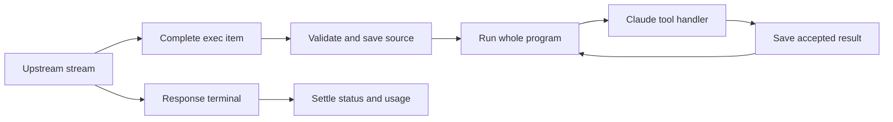

# Code mode and reasoning verification, 2026-10-24

## Current repair and verification

Runtime source: `538eb41adda1d1e155e36e6ec2fbb1eef5a5a6e9`. Normal local pre-push gate: PASS (358.9 seconds; 612 Responses and 654 provider cases, zero failures, errors or skips). Frozen interactive client fixture: PASS for completion and late provider failure on the same jar. Workflow-pinned secret scan: [recorded in the current verification status](https://github.com/torad-labs/splice/pull/420#issuecomment-6383599545).

Qualified jar SHA-256: `209be38e1d17141e8f7efdc7c653c51555d3db8c28bc50c7fa3035df7909d47d`. Both interactive scenarios delivered the exact 89 fixture characters once on the wire and in native client thinking blocks, with zero opaque blocks, one effect and normal exit 0.

| Interactive scenario | Effect after item.done | Effect before terminal |
|---|---:|---:|
| Completion | 740 ms | 1,260 ms |
| Late provider failure | 816 ms | 1,185 ms |

Explicit non-completed exec-item status is rejected before executable source is admitted. An added in-progress item remains pending; executable admission requires completed status or the compatible legacy absence. Completed items retain eager dispatch and late-failure recovery. The repair starts a validated whole exec item at item completion, preserves accepted source through late provider failure, and retains readable reasoning once while keeping encrypted items in native server history. Ordered prefaces and reasoning survive callbacks, restart and re-anchor. Sparse terminal arrays and reused output indexes retain source boundaries. Native torn and recovered message boundaries are preserved, with complete prefix bytes replayed once. The cursor advances from actually delivered text, so interrupted prose and reverse message completion retain the client-visible boundary. A uniquely matching anonymous message can bind to its terminal ID without losing additional native reasoning. Native and codec-normalized copies are deduplicated by nonempty reasoning item identity while preserving native payload fields and distinct IDs.

Sparse terminal snapshots retain the observed relative order of reasoning items through retries and restart. A terminal replacement becomes authoritative only when one batch covers the entire observed cohort; separate sparse retry snapshots are not combined into a fictitious complete order. Optional ordering metadata yields under byte pressure before actual reasoning is refused. Proven terminal order is retained as stable indexes before that metadata is reclaimed, including after restart. Message completion resolves an existing native identity before inferring a new position. Repeated late text that has already been delivered is idempotent. Terminal-only reasoning is retained after a sealed exec when the native boundary proves its position.

Completed-item text and later deltas share the delivered frontier, so a late duplicate delta does not repeat text already supplied by completion. Structured-output buffers retain a verified completed JSON suffix. Recovery follows actual delivery order when output indexes complete in a different order. Delivered native reasoning and prose after the sealed custom call are retained once at their verified native boundaries in following context. The accepted pre-exec prefix stays immutable while typed continuity updates retain the post-exec items and their raw identities.

Backend-complete text and delivered text are tracked separately. A provable completion suffix is delivered before later reasoning can advance history. Recovery retains complete backend snapshots while refusing unsafe continuation beyond an undelivered or mismatched prefix. Terminal-only reasoning uses verified delivery boundaries; pending prose survives reused indexes, and missing exec indexes seal after the last captured item.

Held raw reasoning and summary prefixes share the unchanged character capacity. A shared incremental classifier preserves whitespace and comment semantics without copying and rescanning each cumulative prefix. Literal text settles in order before later visible output and at terminal/EOF boundaries. Blank and comment-only prefixes disappear before the next visible buffer is charged, without an empty Thinking row. Capacity failures do not flush oversized held text; upstream failure still settles ordinary literals honestly. Delivery traces borrow ranges in the original delivered-text buffer. Distinct ciphertext, mismatching backend data and unrepresented completion tails retain their own bounded ownership; model-only terminal harvesting cannot replace the proven delivery ranges.

Final terminal harvesting is checked against the same retained capacity before successful settlement. Native-tail admission transfers existing ownership rather than charging the same retained payload twice. Streamed tail updates are durably consolidated at the defined handoff boundaries, keeping journal growth bounded. No heap, journal, timeout or entry limit is raised.

History hashing batches the same tagged UTF-16 grammar into a fixed 4 KiB buffer. Literal legacy vectors, Unicode/surrogate chunk boundaries, copies and restored snapshots preserve existing keys without a cache migration. The history walk stays live while unaffected immutable message fragments are reused; only verified insertion spans rebuild. When both replay and cache capture are disabled, the unused history tracking is skipped. Reasoning before/after messages and between a tool result and a coalesced peer update remains outside cached lookups. No measured speed claim is made before the fixed paired evaluation.

Optional cache persistence can be disabled while replay remains available in bounded memory. Sessionless tool turns use the existing canonical opener and exact tool-ID memory lookup; they do not emit opaque client carriers or create an unscoped positioned store. Sessionless prose without a verifiable scope or tool identity remains a cache miss. Old duplicate live/terminal records are reconciled before admission accounting. Ordinary tool-result text and image changes invalidate later reasoning; only the exact cleared-result marker can reuse a unique, branch-scoped proof of the original full result. Proofs contain hashes, consume no reasoning-entry slots, and share the existing byte limit. New proof records append only admitted deltas. Serialized journal frames and reserved ambiguity-tombstone space are charged to the unchanged byte budget; conflicts remain durable misses. Whole-history replacement is reserved for actual normalization or index migration. A corrupt cache remains removed until actual reasoning is available to persist. New media-bearing callbacks capture an optional versioned digest of the exact original wire item in the existing accepted-result record. This preserves later cleared prefixes after restart without guessing removed annotations. Code-mode callback reconciliation also requires strict evidence for the exact sole-text cleared-result marker, keeping the original accepted result and canonical exec history only for the verified branch. Ordinary result edits, additional content, media, ambiguous identities and changed branch prefixes remain invalidating. Previously cleared legacy hashes without a verifiable original prefix cannot be reconstructed; those lookups miss safely.

A large admitted HTTP request could also expose a response-close race: final-write completion could precede request cleanup and hard-close unread input, cutting off an early rejection body. Announcing that close now halts reads under the existing lock, so the existing bounded staged shutdown applies. A real-socket regression forces that ordering and checks the full 413 body, half-close, client-FIN closure and heap release. Body limits and timeouts remain unchanged. Native validation and script placement planning were separated into focused collaborators to preserve the concentration ratchet without changing its baseline.

Version 3 uses the actual Claude Code 2.1.310 interactive TUI, isolated loopback fixtures, the unchanged two-second held terminal, one unguarded filesystem effect, exact wire/client reasoning, zero opaque blocks and normal interactive exits. Probe source SHA-256: `eb28389468371aeb1291652e22f5facb44db66761708a74e9f464a78dfa475f9`; PTY helper: `7a60ea1e913ae46e898fc7fbd90e84fce5da19b3cf3b2e224ebae74d43297289`. The helper also passed four model-free cases/16 assertions covering a TERM-ignoring PTY child, cooperative termination, ordinary interactive exit and artifact-error cleanup. TERM grace and KILL reaping are bounded. See [the fixture contract](../../.Codex/tmp/codex-parity/probe-client.md).

The final paired evaluation uses 30 micro and 18 public trials with both pinned clients in interactive PTYs. The [runner patch and controls](../../.Codex/tmp/codex-parity/interactive-benchmark/README.md) and [fixed plan](../../.Codex/tmp/codex-parity/interactive-benchmark/interactive-evaluation-plan.md) are included for review. Analyzer v3 revision 4 explicitly checks high/detailed/all_turns settings, separates known auxiliary requests, validates genuine client session artifacts and blocks unknown or malformed evidence. Its 53 model-free cases/228 assertions passed. Completed snapshots must match the observed prefix; later suffixes and exact replays are validated against immutable completed text. Contradictory completions, unknown or excess bytes, and distinct item identities remain checked. This analyzer correction leaves the qualified runtime jar above unchanged. The [current verification and evaluation status](https://github.com/torad-labs/splice/pull/420#issuecomment-6383599545) records current same-binary verification and final evaluation results. The final interactive comparison is evaluated independently of the historical first pass below.

All measurements below describe the earlier print-mode first pass. They are retained for provenance and are not pooled with the final interactive comparison. GitHub Actions could not start because of an account billing restriction; local validation is reported explicitly. This work targets the feature branch and does not cut a release.

## Historical first pass: f94016c, print mode

The first pass improved completed-item dispatch and server-owned reasoning delivery, and was installed from `f94016cfaf78bf41a215437ec4b78eec7f8f8475`. Later review found the edge cases addressed by the current repair above. The full gate, unchanged real-client probe, four smoke trials, all 48 paired benchmark trials and six fixed diagnostic trials passed. Readable model text is preserved; opaque replay blocks stay off the client stream. End-to-end timings vary by task, as recorded below.

## Execution boundary

Splice admits an exec program at `response.output_item.done` after validating the complete item and its native identity. The response reader continues independently to collect the terminal status and usage. Sequential awaited tools advance with their results; explicit parallel groups retain their batching behavior. Partial programs do not execute.

An admitted program retains its execution identity and accepted results after a late upstream failure. Recovery uses saved evidence and does not rerun the source. Uncertified source endings release pending startup. A valid sealed item retains its acceptance independently of worker scheduling; explicit disposal still prevents a pending startup from reviving it.

Encrypted reasoning remains in ordered server history. Claude Code receives readable reasoning supplied by the model without new opaque replay blocks that render as empty Thinking rows. Existing v1 replay envelopes still decode. Replay stays ordered through prose, callback and restart boundaries. Compaction requests preserve the existing history prefix; subsequent turns use the compacted history. The input-cache key derivation is unchanged. Replay remains enabled and mirroring remains disabled.

The reference is Codex source at `970111f6cb62cc02fe36a82ea7d71b37a2889c97`: its ordinary [completed-item handler](https://github.com/openai/codex/blob/970111f6cb62cc02fe36a82ea7d71b37a2889c97/codex-rs/core/src/session/turn.rs#L2913), [eager tool dispatch](https://github.com/openai/codex/blob/970111f6cb62cc02fe36a82ea7d71b37a2889c97/codex-rs/core/src/stream_events_utils.rs#L348), and [whole-program execution](https://github.com/openai/codex/blob/970111f6cb62cc02fe36a82ea7d71b37a2889c97/codex-rs/core/src/tools/code_mode/execute_handler.rs#L40). This work aligns that execution boundary and the separation between model history and client presentation. Codex can also defer dispatch for synchronous post-model hooks and mailbox drains.

## Historical print-mode probe

The frozen probe SHA-256 is `3253aed2bed031701a4d8c9c7cf2eb2a0e4ffa8af1051fce6cf45659c38b5ec8`. It uses the actual Claude Code 2.1.310 executable, an isolated Splice jar and a synthetic Responses server. There are no paid model calls. The server sends readable reasoning and a complete exec item, then holds the terminal for two seconds. A second scenario fails the response after the item is complete.

The same probe checks callbacks before the terminal, one unguarded filesystem effect per program, the exact readable text once in both the wire and real client partial events, zero opaque blocks, retained reasoning on the following request, and a successful final client answer. Final client snapshots are excluded from delta counts.

First-pass candidate source: `f94016cfaf78bf41a215437ec4b78eec7f8f8475`. Clean pre-push jar SHA-256: `c581cfbb7431765b7b06437d4b1844d14285eff69c6f717a4407a3ef0883b6fa`. The unchanged probe passed both scenarios with exit 0:

| Scenario | Callback after item.done | Callback before terminal | Effects | Opaque blocks |
|---|---:|---:|---:|---:|
| Success | 632 ms | 1,368 ms | 1 | 0 |
| Late response failure | 594 ms | 1,407 ms | 1 | 0 |

Each delivered the exact 89 readable fixture characters once on both channels. Success retained reasoning through WebSocket chaining; late failure retained one explicit reasoning item in the following request. There were no infrastructure errors. The probe generates one program per scenario; reissued-source and persisted-restart recovery are covered by the provider tests.

The task-start installed jar (`ce731c711f944d807f7980fce934feeb982735f9d1008ca44971f178a43bf56a`) waited until after the terminal in the success scenario and did not execute the completed item in the late-failure scenario. The recovered Oct 22 jar (`31ffb8de2dc7968803be5e0198f5203701d72152c4c37392af8ac6014c11afaf`) also fails these bounded scheduling checks under the current replay-on controls. That does not invalidate its earlier successful real sessions or equate it with the broken task-start installation.

## Historical first-pass checks

The normal pre-push gate passed on the committed `f94016cfa` tree in 6m52s, including every scoped module check, architecture and concentration laws, coverage, structural rules, strict TypeScript checks, 11/11 byte-exact oracle scenarios, 63/63 conformance cases and packaged code-mode mocks. SSH push exited 0 and verified the remote fix branch at that candidate commit. No concentration limits, failure assertions, timeout limits or task verifiers were relaxed.

Earlier failures are retained in the local evidence: source-ownership/recovery and native-history defects were corrected; obsolete opaque-wire expectations were replaced by exact readable output; the strengthened ancestor expectation was corrected to the existing output wrapper. A shutdown-drain test failed in one earlier run, then passed unchanged in both subsequent full runs. No speculative shutdown modification was made.

The replaystream oracle's intentional wire change is reconstructed by removing one opaque redacted block and closing its index gap. All other client bytes and all upstream request bytes remain identical. The other oracle pins, including compactish, remain unchanged.

## Historical print-mode paired benchmarks

Controls: GPT `gpt-6.1-sol`, high effort, pinned Codex 0.159.1 and Claude Code 2.1.299, replay on, mirroring off, WebSocket and prefill on, detailed reasoning requests, focused-exploration guidance, repository-tools profile, request/instruction capture. Three repetitions per task and client; serial execution with alternating client order. The newer-client probe above is a separate compatibility check.

The actual baseline and candidate micro manifests match all 18 control fields, including the full config, task hashes, fixture images, client hashes, guidance/surface hashes, timeouts and capture settings. Build identity, label and start time are recorded separately.

Before candidate evaluation, the frozen task-start installation passed all 30 micro trials and 18 public trials. Every capture was complete; model/effort mismatches, lost scripts, abandoned histories and unresolved callbacks were zero. Its Splice journals contain 118 clean records and 230 accepted callbacks. The client received all 5,921 readable summary characters supplied upstream, plus 33 opaque blocks. Those opaque blocks are the presentation defect addressed here.

Baseline means in seconds:

| Task | Native Codex | Task-start Splice |
|---|---:|---:|
| independent-reads | 19.865 | 24.264 |
| explicit-parallel-reads | 20.359 | 13.834 |
| stale-write-recovery | 26.721 | 19.419 |
| repository-fix | 26.461 | 20.265 |
| repository-search | 20.216 | 20.768 |
| tb-regex-log | 73.146 | 57.153 |
| tb-log-summary-date-ranges | 29.177 | 32.921 |
| tb-fix-code-vulnerability | 60.896 | 50.764 |

Captured paired smoke receipt: `2026-10-24T07-50-08-445Z-candidate-f94016c-replaytrue-smoke`. All four task/client trials verified; captures and settings matched. Splice journals contain 12 clean records and 21 accepted callbacks, with zero errors, lost/abandoned records or unresolved callbacks. Both readable summaries matched live upstream deltas, completed summaries and client text exactly, in order and once: 904 characters total, zero opaque blocks.

| Smoke task | Native Codex seconds | Candidate Splice seconds |
|---|---:|---:|
| independent-reads | 19.233 | 51.856 |
| stale-write-recovery | 31.764 | 27.575 |

The slow independent-read result is retained. Its six model responses took 48.968 of the 51.856 seconds. One response took 24.970 seconds: metadata arrived at 168 ms, response.created at 408 ms, first tool-source content at 22.850 seconds, item completion at 24.931 seconds and terminal at 24.970 seconds. It reported 132 output tokens and 0 reasoning tokens, with no readable reasoning events. Its callback reached the client 27 ms after item completion, before the terminal. This establishes an upstream pre-content wait; the capture cannot distinguish scheduling, compute or transport batching. It does not establish congestion or a gateway terminal hold.

Full micro receipt: `2026-10-24T07-55-03-375Z-candidate-f94016c-replaytrue-micro`. All 30 trials verified with complete capture/integrity checks and zero model/effort mismatches. Splice completed 69 clean records and 163 callbacks, with zero journal errors, lost/abandoned records or unresolved calls.

Every task/arm below has three samples; times are seconds.

| Micro task | Native mean | Splice mean | Native median (min–max) | Splice median (min–max) |
|---|---:|---:|---|---|
| independent-reads | 24.372 | 19.733 | 17.985 (16.867–38.264) | 14.255 (11.961–32.984) |
| explicit-parallel-reads | 21.829 | 25.519 | 20.690 (20.247–24.549) | 25.570 (24.411–26.576) |
| stale-write-recovery | 35.767 | 18.471 | 32.614 (32.141–42.547) | 18.896 (14.945–21.571) |
| repository-fix | 28.347 | 28.527 | 28.430 (25.410–31.200) | 23.773 (22.089–39.719) |
| repository-search | 36.191 | 25.317 | 27.274 (21.769–59.530) | 22.383 (22.053–31.516) |

The overall micro mean is 29.301 seconds native versus 23.513 seconds Splice, 19.8% lower for Splice in this run. Three task means favor Splice, repository-fix is close, and explicit parallel reads favor native. The earlier installed-sample means were 22.724 seconds native and 19.710 seconds Splice; this patch cannot be credited with every timing difference between separate runs.

Native returned 6 readable summary parts/2,721 characters across 92 Responses requests. Splice returned 8 parts/3,718 characters across 84 requests; all 3,718 characters reached the client exactly and in order, with zero opaque blocks. Native client display is not measured by the Claude-client counters. Of the exec-to-tool associations observable in capture timing, 39 of 69 candidate callbacks precede the terminal, versus 0 of 67 in the installed-sample run. The first following client tool is associated by time window; this measures stream receipt, not call identity or terminal painting.

Independent reconstruction also matched all 21 prose parts/3,373 characters in combined stream order, with 121 message stops for 121 client messages, no empty/unclosed/unmapped blocks and no boundary inversions. All 14 reasoning followups retained their response chain. Six encrypted-only items had no readable source text and correctly produced no empty client row. Stale-write retries followed the expected rejected-write, fresh-read, corrected-write sequence.

The parallel-read difference was investigated. Candidate reads retain six-way concurrency and finish in about 0.75 seconds, matching the baseline. Two inspected candidates add checks using unavailable Python interpreters (exit 127), then recover with Node, producing extra model rounds. Native history, results and reasoning remain ordered and unique; response parents and cache keys are valid. Time outside upstream responses stays comparable. The fixed six-trial old-jar/new-jar comparison reported below used unchanged image, guidance and verifiers.

Full public receipt: `2026-10-24T08-08-45-538Z-candidate-f94016c-replaytrue-public`. All 18 trials verified with complete captures and matching controls. Splice completed 41 clean records and 74 callbacks, with zero journal errors, lost/abandoned records or unresolved calls. The actual public manifests match the same 18 control fields as the micro comparison.

| Public task | Native mean | Splice mean | Native median (min–max) | Splice median (min–max) |
|---|---:|---:|---|---|
| tb-regex-log | 75.826 | 66.145 | 72.292 (63.833–91.352) | 60.406 (53.071–84.959) |
| tb-log-summary-date-ranges | 28.003 | 28.276 | 28.073 (22.963–32.974) | 23.789 (22.756–38.283) |
| tb-fix-code-vulnerability | 47.243 | 59.945 | 52.460 (35.939–53.330) | 63.630 (51.411–64.794) |

The public mean is 50.357 seconds native versus 51.455 seconds Splice, 2.2% higher for Splice. Regex-log favors Splice, date ranges are close, and vulnerability repair favors native. Across the full 24 trials per arm, means are 37.197 seconds native and 33.992 seconds Splice, 8.6% lower for Splice in this evaluation. These are small-sample observations with substantial per-task variation.

Native returned 11 readable parts/5,081 characters across 56 Responses requests. Splice returned 12 parts/5,467 characters across 50 requests. Exact reconstruction confirms every source character once and in order, plus all 15 prose parts/2,943 characters, with zero opaque or empty blocks and all 67 client messages closed.

The strict count-only check initially held the next stage because the final vulnerability trial had 1,063 source characters and 1,065 client characters. Three independent reconstructions confirmed one item with two summary parts: 557 characters, the established `\n\n` paragraph separator, then 506 characters. The expected and actual full text have identical SHA-256 `5a954af39542758ef639e3c2197e82c56cd4ebec6e679849aed157085850fb52`. The aggregate client count is therefore 5,469: all 5,467 source characters plus those two formatting characters. The original flagged audit was retained, the formatting classification was recorded, and the hold was cleared without changing source, task verifiers, fixtures or recordings.

The bounded jar-only diagnostic ran after the public suite, using the Splice client, the same explicit-parallel task and all 18 identical controls. Its order and sample count were fixed before launch; all six task verifiers passed.

| Order | Jar | Seconds | Readable text exact | Opaque blocks |
|---|---|---:|---|---:|
| 1 | Task-start ce731c | 17.894 | yes | 0 |
| 2 | Candidate c581cf | 20.489 | yes | 0 |
| 3 | Candidate c581cf | 20.895 | yes | 0 |
| 4 | Task-start ce731c | 23.771 | yes | 2 |
| 5 | Task-start ce731c | 23.942 | yes | 1 |
| 6 | Candidate c581cf | 15.846 | yes | 0 |

Old-jar mean/median/range: 21.869/23.771/17.894–23.942 seconds. Candidate: 19.077/20.489/15.846–20.895 seconds. Paired candidate-minus-old differences were +2.595, −2.876 and −8.096 seconds. The earlier 14-versus-25-second gap did not reproduce consistently. This small comparison does not prove a causal speedup; it provides no evidence of a consistent execution penalty in the repaired jar.

All six readable-text comparisons passed. Two original old-jar combined “exact” flags were false solely because they also required zero opaque blocks: one trial delivered the exact 794 readable characters plus two opaque blocks, and another had zero readable source/client characters plus one opaque block. These are retained baseline observations, not evidence of readable-text loss. Old runs used three Bash checks each; new runs used three, three and zero, with varying model-round counts. No image, guidance, verifier or source changes were made to improve the result, and no additional trials were added.

All original captures, flagged audits, outliers and diagnostic classifications are retained locally. The pre-change installation already wins several task means, so those wins cannot be credited to this patch.

## Historical measurement interpretation

Task verification, script/callback health, reasoning delivery and elapsed time are separate measurements. A missing readable vendor summary cannot be recovered from encrypted history. Captures establish what the vendor supplied and what the client received; they do not measure terminal painting or disclose private model reasoning. Three repetitions give directional timing evidence and cannot establish universal speed superiority.

This historical version-2 probe checked the real client stream without a TTY. It is retained as evidence and is superseded by the interactive version-3 fixture. Historical Oct 14 benchmark receipts use replay off and cannot be treated as a controlled jar-only comparison with the current replay-on evaluation. Analyzer v2 excludes auxiliary native `/alpha/search` requests from Responses-generation denominators, retaining their metadata separately. All 62 native and 57 Splice public baseline Responses requests explicitly used high/detailed/all_turns settings; the original captures and analyses remain unchanged.

Splice retains its GraalJS runtime and Claude permission handlers. Codex has a broader helper API, including explicit yield/wait, cross-exec store/load and media forwarding; those features are outside this execution/reasoning repair. Benchmark results assess the stated repository-tool tasks and cannot establish parity across every native helper.

## Historical first-pass installation

The pushed candidate `f94016cfaf78bf41a215437ec4b78eec7f8f8475` was installed after validation. Jar SHA-256 is `c581cfbb7431765b7b06437d4b1844d14285eff69c6f717a4407a3ef0883b6fa`; launcher SHA-256 is `36e84897eb800f982d13b1a8dec79de07b37b4b4c51029b3d271bb3482d3cb39`.

Both previous files were backed up with suffix `20261024T083256869Z-pre-f94016cfa`, then replaced by sibling copy and atomic rename. `splice restart --now` exited 0. The listener PID is `1695968`; SHA-256 read from its open descriptor `/proc/1695968/fd/18` exactly matches the artifact and installed path. Claudex health returned ok on port 3099, version 0.4.0. Installation verification was recorded at 2026-10-24T08:34:26Z. CI was not independently queried in this session; the complete local pre-push result is recorded above.
