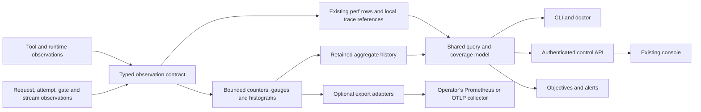

# Complete Splice instrumentation plan

Date: 2026-11-05. Status: implementation plan; no application changes made by this planning task.
Source baseline: `43fbc0046`. Recheck changed implementation seams before starting work.

## Outcome and scope

An operator or agent can answer: how much work Splice receives and completes; how much meets its latency objectives; where a request waits or spends time; which resource becomes saturated; whether an apparent regression is real; and whether the measurements themselves are complete and inexpensive.

**User decision:** Splice remains self-contained. Local collection, retained history, queries, CLI diagnostics, and console views work without another service. Prometheus/OTLP export and deep profiling are optional. No collector endpoint means no OTLP network traffic.

All twelve improvement families from the November 5 inventory are part of this plan, including the former P2 items. Work is sequenced by dependency, not split into a small release followed by an unspecified backlog. Completion requires the full coverage and acceptance matrix below.

This plan extends the operator observability channel in [the telemetry discussion draft](telemetry.md), the work in [request performance](../architecture/request-performance.md), and the lessons in [the claudex performance investigation](../architecture/claudex-performance-2026-10-14.md). It does not implement or change the draft's separate product analytics channel. The unrelated `.Codex/PLAN.md` remains intact.

The November 5 audit artifacts are in the workspace at `exa-results/splice-observability-2026-11-05/`. Their I01–I18 and P01–P12 identifiers are used here. Observed workload counts are descriptive samples, not capacity claims. The installed binary was not proven identical to the inspected source.

## Complete improvement inventory

| ID | Deliverable | Completion evidence |
| --- | --- | --- |
| P01 | Shared metric registry; precise request, content, phase, and transport timing | A scripted request with known waits and flush boundaries yields the expected measurements; schema explains every field's origin and missingness |
| P02 | Arrival, completion, success, attempt, token, byte, event, and goodput rates | Fixed-window rates reconcile with accepted observations; local work, model requests, missing usage, and failures have explicit populations |
| P03 | JSON performance CLI, consistent filters, schema discovery, complete paginated export, compact diagnosis, updated doctor | An agent can query and export a matching population without parsing console text or silently losing rows |
| P04 | Historical inflight, queue, saturation, refusal/cancellation, and latency/gap histograms including p99 | A known overload interval appears with its duration, actual counts, latency distribution, and coverage |
| P05 | Optional Prometheus and OTLP metrics, traces, and content-free structured events | Local and exported observations agree after documented unit/population conversion; exporter failure leaves inference responsive |
| P06 | CPU, GC, allocation, scheduler, thread, connection, descriptor, and memory diagnostics; bounded JFR/async-profiler | A local capture is bounded, linked to its interval/build, and distinguishes CPU, allocation, waiting, and contention |
| P07 | Repeatable capacity, correctness, and instrumentation-cost benchmark suite | Matched baseline/candidate runs identify the SLO-constrained capacity envelope and report uncertainty and generator limits |
| P08 | Boot/build/schema/config provenance and per-sink completeness | Restarts, counter resets, loss, delayed persistence, and unknown intervals remain visible |
| P09 | Integrated console performance view and cohort/baseline comparison | A user can move from a slow interval to representative requests and profiles with the same filters and honest comparisons |
| P10 | Configurable performance objectives and sustained-condition alerts | Deterministic windows exercise pending, firing, deduplicated, resolved, and insufficient-data states |
| P11 | Tool, MCP, and code-mode queue/execution/buffering/cold-start attribution | One request links model attempts and tool work without double-counting borrowed permits or overlapping spans |
| P12 | Instrumentation's own API, storage, cache, export, and polling cost | A constant inference workload stays within the agreed overhead budget while history queries, polling, and export are exercised |

## Architecture and ownership

Use one typed observation contract and one aggregation implementation across the CLI, control API, console, alerts, and exporters. Preserve the current perf ledger and trace facilities. Add bounded aggregates and lifecycle observations where completed rows cannot answer a question, especially arrivals, rejected admission, active work, and live throughput.

- `core/perf`: registry, typed observation interfaces, clocks/identity, bounded accumulator primitives, and wire DTOs where appropriate. Keep core free of project dependencies and exporter SDKs. Domain code records measurements through this seam.
- `features/turns`: request/attempt/stream lifecycle and local perf rows; `integrations/upstream`: gate, transport, runtime observations at existing ownership seams; `integrations/codemode`: native host and callback/tool attribution.
- `features/usage`: query semantics, retained aggregate consumption, summaries, objectives, CLI, and alert evaluation. Reuse existing cached projections and the coalesced-persistence pattern in `EconomicsStore`; do not introduce a second billing calculation.
- Add `integrations/observability` for OTel SDK/exporter and profiler adapters, depending on core. Compose adapters and persistence ports in `app`; do not create a usage-to-turns dependency or a cycle. Update `gradle/module-law.txt` explicitly if this module is introduced.
- `app`: authenticated routes, lifecycle wiring, file sources, and existing console assets. Diagnostics consumes the registry's support-safe projection.

Network export uses a dedicated bounded worker/queue. It must not use the single `AsyncFileIo` executor for network waits, nor hold inference locks while sending. This deliberately replaces the older telemetry draft's suggested shared-lane network send. File persistence continues through the established bounded file-I/O primitives, with per-sink accounting added.

## Measurement contract: P01, P02, P04, P08

### Registry and compatibility

Each field declares a stable identifier, description, type, unit, measurement origin/end, population, aggregation, supported paths, missing-value reason, cardinality policy, and permitted local/support/export projections. Generate or validate schema documentation, doctor selectors, compact projections, and exporter mappings from this registry. A registry does not imply loading every field into every cached projection.

Keep legacy marks, units, outcomes, and existing route/CLI behavior readable. Introduce explicit names for new semantics instead of relabeling old `total` or `first_byte`. New summaries identify their contract version. Old rows remain usable for the fields they actually contain; do not backfill unavailable arrival times or runtime history as zero.

Use monotonic time for elapsed durations and wall time for correlation/window selection. Store process identity and clock provenance so a wall-clock adjustment is not mistaken for negative request time. Every new record has a stable observation ID, boot ID, schema version, build/version identity, and a content-free configuration revision. Export configuration identity as resource/metadata rather than an unbounded metric label. Missing build provenance is `unknown`, not the repository's current checkout.

### Timing boundaries

| Measurement | Contract |
| --- | --- |
| Arrival to terminal completion | Server request arrival through the successful terminal write/flush boundary, failure, or cancellation; this is a server-observed completion, not proof of remote client consumption |
| Arrival to first client byte | First successful local write/flush boundary, including protocol frames; does not assert the remote application consumed it |
| Arrival to first meaningful content | First successfully delivered model reasoning, text, or tool content; heartbeat/opening frames do not qualify; record each content kind when observable |
| Admission and preparation | Pre-admission, gate wait/held time, lease wait, roster/auth/credential checks, size preflight, outbound preparation; retain their real nesting/overlap |
| Upstream attempts | Attempt start/write, headers, first byte/frame/content, completion, backoff, and outcome; retries/fallbacks retain separate attempts |
| Transport-specific boundaries | HTTP write completion, WebSocket send acceptance, header handoff, and first fragment keep distinct names and availability |
| Client delivery and streaming | Upstream wire/content gaps, local read/block time, buffering, pacing delay, write/flush time, downstream gaps, bytes and events |
| Tool work | Admission/queue, host startup, execution, callback wait, result buffering, result delivery, timeout, cancellation, and terminal outcome |

Elapsed timings include suspension and are not CPU measurements. Upstream timings include network/provider effects and cannot isolate provider compute without provider evidence. Exclusive local self-time is computed only from non-overlapping intervals within the same request/attempt; expose unattributed remainder and overlap where a complete decomposition is unavailable. Never subtract population percentiles or sum nested spans to manufacture gateway overhead.

Streaming-gap histograms count observed gaps, separately from a distribution of each request's maximum gap. Include live time since last progress so a still-open stall is visible before a request finishes. Distinguish protocol activity, model content, and client delivery; model silence alone does not establish a dead path. Chunks/events are not tokens. Token-level latency is unavailable unless the protocol supplies a defensible token boundary.

### Lifecycle, populations, and rates

- Record arrivals before admission; count refusals, queued cancellation, accepted work, attempts, and terminal outcomes separately. A terminal observation closes each request/attempt once, with `finally`-safe live-gauge cleanup. Local cache/code-mode steps remain distinct from upstream model requests.
- Track client requests, active upstream attempts, gate permits, queued waiters, and tool executions as different gauges. A code-mode continuation borrowing a permit must not appear as another independent permit. Keep admission peak and interval-reconstructed completed-request peak under distinct labels.
- Expose arrivals/s, completions/s, successful completions/s, attempts/s, input/output/cached tokens/s, upstream/downstream bytes/s, and events/s. Preserve canonical token accounting, including reasoning and absorbed rounds, without adding overlapping token categories twice. Track retry amplification and backoff separately from request success.
- Use requested wall-clock window duration as the rate denominator. Report observed duration, startup/restart gaps, read errors, and unmeasured periods beside it. Any rate over observed time is a separate explicitly named rate. Do not divide by the distance between the first and last completed row.
- Provider token usage received at completion produces **completion-attributed token rates**. Do not pretend to know when those tokens were generated. Live byte/event rates and late usage reconciliation use different counters; missing token usage has its own count.
- Goodput is successful requests satisfying the configured latency/progress objectives per second. Also expose the good fraction of eligible arrivals, including failures/refusals in the eligible population; exclude internal local steps by an explicit scope rule. In-progress or unmeasured objective results are pending/unknown, never silently good. For arrival cohorts, late completions revise the cohort until closed; for completed-window goodput, label completion attribution explicitly.
- Keep the legacy `failure_share` definition for compatibility and add explicit success, failure, refusal, cancellation, and empty-response counts/shares with documented denominators. Do not infer success as `1 - failure_share`.

### Histograms, concurrency history, and coverage

Record mergeable histograms for queue wait, first meaningful content, total duration, upstream attempt duration, tool duration, and the principal streaming gaps/blocking times. Provide count, sum, min/max, p50/p95/p99 and the histogram representation. Use a bounded representation with documented error, overflow, and bucket schema; pin explicit duration boundaries in the registry, including SLO thresholds. Keep exact existing percentile behavior on legacy summaries. Do not average percentiles across heads or buckets. Sparse-tail estimates disclose sample count and granularity.

Gate events maintain exact counters and saturation transition durations; periodic samples support display. Proposed initial sampling cadence is 5 seconds. Store sample counts/min/max and time-weighted gauge means, including gate-limit changes; persist the sampled-series resolution. Queue age/oldest wait, refused admission, queued cancellation, cap utilization, and time at saturation must survive the same history path as latency.

For new aggregate history, begin with minute rollups for the latest 24 hours and hourly rollups through the configured history window (currently a fresh default of 35 days). Keep raw-row/trace retention under existing controls. All aggregate buffers, label sets, queues, and disk stores have byte/count limits; evictions and lower resolution are disclosed. Profile artifacts have a separate short retention/cap because their size differs from counters. Reuse caches/checkpoints so a poll or scrape does not scan weeks of JSONL.

Persist coverage and loss per sink: observed, enqueued, written/exported, failed, dropped, pending, oldest pending age, and last successful flush. Existing global file-I/O totals remain useful but are not evidence of perf-specific loss. A crash may leave an uncertain interval since the last checkpoint; disclose that uncertainty instead of claiming exact crash-loss counts. Records committed late are not assumed to be ordered by request completion time.

## Runtime, tool, and self-observation: P06, P11, P12

### Runtime and profiles

Add process CPU time/load, GC collection/pause counts and duration, allocation rate where measurable, heap/nonheap/direct/mapped memory, RSS/PSS where supported, live/platform/virtual-thread observations where supported, owned dispatcher/executor pending/running work and scheduling delay, active/reused/idle connections and connect/pool wait, socket pressure, and descriptor use/limits where available. Use existing transport timing hooks, socket probes, `JvmHeap`, and owner observations. Report capability and unavailable reasons per OS/JVM; unavailable is not zero. Allocation sampling and overlapping owner estimates must remain labeled as estimates.

Instrument only queues/dispatchers Splice owns or that expose supported observations. A suspended coroutine is not a blocked OS thread; a thread-state count is not request queue time. Record DNS/connect/TLS timing only when the transport exposes it, and keep HTTP and JDK WebSocket capabilities separate.

Provide on-demand built-in JFR and an optional async-profiler adapter for CPU, wall, allocation, and lock profiles. Proposed defaults: a 60-second capture, a 5-minute maximum, a 64 MiB artifact cap, one deep capture at a time, and a 256 MiB total artifact store. Verify the selected profiler can enforce each bound; otherwise declare that mode unsupported or stop it with a bounded supervisor. No implicit download or privileged attach. A missing native profiler returns a capability result and leaves built-in JFR available.

Each artifact records profile ID, time window, build/config/boot, profiler settings, sampling limitations, size and completion status. Request diagnostics link by interval and trace reference; do not claim every CPU sample belongs to a request without attribution evidence. Artifacts stay in a managed local directory with existing restrictive file primitives and are not attached to routine OTLP events. Routine diagnostics require neither forced GC nor heap dumps. Default JFR events exclude request bodies, arbitrary headers, and content-bearing custom events.

### Tools, MCP, and code-mode

Join the current native spans, code-mode lock timing, host duration, and result-buffered duration to a request/attempt/tool-operation identity. Cover host cold starts, warm reuse, queue depth, occupied capacity/cells where applicable, pending-reply age, execution, callback wait, buffered result bytes/age, delivery, timeout/cancel cleanup, and calls per completed turn. Separate a tool request from a retry or continuation; use span links where async lifetime has no single nested parent.

Extend MCP memory inventory with execution and capacity observations where Splice owns the invocation. Third-party tool internals remain unobservable unless they supply measurements. Retain process memory sharing estimates with their current caveats. Host/request/session IDs are correlation attributes in local records or permitted traces, not metric labels. Tool arguments, results, scripts, and prompt content are not new export attributes.

### Cost of instrumentation

Measure control API request duration/outcome, active queries, cache hit/miss, cold projection time, rows/bytes scanned, bounded query work, serialization time/response size, exporter batch latency, queue pressure, dropped measurements, history size, and profile overhead. Allocation cost comes from supported runtime counters/profile benchmarks rather than assigning invented per-coroutine allocation totals.

Use route templates, not full URLs/query strings, as metric dimensions. Guard against recursive telemetry: observing a scrape does not generate a new export loop, and reading a snapshot does not mutate its business counters. Limit expensive concurrent history queries and return a clear busy/partial result rather than exhausting inference resources. Warm-cache polling and cold-start behavior both need evidence.

## Operator and agent surfaces: P03, P09

All additions below are proposed interfaces, not claims about commands/routes that exist today. Existing flags and routes retain their contracts.

| Surface | Planned interface/behavior |
| --- | --- |
| Summary CLI | `splice perf --json --window 5m --head claudex`; support 1m/5m/15m and existing windows, explicit from/until, and common cohort filters |
| Cohort filters | Shared head/model/transport/outcome/session/project/account/local/compact filters where the selected source supports them; reflect exact scope in the response |
| Schema | `splice perf schema --json` and `GET /api/perf/schema`: field definitions, units, projections, capabilities, compatibility version |
| History | `GET /api/perf/series`: bounded-resolution rates, latency histograms, queue/concurrency/runtime series, and coverage |
| Row export | `splice perf export --format jsonl ...`; additive cursor support for `/api/perf/turns`, retaining the existing newest-n mode |
| Diagnosis | `splice perf diagnose --json ...`: ranked evidence, implicated stages/resources, representative request/profile references, unknowns, and suggested measurements |
| Runtime | `GET /api/perf/runtime`: current resource snapshot, capabilities, freshness, and process identity |
| Profiles | `splice perf profile ...`; authenticated start/stop/status/artifact routes under `/api/perf/profiles`, with bounded server-controlled capture settings |
| Support report | Doctor's perf projection comes from the registry; safe timings, identity, capabilities and coverage are included without content or credential expansion |

JSON is stable, versioned, ANSI-free, and contains machine-readable errors and partial-result status. Summary/result envelopes include query scope, source, as-of time, requested/observed interval, build/boot cohort, schema, sample counts, missing-field counts, resolution, truncation, and coverage issues. Empty data and read failure must be distinguishable. Support-safe exports exclude raw paths/identifiers unless the established local query contract specifically requires them.

Retain daemon-independent `splice perf` for file-based history. Use the same library and schema for live and offline summaries; offline mode says live gauges, unflushed counters, and profiling are unavailable. Do not add a hard daemon dependency to existing usage.

Cursor export fixes an as-of committed-record set, filter hash, and deterministic order; it cannot rely only on request end timestamps because records arrive late. A per-segment append position plus stable record IDs can bound the snapshot without copying all payloads into RAM. Define continuation across rotations and cursor expiration after retention. An expired/unreadable segment gives an explicit incomplete/expired response; never silently skip it. Provide migration IDs for legacy records and test late writes, equal timestamps, restart, and segment rotation. Counts and aggregate summaries cover the matching population, not the displayed page.

Session/project/account filters may require raw rows and are not a promise of permanently preaggregated high-cardinality series. Bound those queries, expose reduced availability, and return unsupported/partial explicitly. Never silently use all-project aggregates for a filtered view.

Extend the existing Usage/Requests console with:

- Shared time/cohort controls and visible counts/coverage; throughput and goodput; p50/p95/p99 with distributions; historical queue/concurrency/limit and saturation duration.
- Runtime CPU/GC/memory and I/O/export pressure aligned with the request interval; tool/host timelines; meaningful-content and client-delivery boundaries in the current waterfall.
- Links from an interval to representative failures/slow requests, traces, and bounded profiles. Keep full configured local forensic trace behavior and its retention unchanged.
- Saved baseline/current comparisons partitioned by build/config, head/model, transport, streaming mode, input/output size, cache state, and outcome. Disclose mixed cohorts, insufficient samples, missing usage, and approximate buckets; no unsupported provider speed ranking.
- Accessible chart/table equivalents and useful empty, loading, partial, offline, and stale states. Summary cards follow the same project filter as the surrounding view.

Diagnosis is evidence-based, not an automatic tuning agent: distinguish an observed wait from an inferred cause and include the next measurement that could disprove the inference. Reporting does not change gate limits, model settings, caches, or restart the daemon.

## Optional interoperability: P05

Expose a Prometheus scrape surface through the existing authenticated, loopback control-plane policy. Provide the matching scrape configuration so authentication is usable; do not add an unauthenticated public management listener. All collectors consume in-memory aggregates, not a fresh raw-history scan on every scrape.

Configure OTLP under the operator telemetry namespace, aligned with the existing draft, with per-signal selection for metrics, traces, and content-free structured lifecycle/error events. Support the documented HTTP/protobuf path first and the chosen gRPC SDK adapter within the same work package; validate endpoint/protocol/header combinations. Keep SDK versions aligned with the repository's pinned OTel family. Document hot-reload versus restart requirements through the existing configuration metadata instead of another hand-maintained list.

Use a stable `splice_*` metric namespace with documented conversion from legacy milliseconds to exporter seconds. Pin the GenAI semantic-convention mapping/version; it is a mapping layer, not permission to rename local fields whenever an upstream draft changes. Head/model/transport/outcome/status-class dimensions have bounded sets. Never form an unrestricted cross-product of every dimension. Unknown/excess label values go into an explicit overflow series with a count, not silent series loss. Session/request/account/project IDs, exception strings, URLs, tool arguments, and host instance IDs are excluded from metric labels.

Propagate request trace context through admission/preparation, upstream attempts/retries, streaming/delivery, and tools/native callbacks, with local trace references. End a streaming span at terminal completion, not merely receipt of headers. Validate incoming trace context and make downstream propagation explicit where a provider supports it. Export sampling is separate from local forensic capture: sampling or dropping exported spans never reduces the configured local trace. Exported span coverage and sampling settings are visible.

Export uses registry-approved metadata only: no prompts, messages, tool arguments/results, raw authorization headers, credential values, or arbitrary error payloads. Error codes/classes and trace IDs provide correlation. Redact exporter header values from config/status/support output. Dedicated bounded queues implement timeouts, retry/backoff, drop accounting and bounded shutdown; exporter outage must not block requests or state persistence. Provide example Prometheus/Grafana and OTel Collector configuration as optional documentation, without adding an installation dependency.

## Objectives and alerts: P10

Store named objective sets scoped to a bounded cohort: arrival-to-first-meaningful-content, completion, queue delay, and optional progress-gap limits. These power both goodput and alert evaluation so they cannot disagree. Evaluate per-request objective success from its measurements, not a percentile or histogram bucket that straddles the threshold. Historical reevaluation needs raw eligible measurements or a disclosed approximation/unavailable result. Record objective revision in results and baseline manifests. Do not select a universal latency SLO from the incidental live sample.

Support sustained queue pressure, latency tails, failure/refusal rate, retry amplification, missing progress, resource/GC pressure, and telemetry loss/staleness. Rules specify threshold, window, minimum eligible count/coverage, hold time, cooldown, and recovery condition. State is `insufficient_data`, `pending`, `firing`, or `resolved`; no-data is not healthy. Distinguish a possible stuck delivery path from legitimate upstream thinking.

Persist bounded alert history, stable deduplication keys, and restarts/recovery semantics. Include observed value, threshold, sample count, window/cohort, coverage, build, and diagnostic/request links. Reuse existing desktop/webhook delivery settings, with bounded delivery attempts. Rules and outbound delivery are operator-configured; installing this instrumentation does not enable new outbound notifications or trigger automatic performance tuning.

## Implementation sequence and dependencies

Every work package is in scope. Acceptance evidence is attached to the same candidate build at final integration; earlier component receipts are not a substitute for the final integrated result.

| Wave | Work package and output | Depends on | Coverage |
| --- | --- | --- | --- |
| W0 | Capture unchanged baseline; extend deterministic workload/manifest scaffolding; establish measurement and overhead budgets | Inspected baseline | P07, P12 |
| W1 | Registry, identity/coverage envelope, clocks, compatibility projections, observation/accumulator seams | W0 | P01, P08 |
| W2 | Request/attempt lifecycle, throughput/goodput inputs, histograms, queue history, bounded rollups, per-sink accounting and cost probes | W1 | P02, P04, P08, P12 |
| W3 | Tool/native/MCP attribution, runtime/transport capability probes, bounded profiler adapters and artifact lifecycle | W1; integrate with W2 | P06, P11 |
| W4 | Shared query/schema, cursor export, CLI/doctor; optional Prometheus/OTLP adapters and config | W2, W3 | P03, P05 |
| W5 | Integrated console, baseline comparison, objective evaluation and alert lifecycle/delivery | W4 | P09, P10 |
| W6 | All-surface reconciliation, fault/retention/restart checks, UI walkthrough, complete capacity/overhead experiments, operating docs | W0–W5 | P01–P12 |

Start benchmark scaffolding and self-cost observations early; do not leave overhead discovery until after the UI/exporters are built. Keep changes additive and small enough to review, with schema/fixtures landing before consumers. All feature families must close before calling the instrumentation expansion complete.

## Concrete implementation seams

Paths below are relative to the repository; package prefixes are abbreviated only in this table.

| Area | Existing seams to extend |
| --- | --- |
| Registry and timing | [PerfKeys.kt](../../core/src/main/kotlin/splice/core/perf/PerfKeys.kt), [TurnPerf.kt](../../core/src/main/kotlin/splice/core/perf/TurnPerf.kt), `HistoryWindow.kt` |
| Request recording | [TurnTelemetry.kt](../../features/turns/src/main/kotlin/splice/head/turn/TurnTelemetry.kt), [PerfStats.kt](../../features/turns/src/main/kotlin/splice/head/perf/PerfStats.kt) |
| Summaries and query | [PerfSummary.kt](../../features/usage/src/main/kotlin/splice/usage/perf/PerfSummary.kt), `PerfPayloads.kt`, `PerfRoutes.kt`, `TurnsFilter.kt`, `PerfPeak.kt`, `PerfProjectedKeys.kt`, `PerfCommand.kt` |
| History and persistence | `app/.../sources/PerfRowsFileSource.kt`, `PerfSourceFiles`, `PerfRowsProjection`; [AsyncFileIo.kt](../../core/src/main/kotlin/splice/core/util/AsyncFileIo.kt); `features/turns/.../usage/EconomicsStore.kt` |
| Gates and transport | [InflightGate.kt](../../integrations/upstream/src/main/kotlin/splice/upstream/retry/InflightGate.kt), [UpstreamTransport.kt](../../integrations/upstream/src/main/kotlin/splice/upstream/transport/UpstreamTransport.kt), existing write/header/socket timing bridges |
| Runtime and retained owners | [JvmHeap.kt](../../integrations/upstream/src/main/kotlin/splice/upstream/memory/JvmHeap.kt), `JvmMemorySnapshot.kt`, [HeapBudget.kt](../../core/src/main/kotlin/splice/core/memory/HeapBudget.kt) |
| Native tools and MCP | [NativeTracing.kt](../../integrations/codemode/src/main/kotlin/splice/codemode/nativehost/trace/NativeTracing.kt), host/parity duration and buffer metrics, [McpMemory.kt](../../app/src/main/kotlin/splice/app/sources/mcp/McpMemory.kt) |
| Control API | `app/.../control/usage/UsageMount.kt`, `UsageReadRoutes.kt`, `HistoryWiring.kt`; `control/mount/ControlGuard.kt`, `TraceMount.kt`, `TurnsMount.kt` |
| Console and doctor | [perf-heads.js](../../app/src/main/resources/console/perf-heads.js), [reqview.js](../../app/src/main/resources/console/reqview.js), [DoctorReportPerf.kt](../../features/diagnostics/src/main/kotlin/splice/diagnostics/doctor/report/DoctorReportPerf.kt) |
| Alerts | `features/usage/.../alerts/AlertStore.kt`, existing `AlertDelivery` |
| Benchmark foundations | [HeadServerLoadTest.kt](../../features/turns/src/test/kotlin/splice/head/HeadServerLoadTest.kt), [PerfHistoryProfile.kt](../../app/src/test/kotlin/splice/app/sources/PerfHistoryProfile.kt), sibling `Splice-Benchmarks/tools/agent-bench/telemetry.ts` |

## Acceptance and benchmark design

### Observable behavior checks

Test returned data and user-visible outcomes, consistent with repository rules; do not add tests asserting private call counts or the particular implementation of a cache.

1. **Timing and accounting:** known admission/preparation/upstream/tool/client delays; heartbeat before content; text/reasoning/tool-only and non-stream responses; queued refusal/cancel; disconnect; retry/auth refresh/fallback; locally handled and borrowed-permit work. Reconcile arrivals, active work, terminal outcomes, usage and histograms without duplicate completion.
2. **Windows and completeness:** long requests crossing windows, delayed usage, late row append, equal timestamps, malformed/unreadable rows, sparse/no data, clock adjustment, process restart/counter reset, retention/rotation, cursor continuation/expiry, and raw versus aggregate coverage. A historical unsupported measurement stays unknown.
3. **Surface consistency:** the same fixture cohort produces equivalent results through the shared query, offline/live CLI, API, console, objective evaluator, and exported metrics after documented conversion. Include project filtering and legacy summary compatibility. Cursor export returns each retained eligible record exactly once in a fixed snapshot.
4. **Runtime and tools:** supported/unsupported platform capabilities, cold/warm tool hosts, overlapping callbacks, pending replies, buffered output, cancellation cleanup, and bounded profile completion/abort. Profile manifests match the actual process/build and interval.
5. **Export and resource faults:** slow/unreachable collector, malformed config, bounded queues, backoff, cardinality pressure, disk/write failure, partial shutdown, unavailable profiler and concurrent capture requests. Responses remain usable and loss/partial status becomes visible. Registry projections exclude disallowed content/secret fields.
6. **Objectives:** pending/firing/resolved/insufficient-data transitions, minimum counts, hold/cooldown, delivery retries/deduplication, restart and late observations. Goodput and alert populations agree.
7. **Console:** walk every new control and empty/partial/offline state on the candidate build. Inspect dark mode at the operator's wide-screen setup and both themes at 1440 px, as required by repository conduct; use the design-judge workflow during implementation. Keep screenshots and build identity with the acceptance receipt.

### Capacity experiments

Extend the existing mock SSE and history/profile infrastructure and sibling agent-bench integration. Use a separate deterministic daemon/upstream desk; do not benchmark capacity against the working daemon during development. Add AIPerf where protocol support is verified, otherwise use an adapter that preserves Splice's real protocol and reports generator limitations. No paid-provider workload is required to accept the implementation.

- Run both fixed-concurrency sweeps (initial points 1, 10, 50, 70, 100, extended as needed) and independent offered-arrival-rate sweeps through saturation. The existing 1000-stream test remains a correctness gate, not a substitute for this experiment.
- Cover short/long requests, large retained histories, warm/cold cache, streaming/non-streaming, supported SSE/WS paths without changing production transport defaults, slow clients, bursty upstreams, tool-heavy turns, retries/429s, reconnects, refusal and cancellation. Use representative combinations plus focused stress cases rather than an uncontrolled full Cartesian product.
- Compare direct scripted upstream and proxied paths, unchanged baseline and candidate, minimal/local collection, exporters on/off, ordinary polling and stress polling, and optional profiles. Preserve wire hash/terminal correctness checks; apparent speed gains from dropped/truncated work fail.
- Report offered/accepted/completed/failed/refused/pending rates; SLO-constrained goodput; first-content/completion/queue tails; tokens/bytes/events; inflight/queue/cap; CPU/GC/allocation/RSS; telemetry loss and polling/export cost. Report generator scheduling delay, missed/dropped iterations and achieved offered rate so overload is not hidden by the load generator.
- Fix model/output/input-size/cache/transport/configuration cohorts, hardware/JVM/build/artifact identities, warmup, duration, seed and SLO revision in a manifest. Start with at least five repeated steady runs per compared point and confidence intervals; increase runs only where uncertainty prevents a decision.
- Determine the largest sustained offered rate meeting the specified objectives and error/loss limits. A single high completed-request count is not sustainable capacity. Compare only compatible cohorts and disclose unresolved pending work at the end.

W0 records numerical budgets before candidate results are inspected. Proposed starting gates: no more than 5% degradation in steady goodput or CPU per completed request for default collection; p95 added proxy overhead no greater than the larger of 1 ms or 5% of the matched baseline; bounded telemetry memory/disk with no growth after warmup; no silent data loss at the declared operating load. Deep profiling has a separately measured overhead envelope and is not subject to the always-on target. If baseline variance exceeds a threshold, improve the experiment and record uncertainty instead of declaring a pass or silently relaxing the budget. These are planned targets, not measured claims.

Initial limits to validate in W0–W2: 32 MiB for additional aggregate/history-cache state, 256 MiB for the additional rollup store, at most 256 active bounded head/model combinations per aggregate family, and a separate small bounded exporter queue budget. Existing raw history and trace budgets remain separate. Cap the overall store and all dimensions as well as individual queues; expose overflow/eviction. Tune these starting values only with recorded benchmark evidence and an updated plan, not hidden defaults.

### Repository gates and delivery

Preserve [AGENTS.md](../../AGENTS.md) contracts: state filenames/StatePaths, per-head configuration isolation, prompt-cache/replay behavior, honest terminal failures, full configured traces, and no synthetic summaries. No request-body rewrite, transcript shrinking, reduced trace fidelity, scheduler redesign, or gate-limit increase is justified merely by adding instrumentation.

Run the repository's gate of record under the current pre-push/release workflow, including architecture/module laws, detekt/rules, behavioral tests, the 1000-stream test, and byte-exact wire oracle. Follow the current [CLAUDE.md](../../CLAUDE.md) rule against redundant separate Gradle proof runs; builds run in the background. Record actual exit status and exact candidate identity. Planning itself does not require running the application suite, a load test, an install, or a restart.

Ship additive readers/writers first, then consumers/exporters behind their explicit configuration. Old rows remain readable and optional adapters can be disabled independently. A rollback must not strand history in a new mandatory format or change existing state filenames. Document schema migration, retention, cursor expiry, exporter setup, profile support, and an agent/operator troubleshooting recipe. Release/version changes follow the existing project authorization rules.

## Preservation matrix for the existing inventory

| Existing capability | Extended by | Preservation requirement |
| --- | --- | --- |
| I01 Windowed summary | P01, P02, P03, P04, P09 | Existing windows/text CLI and legacy field semantics remain available |
| I02 Numeric summaries | P01, P03 | Tail population remains explicit; do not silently turn tail into a time window |
| I03 Filtered request inventory | P03, P09 | Filters apply before pagination; whole-population count and coverage survive |
| I04 Local preparation timing | P01, P11 | Preserve waits/nesting; elapsed time is not CPU time |
| I05 Transport/client timing | P01, P05 | Preserve SSE/WS boundary differences and missingness |
| I06 Stream/backpressure diagnostics | P04, P09 | Preserve maxima while adding actual gap distributions and live progress age |
| I07 Live admission/queues | P02, P04 | Live gauges and held/borrowed permits retain their real populations |
| I08 Historical peaks/waits | P04, P09 | Admission and reconstructed peaks stay separately named |
| I09 Tokens/cache/wire volume | P02, P05 | Canonical usage/cost accounting remains single-source |
| I10 Reliability/retries | P02, P10 | Existing failure-share semantics preserved; explicit new denominators added |
| I11 Traces/wire capture | P05, P09 | Full configured local capture/retention unchanged by export sampling |
| I12 JVM/owner memory | P06, P09 | Estimates, overlap, RSS and actual allocation remain distinct |
| I13 File-I/O/telemetry health | P08, P12 | Existing global lane metrics kept; sink-specific loss added |
| I14 MCP memory inventory | P06, P11 | Existing sharing/memory view retained alongside execution metrics |
| I15 Console/doctor | P03, P09, P10 | Support-safe projection and consistent filters; no loss of existing diagnosis |
| I16 History/retention | P03, P08 | Configured retention, readable coverage, rotation and offline use preserved |
| I17 Native OTel foundation | P05, P11 | Extend existing context; avoid duplicate disconnected span trees |
| I18 Test/benchmark foundations | P06, P07, P12 | Reuse current harnesses and preserve correctness gates |

## Completion checklist

- [ ] P01–P12 implemented, each with the corresponding completion evidence above.
- [ ] I01–I18 preservation requirements reviewed on the integrated candidate.
- [ ] Local CLI/API/console/diagnostics work with no external collector or profiler installed.
- [ ] Schema, measurement populations, missingness, filters, projections and exporter mappings agree.
- [ ] Restart/retention/overflow and slow-collector behavior are visible and bounded.
- [ ] Capacity and overhead reports include exact build/config/hardware, repeatability, uncertainty and wire correctness.
- [ ] Console inspected on the actual candidate; optional integrations and offline behavior exercised.
- [ ] Repository gate of record passes; operating docs and example configurations match the delivered interfaces.

## Research informing the design

These are the primary sources found through the requested Exa research. They motivate the design; they do not establish that Splice already implements it.

- [LiteLLM Prometheus metrics](https://docs.litellm.ai/docs/proxy/prometheus): distinct request/provider/queue measurements, active work, and exported operating metrics inform P02/P04/P05/P12.
- [Bifrost latency breakdown](https://docs.getbifrost.ai/features/observability/latency-breakdown) and [Prometheus metrics](https://docs.getbifrost.ai/features/observability/prometheus): request components, overhead attribution and gateway dashboards inform P01/P04/P09. Splice's self-time must still be derived from its own real boundaries.
- [OpenTelemetry GenAI metrics](https://github.com/open-telemetry/semantic-conventions-genai/blob/main/docs/gen-ai/gen-ai-metrics.md): versioned inference/tool/agent semantics inform P05/P11. Recheck and pin the exact mapping when implementing because the conventions are developing.
- [NVIDIA AIPerf metrics](https://docs.nvidia.com/aiperf/reference/ai-perf-metrics-reference) and [parameter sweeps](https://docs.nvidia.com/aiperf/tutorials/metrics-analysis/parameter-sweeps): goodput, population definitions, repeated sweeps and confidence intervals inform P02/P07/P10.
- [Grafana k6 open versus closed workloads](https://grafana.com/docs/k6/latest/using-k6/scenarios/concepts/open-vs-closed/): independent arrival workloads complement concurrency sweeps in P07.
- [async-profiler](https://github.com/async-profiler/async-profiler): optional CPU/wall/allocation/lock investigation complements request telemetry in P06.
