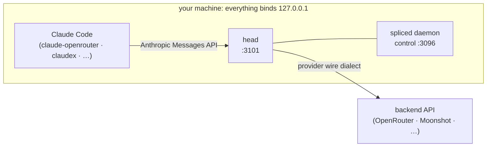
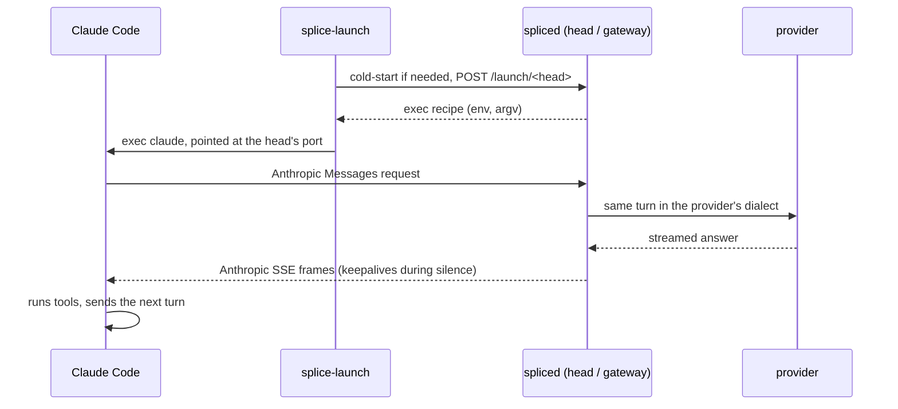
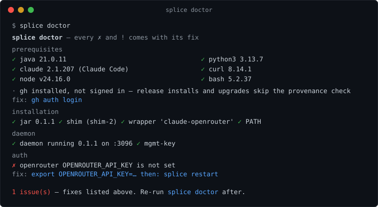

[README](../../README.md) · [Wiki Home](README.md)

# Architecture and troubleshooting

How Splice sits between Claude Code and your model backends, what it does to keep long sessions alive, and how to find and fix a problem when something goes wrong. Start with `splice doctor`: every failing check prints its own fix.

## How it works

A single Kotlin daemon (**spliced**) runs between Claude Code and the configured model backends. Each head is a thin Claude Code wrapper on its own loopback port. Splice translates Anthropic's Messages API into each provider's wire dialect; Claude Code remains the tool executor.



Each wrapper is an `argv[0]` symlink to the shared launch shim [`app/src/main/dist/bin/splice-launch`](../../app/src/main/dist/bin/splice-launch): it cold-starts the daemon if needed, asks it for an exec recipe over the loopback control plane, and execs the real `claude` pointed at the head's port. Only the head talks to the backend. The control API answers only on this machine (port 3096 unless `[daemon] control_port` says otherwise), and it needs the key for everything except `/health`, which reports the version and whether the heads are up. Adding a backend using an existing dialect and auth kind is a TOML edit, not code. See [`app/src/main/resources/splice.example.toml`](../../app/src/main/resources/splice.example.toml) for the full sample topology.

The gateway path works the same way without a head command: plain `claude` (on the door) or `splice launch claude` reaches the daemon's local gateway, and the model you pick with `/model` selects the provider. See [Door and launchers](door-and-launchers.md).

`install.sh` builds the fat jar from a checkout (or fetches a release), installs the shared launch shim, links the wrapper commands into `~/.local/bin`, and finishes by running `splice doctor`.

### A turn, step by step



### Long-session reliability

Compaction uses the session's own model and reasoning effort and preserves its request shape. A stable prompt-cache key and unchanged prefixes support cache reuse, but the actual cache result depends on the backend and workload. Replaying earlier turns' reasoning into a new turn is separate and is described [below](#reasoning). Within a turn, ChatGPT, OpenAI and Muse heads re-send cached reasoning on tool round-trips by default.

A client disconnect during compaction detaches that client rather than cancelling the upstream work. A byte-identical retry can follow the running turn or receive its recorded result without starting a second upstream turn. This is compaction recovery, not a promise to replay arbitrary tool executions. Stopping a head ends compactions still running on it. By default, `splice restart`, `splice upgrade` and `POST /api/daemon/restart` hand over at once under Splice's systemd unit and wait only for compactions that the restart would cut — compactions on a Muse head, a local runtime with `slot_affinity` on, or a daemon not running under the unit; pass `--wait` (or `?wait=1` on `POST /api/daemon/restart`) to wait for compactions on every head, or `--now` (`?now=1`) to skip every wait. An unreadable in-flight count is reported before restarting without the wait. A finished answer whose client disconnected is kept on disk for identical retries for up to two hours without another upstream turn. Expired recordings are swept at head start and when another answer is saved.

```bash
splice restart          # hand over; wait only for compactions a restart would cut
splice restart --wait   # wait for compactions on every head
splice restart --now    # skip every wait
```

A restart under Splice's systemd unit does not cut an answer that is already arriving. The launcher keeps the unit's first process and the listening sockets, and a restart starts the next daemon beside the running one. The running daemon stops taking requests, hands over, and finishes the answers already arriving, for up to 15 minutes. A compaction that is already answering finishes the same way; one whose client has hung up is ended, and the retry its client sends reaches the next daemon. The next daemon serves every new request meanwhile and counts each finished answer's request row, tokens and cost. A request its provider had not begun answering ends with the restart line, and Claude Code sends it again.

Two kinds of head still stop whole, every running turn ending with the restart line: a Muse head, and a local runtime with `slot_affinity` on. So does every running turn on a daemon started outside the unit or on macOS. On a ChatGPT head that runs code mode the answer finishes, and a script still running when its answer ends is reported to the model as lost, so the model runs it again; the conversation's next turn waits for the running daemon to let go of it. `splice restart`, `splice upgrade`, the console's Restart and a console save that needs a restart all go this way; an upgrade that brings a newer launcher restarts the unit whole, once, so that launcher starts. The daemon is then the launcher's child and no longer the unit's first process (`/health` names its `pid`). On a machine whose own tools take a unit's first process for the service, such as an out-of-memory keeper that protects that process and treats the unit's other processes as expendable, set `SPLICE_HANDOVER=off` in the unit's environment (a drop-in with `Environment=SPLICE_HANDOVER=off`): the daemon stays the unit's first process, and a restart ends every running turn with the restart line as before.

A `context_window` edit in `splice.toml` needs no restart. The running daemon re-reads the windows (a model's `context_window`, `extra_windows`, `window_rules`, `default_context_window` and a head's `context_window`) when the file changes. Running sessions start compacting at the new size right away; new sessions start with it. A local runtime is asked about a new window first and a window it refuses is not applied; a file that does not parse keeps the windows in force. The daemon log names what moved, or why nothing did. Every other key is still read only at boot, and `splice doctor` reports the file stale until `splice restart`.

During upstream silences, Splice sends SSE keepalives so Claude Code can distinguish an open stream from a stalled connection. Optional progress messages identify themselves as Splice-authored status, never model reasoning. Failed or truncated streams remain failures rather than being presented as finished answers.

## Backends and protocols

Splice speaks several upstream wire dialects, selected per provider in the topology (the rows below are what `splice add` writes for each profile):

| Dialect | Used by |
| --- | --- |
| `openai-responses` | ChatGPT (at `https://chatgpt.com/backend-api/codex`), Grok, Muse, and OpenAI API-key providers configured for the public Responses API |
| `openai-chat` | OpenRouter, local runtimes, and the generic `api-key` profile |
| `anthropic-passthrough` | Claude, Kimi, DeepSeek and other Anthropic-compatible endpoints |

An OpenAI API-key provider uses the public Responses API at its configured base URL when its dialect is `openai-responses`; the generic api-key profile writes `openai-chat` instead. On the codex provider, `websocket = true` under `[providers.codex.quirks]` sends Responses turns over a WebSocket. It ships off, and a failure before any answer, or a declined handshake, falls back to the ordinary stream:

```toml
[providers.codex.quirks]
websocket = true
```

### Throttles and account pools

When a provider answers 429 without naming a quota window or reset, Splice moves the same turn to an available pooled login before any answer reaches Claude Code. With no available sibling, it retries after 2, 4, 8, 16, 30, 30 and 30 seconds, within the turn's deadline, then returns a retryable failure. The two-minute retry budget is shared across logins so a throttle affecting the whole pool can lift without an indefinite hold. A named exhausted window with no reset, or a billing-cycle limit, also permits a pool handoff but ends promptly with the provider's words when no sibling can answer. Stated resets retain their bounded wait policy. A new provider limit reading releases that login's Use-now pins; a cached refusal can hand off without extending its cooldown. No account switch or fresh throttle resend occurs after answer content reaches the client.

## Reasoning

"Reasoning" here means one of three narrow things, never the model's raw private chain-of-thought:

- **Provider-generated reasoning summaries**: a short summary the backend itself produces and returns.
- **Readable reasoning fields**: supplied explicitly by the backend on the wire (e.g. `reasoning_text` / summary fields).
- **Opaque encrypted reasoning-item replay**: carrying the backend's own encrypted reasoning items forward into a later request, verbatim and unread.

Splice never has, exposes, or reconstructs the model's raw chain-of-thought or exact reasoning. Provider-native readable fields may be displayed as thinking blocks, but `mirror_reasoning` is locked off after every configuration layer: TOML, state, environment variables, and runtime PATCH cannot enable a synthetic transcript summary.

Replaying reasoning (`replay_reasoning`) ships on: every earlier turn's reasoning goes back to the model until the conversation compacts, the way Codex sends it. Off, Splice drops each reasoning item that came before the last real prompt, and a session driven by peer messages loses its reasoning at every message. The `reasoning_cache` ships on for ChatGPT, OpenAI and Muse: it persists reasoning at verified positions in the conversation, including prose-only turns and readable summaries supplied by the provider. Encrypted reasoning stays in that server-owned history; Claude Code receives readable model reasoning without opaque replay blocks that appear as empty “Thinking…” rows. Old transcript replay envelopes remain readable. If the upstream supplies no readable reasoning, Splice invents none. Set `replay_reasoning = false` or `CLAUDEX_REPLAY_REASONING=0` to keep earlier turns' reasoning out.

Reasoning effort is part of the prompt-cache key, so Splice never varies it by turn type, compaction included.

## The cache-replay experiment

An A/B run in July 2026 asked one question: **does replaying opaque encrypted reasoning items back into a request bust the prompt cache?** Two isolated real Claude Code sessions ran the same fixed multi-turn workload on a side port, only the replay toggled, and a captured, sanitized transcript replayed it without live credentials. Its harness was retired with the Node proxy it drove; the result is what matters.

The cache effect remains workload-dependent. The reasoning-depth result made replay default-off in July: replay caused the model to reuse prior thinking, reducing output and making reasoning thin. Since Oct 23, 2026 replay ships on again. With it off, only 26% of claudex's earlier tool steps reached the model with their reasoning, against about 90% in Codex's own requests, and a session driven by peer messages lost its reasoning at every message.

## Layout

```
core/          :core: the shared kernel: config, topology, auth, turn, model, usage, and the
               persistence primitives state lives in (framework-free by module law)
integrations/  reusable adapters: claude-code/ (login, mcp, wrap, resume, transcript), upstream/
               (transport, retry, credentials), http/, mcp/ (the MCP host), mcp-hub/ (the hub's two
               native binaries, splice-mcp-holder and splice-mcp-front), topology/ (the loader),
               oauth/ (sign-in flows and account files), codemode/ (the GraalJS worker pool),
               observability/ (performance export and profiles), daemon-client/ (the CLI's calls
               to a running daemon), terminal/ (prompts), dialects/ (wire contracts) and
               providers/ (vendor adapters)
features/      capability projects: turns, sessions, models, heads, accounts, usage, lifecycle,
               diagnostics, launch, configuration, harness, server, share, with use-case slices as
               packages; one slice reaches another only through its public read models, ports and commands
modes/         the Modes: one folder per mode with its manifest, prompt, tools and code (modes/README.md)
app/           :app: composition: the daemon, the control plane (app/control), the `splice` CLI, the
               fat jar, the launch shim and the sample topology
               (src/main/dist/bin/splice-launch: every head command is an argv[0] symlink to it;
               src/main/resources/splice.example.toml: the sample multi-provider topology, shipped in the jar)
quality/       enforcement: architecture/ (the Kotlin laws), compiler-plugin/, rules/ (the ast-grep
               walls, write-time AND at the gate), detekt/
build-logic/   Gradle convention plugins; the build itself is rooted at the repository root
tools/         engineering tools: gate/ (the ladder and its selftests), e2e/ (fixtures, probes and Docker),
               release/ (release validation and licenses), codemods/ (source migrations), console tests
install.sh     fetch/build the jar, install the shim, link wrapper commands, keep the release copy
.claude/       the write-time hook wiring (settings.json); its tests live in tools/gate/test/
.dev/          research notes, the restructure move records, release runbooks
docs/          architecture and design docs (PROVENANCE.md, the request-byte contract), product specs (specs/),
               this wiki (wiki/), README assets
.github/       workflows, the community health files, issue and PR templates
```

The daemon is Kotlin; the launch shim is POSIX `sh` and `curl`. The legacy `server/` Node proxy and its `bin/claudex-next` shim were **deleted on 2026-08-10** (P8-CUT), after the Kotlin daemon had owned the production ports for three days and 32,326 turns at 99.14% clean. The wire behaviour it established survives as 11 byte-exact fixtures in the migration oracle (`npm run oracle:replay`), whose mock upstream is vendored so it no longer depends on the deleted tree. Contracts and invariants live in [`AGENTS.md`](../../AGENTS.md); contributing and the gate in [`.github/CONTRIBUTING.md`](../../.github/CONTRIBUTING.md).

## Why you might not want splice

Reasons to walk away:

- **One tested Claude Code version per release.** The launch handshake checks the daemon's version. Doctor and the status line report when Claude Code is newer than the version tested with that release.
- **A team server that is only starting.** One Splice can [serve a team](team-server-mode.md) on keys it issues, over TLS, with per-person caps, but there is no sign-in, budget, usage ledger or per-person metric yet, and it serves only heads that sign with an API key or a self-hosted provider, never a person's plan login. A team that needs those today should run a gateway built for that job (LiteLLM, for example).
- **A JVM daemon.** Java 21 is a hard dependency. The daemon has no fixed heap ceiling: its heap may grow to 75% of RAM, and G1 is tuned to keep committed memory close to the live data. The JVM options live in one place, `SPLICE_JVM_OPTS` in the `splice-launch` launcher, which every daemon start runs through; set that variable to override them.
- **A one-person project.** The release gates are strict: every release is checksummed, provenance-attested, and installed hermetically in CI before it ships. One person maintains the project.

## Troubleshooting

### `splice doctor`

```bash
splice doctor                                  # human checkup with a fix under every failing check
splice doctor --live                           # also sends a small streamed tool-use probe to each local runtime
splice doctor --json --with-logs --out report.json   # a shareable report
splice check-config                            # boot findings, without starting the daemon
splice check-config --fix                      # an interactive session that fixes them
```

`splice doctor` checks prerequisites, install integrity, config, daemon, and auth, then prints the exact fix under every failing check. `splice doctor --json` writes the same findings as a report you can share: versions, the topology's shape (never a credential, an account id or a working directory), every check with its fix, and the last perf rows; `--with-logs` appends the last 500 daemon lines through the same redaction, `--out FILE` writes it. Nothing is uploaded.



When a session's Claude Code is newer than the version this Splice release was tested with, doctor, `splice status` and the status line say so once; equal or older is silent.

### Sessions and performance

`splice sessions` lists the Claude Code sessions on the machine with the head that launched each one and whether it is live, stale or gone, plus the `SendMessage` line that reaches it. `splice perf --window 24h` shows, per head, how long turns wait before the first byte and how long they stream, the failure share by outcome, retries, cache hit ratio and peak concurrency. The [performance operator guide](../observability/README.md) covers machine-readable queries, the Performance console, profiles, exporters, objectives and measurement limits.

### Common problems

| Symptom | Cause | Fix |
| --- | --- | --- |
| Launch warns about a missing key; requests fail upstream though `echo $OPENROUTER_API_KEY` shows it | the daemon reads API-key env vars from **its own** environment; you exported the key after it started | store the key with `splice key set NAME` or `<command> login` (re-read per request, no restart), or `splice restart` from a shell that has it |
| `splice restart` still does not see an exported key | a systemd user unit runs the daemon, so the unit's environment applies, not your shell's | use `~/.config/splice/keys.toml` (`splice key set`); `splice doctor` names this state |
| Daemon refuses to boot | a config finding; boot fails closed and lists every finding at once | `splice check-config`, then `splice check-config --fix` |
| A `splice.toml` edit seems ignored | only window keys are re-read live; every other key is read at boot, and a head restart does not reload TOML | finish pending work, then `splice restart`; `splice doctor` reports the file stale until then |
| A session stops working after `splice rotate-key` | sessions launched before the key helper hold the old turn key | `splice sessions relaunch`, repeated until it reports none left |
| The header says `API Usage Billing` | Claude Code names only Anthropic's plans | nothing to fix: see [the billing word](getting-started.md#the-billing-word-in-claude-codes-header) |
| Restart cut a running turn | the head is a Muse head, a local runtime with `slot_affinity`, or the daemon runs outside the systemd unit or on macOS | Claude Code resends it; pass `--wait` to wait for compactions first |
| Doctor names a head every run | its `wireTap` is on | remove `wireTap` from that head's overrides ([Opt-in capture](disk-and-privacy.md#opt-in-capture)) |

Keys in `~/.config/splice/keys.toml` sidestep the whole environment-variable class: the store is re-read per request, so a `claude-openrouter login` or `splice key set` lands on the next request, no restart required.

### Logs and records

| What | Where or how |
| --- | --- |
| Daemon log | `~/.splice/logs/daemon.log` (and `.1`) |
| JVM boot output and boot crashes | `~/.splice/logs/daemon-boot.log` |
| A head's full request/response trace | `splice trace <head> [--last N] [--session S] [--turn ID]` |
| What Splice sent upstream, in memory | `splice wire <head>` with `wireTap` set on that head |
| Health without a key | `curl -s http://127.0.0.1:3096/health` |

Every file Splice keeps, and who can read it, is listed in [Disk and privacy](disk-and-privacy.md).

## Related pages

- [Getting started](getting-started.md)
- [Upgrading to 0.7.0](upgrading-to-0.7.0.md)
- [Providers and accounts](providers-and-accounts.md)
- [Door and launchers](door-and-launchers.md)
- [Configuration reference](configuration-reference.md)
- [CLI reference](cli-reference.md)
- [Disk and privacy](disk-and-privacy.md)
- [Console and sessions](console-and-sessions.md)
