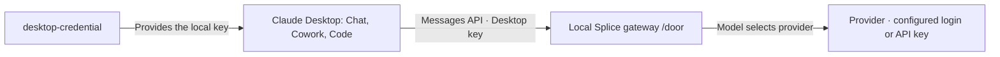

[README](../../README.md) · [Wiki Home](README.md)

# Claude Desktop & Antigravity

Run Chat, Cowork and the Code tab through splice with `splice desktop on`, or launch a separate **Claude (Splice)** app to keep your usual Desktop on claude.ai. If Google's Antigravity CLI is installed and signed in, you can also pick its Gemini models in Chat and the Code tab.

## Claude Desktop on splice

Start with at least one model served by splice, then run:

```bash
splice desktop on
splice desktop
```

**Quit and reopen Claude Desktop** after enabling splice. `on` sets up the whole app in third-party (3P) gateway mode, with nothing to paste and no extra app-mode flag. Chat and Cowork move along with the Code tab. There is no claude.ai sign-in in this profile: its conversations are kept on this computer, not in your claude.ai account. Remote Control and Anthropic-hosted cloud environments aren't offered, and SSH sessions can't reach the local-only gateway.

| Command | What it does |
| --- | --- |
| `splice desktop on [--model <id>] [--yes]` | Show what changes and ask before applying the 3P configuration. The prompt defaults to no. Without a terminal, nothing changes unless you pass `--yes`. An unavailable model or managed Desktop configuration is refused. |
| `splice desktop [--json]` | Show the mode, whether Desktop has used the changed configuration since launch, the door, default, picker, omitted providers or heads with reasons, feature availability by mode, and the last door turn. `splice doctor` names the mode and warns when Desktop needs to be reopened. |
| `splice desktop off` | Close Desktop's door and undo the configuration installed by `on`; then quit Desktop and reopen it. |
| `splice desktop rotate-key` | Replace only the Desktop key. The old key is refused immediately; the helper gives Desktop the new key within five minutes in app mode. |

Desktop's modes are `app` (splice's 3P gateway configuration), `standard` (a Code-tab-only setup left by an older splice), `other` (another configuration controls Desktop's provider), and `off`. An older standard mode keeps working until `on` or `off` replaces it. To clear an old setup, remove its variables under **Claude Desktop → Settings → Claude Code → Environment variables** as directed by `splice desktop off`: splice doesn't edit that encrypted store. The old variables are `CLAUDE_CODE_USE_MANTLE`, `ANTHROPIC_BEDROCK_MANTLE_BASE_URL`, `AWS_BEARER_TOKEN_BEDROCK`, `CLAUDE_CODE_MAX_CONTEXT_TOKENS` and `CLAUDE_CODE_AUTO_MODE_SERVER`.

The local configuration points `inferenceGatewayBaseUrl` at `http://127.0.0.1:<control_port>/door` (default port 3096). On Linux it lives in `~/.config/Claude-3p/configLibrary/` or `$XDG_CONFIG_HOME/Claude-3p/configLibrary/`; on macOS it lives in `~/Library/Application Support/Claude-3p/configLibrary/`. Splice writes its own entry and applies it in `_meta.json`. Desktop runs `<state>/desktop-credential` as its `inferenceCredentialHelper`; no Desktop gateway key is stored in Desktop's files.



The gateway accepts the Desktop key as a bearer or as `x-api-key`; the management and turn keys cannot stand in for it. `splice rotate-key` leaves the Desktop key alone, and the Desktop rotation doesn't touch the terminal's key. Each Desktop door turn appears on `/api/perf/turns` with the model that ran and `door: "desktop"`.

`splice desktop off` and `splice uninstall --all` remove the 3P configuration installed by `on`, its library entry and helpers, and an empty library folder created by splice. The previously applied configuration is restored unless you applied another in the meantime, in which case that one stays. These commands don't erase your conversations or the side-by-side profile. A managed Desktop configuration takes precedence over the local library, so `on` refuses if one exists: on Linux that's `/etc/claude-desktop/managed-settings.json`, and on macOS it is Desktop's managed preferences. For this provider check splice tests for the managed file's presence, not its contents. It doesn't read or write Desktop's keyring or encrypted stores.

### Keep a separate Claude (Splice) app

```bash
splice launch claude-desktop
```

This starts the installed app with a separate profile, leaving your regular Desktop and its claude.ai sign-in alone. The default profile is `~/.config/claude-splice` on Linux (under `$XDG_CONFIG_HOME` if set) or `~/Library/Application Support/claude-splice` on macOS. `splice setup` and `splice setup --update` can offer a **Claude (Splice)** application launcher. On Linux a second Desktop with its own `XDG_CONFIG_HOME=~/.config/<name>` can also use an applied configuration pointing at the local door.

## The model catalog and reasoning picker

Splice builds one `model-catalog.json` at daemon startup from the providers it serves, including signed-in accounts, and updates the lineup as credentials or provider rosters change. A provider's entry supplies the model's name, description, reasoning levels and context window where available; splice fills known missing metadata. For a Chat Completions endpoint that doesn't publish reasoning levels, a declared `[providers.<key>.quirks.chat_effort_vocabulary]` can supply them. A picked model runs on its own provider with that provider's logins, cooldowns and failures. The Code tab's ordinary Claude Code sessions use the same `~/.claude` as the terminal: `splice desktop on` doesn't put new gateway settings in `settings.json` or in the terminal environment. It can remove values an older splice wrote there for Desktop, restoring what they replaced.

`splice desktop on --model <id>` sets Desktop's own gateway default without changing the terminal's `claude`. It accepts a served selector or the ID shown by Desktop. Without a model argument, splice keeps the previous choice if served, otherwise it uses the first provider's pinned or first model. In the generated picker, native Claude models stay first, newest first; a selected non-Claude default leads the remaining rows. So the saved gateway default need not be the first row Desktop displays. Use the picker to choose a different model explicitly.

| Surface | What it supplies |
| --- | --- |
| `GET /door/v1/models` and legacy `GET /desktop/v1/models` | With the Desktop key, both serve the same discovery catalog, including Desktop-only models. The gateway preserves provider-supplied `thinking` metadata; for known named levels without it, splice publishes the actual `effort_options`, marking the default as recommended when known. |
| `inferenceModels` in the applied 3P configuration | Desktop 6.28899.2 takes the picker from this catalog projection and joins discovery by model ID for descriptions and names without a `labelOverride`. Keep `modelDiscoveryEnabled` on. |
| `behavesAs` and `maxEffort` | This Desktop version doesn't build its reasoning selector from discovery's `thinking`. For a non-Claude model with named levels, splice uses the newest served Claude Opus for `behavesAs`, with `maxEffort` as the supported cap. Without a served Opus, that projection doesn't provide the control. |

`maxEffort` caps Desktop's own low, medium, high, xhigh and max sequence; it cannot express gaps, `minimal` or `ultra`. A visible selector doesn't prove it shows the provider's exact levels: compare it with gateway discovery. Splice republishes the configuration at startup and when credentials or the served roster change. Quit the **whole app**, then reopen it to verify the picker in Chat, Cowork or Code after a sign-in, an added provider or a policy change.

### Code tab context windows

Desktop's Code tab uses a 200,000-token window, or 1,000,000 tokens for a model picked as its 1M variant. Splice scales the usage counts it reports to Desktop so the Code tab compacts relative to the model's own window. Discovery still reports the provider's real ceiling in `max_input_tokens`; compaction follows the scaled counts, not that field.

If your Desktop installation uses different windows, set [`code_window` and `code_window_1m`](configuration-reference.md#desktop-code-tab-windows) to match. A model is offered a 1M variant when its real window reaches `code_window_1m`. Restart the daemon and reopen Desktop after changing these values.

## Policy, session import and profile sync

The [shipped Desktop policy](../../app/src/main/resources/claude-code-desktop-policy/ccd-policy.json) enables Chat and Cowork, the built-in browser, extensions, projects, scheduled tasks, skills, user-added plugins and marketplaces, local MCP servers and tool search. The workspace can reach every host by default and MCP tool calls may run for 30 minutes. The 3P configuration then takes supported preferences from your Claude Code setup: effort (`effortLevel`), the default permission **mode**, prompt suggestions, and reachable plugin marketplaces. It reads `~/.claude/settings.json`, `settings.local.json` and `plugins/known_marketplaces.json`; it doesn't edit those files to pass along your preferences. GitHub, git and hosted-file marketplaces can carry over; local folders, sparse checkouts and credentialed URLs don't.

Your Code tab still reads Claude Code's MCP configuration, permission rules and status line. Splice doesn't copy those into **managed policy**: a managed MCP server could displace your Code-tab servers, Code permission rules shouldn't govern Chat or Cowork, and Desktop restricts policy-supplied status lines. Syncing local MCP tools into a Desktop profile is separate.

| Where to change it | How it applies |
| --- | --- |
| **Settings → Desktop policy** in splice's console | Change app surfaces, Code and model settings, MCP and plugins, browser and network policy, or import preferences. Use **Reset** to go back to the underlying defaults. Overrides live in `~/.splice/state/desktop-policy-overrides.json` by default and are published to applied configurations on the door, including side-by-side profiles. Reopen Desktop to apply. |
| Desktop's own configuration | `on` writes splice's configuration whole. Later publishes fill unset policy and add missing marketplaces, including in a configuration you made that points at the door. Values you set there, including false, stay put unless you explicitly override them in splice's console. |
| Gateway connection and model list | Splice owns the door address, credential helper, standing 3P policy and generated `inferenceModels`; they're not console-editable policy overrides. |

The Code tab's Claude Code transcripts live with the terminal's and those sessions see one another as peers. Desktop's own list shows sessions it started. **Settings → Import & export** can copy terminal Claude Code sessions into that list; it doesn't create a live mirror. The shipped policy enables the import offer (`claudeAiImport.bannerBehavior: "show"`, with up to 10 dismissals).

On setup and when the 3P configuration is published, splice fills missing non-auth setup in the gateway profile's `Claude-3p` data. This sync is separate from [terminal launch profiles](door-and-launchers.md#filtered-launch-profiles). It doesn't copy account sessions, cookies or the keyring.

| Item | What carries over |
| --- | --- |
| MCP servers | Into local `claude_desktop_config.json`: the usual Desktop's configured entries and splice's MCP plan, including Claude Code and imported servers. Desktop can start unhosted stdio servers directly. Hosted and HTTP(S) servers use `desktop-mcp` by name, with no URL, header or access key written for the bridge entry. Splice refreshes or removes its bridge entries as servers change, preserving settings you made yourself. Each [mcp mode](modes-and-extensions.md#an-mcp-mode) that is on for every head and not left out for Desktop is a bridge entry too, reaching the daemon's own server; a server of yours with the same name keeps it. Switching such a mode updates the file without a daemon restart; quit and reopen Desktop to see the change. |
| Preferences and extensions | Missing preferences, Cowork user-files location, hardware-acceleration setting and Desktop extensions are copied from the usual profile. Extensions keep executable permissions. Claude Code plugins are not copied; use Desktop's marketplaces to install them. |
| Skills | Your Claude Code skills and user-created skills from the usual Desktop fill gaps in the 3P profile's existing skills plugins. Splice doesn't create a skills plugin where there isn't one yet. |
| Chat system instructions | Not a profile-file import. In an Antigravity Chat conversation, splice includes the Chat request's `system` text (which can contain project instructions) in the opening ACP prompt. The Code-tab ACP bridge does not forward Desktop's system prompt. |

## Managed Code-tab launcher

For Antigravity in **Code** and for live switching between Antigravity and Claude Code, install the managed `processWrapper`. First set up the 3P app or launch the side-by-side app so `<state>/desktop-launch` exists. Then run:

```bash
splice desktop wrapper --print
```

The file needs two keys:

```json
{
    "processWrapper": "<state>/desktop-launch",
    "parentSettingsBehavior": "merge"
}
```

`processWrapper` names the program the Code tab starts through. `parentSettingsBehavior` set to `"merge"` is there so the limits in Claude Desktop's own policy still apply to the Code sessions it starts. Claude Code takes the key from the highest managed source that sets it, and its default, `"first-wins"`, drops the policy Desktop hands each Code session wherever managed settings exist; while no source sets `"merge"`, Desktop logs a `[custom-3p] configuration warning` at every start and shows "The policy from your inference configuration isn't fully applied on this computer" in every Code session. (Claude Code defaults to `"merge"` only for Desktop's own gateway mode with an interactive sign-in; Desktop on splice uses a key, so the default is `"first-wins"` and the key matters.)

The command says only what splice read, in the same shape as `--check`, the `managed settings` row of `splice doctor` and the item `splice upgrade` lists. Each of them starts with what is wanted: both keys with their values.

- **What splice found at the file**, in one of three states. *Read*: for each key, the string it holds (quoted), "a value that is not text" (an object, a list, a number, `true` or `null`, whose contents are never printed), or that it does not set it. *Could not be read*: no permission anywhere on its path, a folder splice cannot look into, a link to nothing, or not a JSON object; splice then does not say whether the file exists. *Nothing at the path*: only where splice established that nothing at all is there.
- **The other places Claude Code may take managed settings from**, named on every run in one wording, without splice reading or querying them: `remote-settings.json` in Claude Code's config folder (`~/.claude`, or the folder `CLAUDE_CONFIG_DIR` names for the process that runs the command; Desktop may give its Code sessions another one), the macOS policy plists, the Windows `HKLM` and `HKCU` policy values, and each `managed-settings.d` drop-in splice lists (or the folder itself where it can't list it). Claude Code takes `parentSettingsBehavior` from the highest source that sets it, so a value there may be the one that counts.
- **What Desktop does**, said once and always as the condition: wherever managed settings exist, Desktop warns in every Code session unless the source that wins sets `parentSettingsBehavior` to `"merge"`. splice never reads every source, so it never says what Desktop does as a fact.
- **Whether splice's launcher is laid**, where it is not: a regular, executable file at the path wanted.
- **What to do**: make the file hold both keys. Only where nothing is at the path does it say to create the file, with the commands that put it in place. Where a file is there, or may be, it says to edit it in place as an administrator (a copy would reset its owner and mode and lose its other keys) and never prints what the file holds. The administrator checks the places splice did not read first. When the file it read holds both keys as wanted, it asks only for that check: nothing to edit and nothing to reopen.

The file belongs to the administrator; splice never installs it for you.

| Platform | Claude Code managed settings |
| --- | --- |
| Linux | `/etc/claude-code/managed-settings.json` |
| macOS | `/Library/Application Support/ClaudeCode/managed-settings.json` |
| Windows (wrapper command path) | `C:\Program Files\ClaudeCode\managed-settings.json` |

This is **Claude Code's** managed file, not the **Claude Desktop** provider configuration under `/etc/claude-desktop`. Verify the executable and both keys with the check below, then quit and reopen Desktop entirely. The check prints the same things as `--print`, each line starting `splice:`, without the file and the commands. It exits 0 when splice's launcher is laid and the file splice read names it as `processWrapper`, and confirms no more than that: whatever `parentSettingsBehavior` holds, and whatever a place splice did not read sets, the lines say. It exits 1 otherwise: no launcher laid, nothing at the path, a file it could not read, or a `processWrapper` that is absent, not text or names another program. Both commands, the doctor and the upgrade find the launcher in the state folder the daemon uses, `[daemon] state_dir` in `splice.toml` included. `splice doctor` shows the same in its `managed settings` row while Desktop is on splice, and warns where the file splice read does not say `"merge"` or names a wrapper that is not splice's laid launcher. `splice upgrade` and `splice setup --update` list an item whenever the file splice read does not hold both keys as wanted, could not be read or is not there, or the launcher is not laid. Where nothing needs setting up, `setup --update` says so only of what splice checked; the doctor it ends on names the places to check.

```bash
splice desktop wrapper --check
```

Use either `--print` or `--check`, not both. Bare `splice desktop wrapper` is the same as `--print`. If you stop using the wrapper, have the administrator remove its `processWrapper` entry (and `parentSettingsBehavior` if nothing else needs it); `splice desktop off` doesn't edit that managed file. The following are internal entry points, not interactive sign-in commands:

| Entry point | Role |
| --- | --- |
| `<state>/desktop-credential` | Runs `splice desktop credential` so Desktop can obtain its current key without storing the key in the helper itself. |
| `<state>/desktop-launch` | Runs `splice desktop launch` as the managed wrapper. For local gateway launches it supplies the Desktop key the app doesn't pass to its wrapper. For Code-tab Gemini it starts the ACP bridge instead of Claude Code. |
| `<state>/desktop-mcp` | Starts the named MCP server bridge through `splice mcp stdio <name>`. Created when profile sync needs a bridged server. |
| `desktop-sandbox` | [Bun contributor tool](cli-reference.md#repository-only-desktop-sandbox) under `tools/desktop-sandbox`, not an installed shim or `splice desktop` verb. Runs Desktop and splice in a private test profile, display and state directory, separate from your regular app. |

## Use Gemini through Antigravity

1. Install Google's `agy` and sign in using its own login. Restart splice to have it query the model roster, then reopen Desktop once the Gemini rows appear. Desktop lists them with `claude-antigravity--` IDs and reasoning metadata; agy's own Claude rows are not added.
2. In **Chat**, select a Gemini row. The door sends the turn to a pool of `agy acp` sessions. Chat's system instructions seed the opening prompt, and a local MCP bridge lets agy request Desktop's Chat tools and continue when Desktop returns results.
3. In the **Code tab**, install and check the [managed wrapper](#managed-code-tab-launcher), then select a Gemini row. The launcher runs `splice desktop acp` → `agy acp` **instead of** Claude Code. The bridge speaks Desktop's session protocol, so streaming replies, tool cards, permission prompts, Stop and the local session history are available there.

In the Code tab the live picker sends `set_model`. The wrapper switches between Claude Code and the ACP bridge under the same session ID; switching among Gemini models stays in ACP. The conversation carries over, but the handoff is lossy: visible conversation and tool-call details such as names and inputs can carry over, not Claude's reasoning or tool results. Switching back resumes the Claude-format transcript, including Gemini's turns.

- When agy delegates, Desktop shows a **Task** card and a subagent pane. A pane left open when a turn is canceled or agy exits is marked stopped.
- Autocomplete combines ACP's own commands with Claude Code skills and slash commands from the user configuration and the project's `.claude` and `.agents` folders.
- ACP sessions can receive Desktop-supplied MCP tools, splice's registry entries, and Claude Code's file-declared tools where allowed. In these sessions `/login` opens the splice console's **Accounts** page before the prompt reaches agy. A session record and transcript are written in Claude Code's format, but the ACP bridge doesn't open Claude Code's peer socket.

**Google's terms govern this path:** splice runs Google's unmodified binary, leaves Google sign-in to agy, does not read agy's sign-in store, and identifies itself as `splice` in ACP. These subscription-backed Gemini rows belong to Claude Desktop: splice doesn't make them available in the terminal, LAN or team pickers, and the HTTP door refuses Claude Code agent loops for these models. Chat is a Desktop request through the gateway; Code replaces the Claude Code process with the ACP bridge rather than driving agy from a Claude Code loop.

### Choose a Desktop harness

The console's **Settings → Desktop harnesses** shows which program handles each family; **Accounts** shows it beside the provider. GPT models from ChatGPT or OpenAI default to Claude Code through splice on the chosen GPT model, as do other ordinary providers. **Codex CLI** is an opt-in for launchers that read the harness map; splice's own launcher still runs GPT sessions on Claude Code whichever you select.

Antigravity is enabled by default; its models appear only when agy is available and signed in. To leave it out so the daemon doesn't start agy, turn it off in **Desktop harnesses**, or add this to `splice.toml`:

```toml
[daemon]
antigravity = false
```

The console's Antigravity choice overrides TOML until you reset it. Restart splice after either change, then reopen Desktop. The prefix-by-prefix routing map is kept in `~/.splice/state/desktop-harnesses.json` by default.

The shared harness catalog includes Claude Code, Codex and Antigravity. To list another **local** ACP program, declare it in `splice.toml` (not through the console), replacing the path with your installed executable:

```toml
[harnesses.local-agent]
name = "Local ACP agent"
description = "Local session runner"
protocol = "acp"
argv = ["/path/to/agent", "--acp"]
```

`name` is required, `description` is optional, and `argv` must start with an absolute executable path. The ID must start with a lowercase letter and use only lowercase letters, digits or hyphens, and cannot replace a shipped ID. The daemon validates the table at startup. The version-1 Desktop map publishes only the ID, name and description for this entry. Declaring it doesn't route any models to it, add a console routing choice or register a peer.

## Related pages

- [The Door, Launchers & Terminal Profiles](door-and-launchers.md)
- [Providers and accounts](providers-and-accounts.md)
- [MCP hub and sync](mcp-hub-and-sync.md)
- [Peers and harnesses](peers-and-harnesses.md)
- [CLI and control plane API reference](cli-reference.md#accounts-launchers-sharing-and-remote-commands)
- [Disk and privacy](disk-and-privacy.md#what-splice-keeps-on-your-disk)
