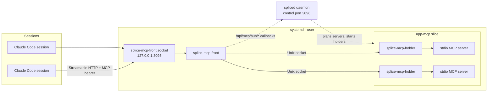

[README](../../README.md) · [Wiki Home](README.md)

# Shared MCP Hub, User Import & Multi-Harness Sync

splice runs each stdio MCP server once and serves it to every Claude Code session, instead of one copy per session. You can also opt in to bringing the MCP servers you already set up in other apps into one splice registry, and splice keeps Claude Desktop, Antigravity (`agy`) and Codex in step with it.

[Shared hosting](#shared-mcp-hosting) · [Hub topology](#the-hub-front-and-holders) · [Settings](#mcp-servers-in-settings) · [Import](#import-your-existing-mcp-servers) · [Sync](#sync-to-other-harnesses) · [Auto-sync and pruning](#automatic-sync-and-safe-pruning)

## At a glance

| You want to | Do this |
| --- | --- |
| Share servers across sessions (the default) | Nothing; `[daemon] mcp_share` absent or `true` |
| Give every session its own copies | `[daemon] mcp_share = false`, or Settings → MCP servers → **Server instances** → Per session |
| Keep one server per session | `[daemon] mcp_hosting_exclude = ["name"]` |
| Turn hosting off entirely | `[daemon] mcp_hosting = false` |
| See what is hosted and why | `GET /api/mcp`, or Settings → MCP servers |
| See what sharing saves | Settings → MCP servers, or `GET /api/mcp/memory` |
| Bring servers in from Claude Code, Desktop, agy or Codex | `splice mcp import` (opt-in) |
| Push splice's servers to agy, Codex or Desktop | `splice mcp sync --to agy,codex` (opt-in) |

## Shared MCP hosting

Every Claude Code session normally starts its own copy of every stdio MCP server in its config. splice starts each such server once and serves it to every session over Streamable HTTP on loopback. Each head's `.claude.json` is rewritten to point at the hosted URL; your own config file is never edited.

Where the server runs depends on whether the MCP hub is on:

| | Without the hub | With the hub |
| --- | --- | --- |
| Where a shared server runs | In the daemon | In its own holder (`splice-mcp-holder`) under `app-mcp.slice`, outside the daemon |
| What sessions connect to | The daemon's control port | The hub's front (`splice-mcp-front`) |

### What gets hosted and what doesn't

| A server whose launch line… | Is |
| --- | --- |
| Names a working directory, a relative path, a location flag such as `--root`, an existing absolute directory, or `${VAR}` | Launched per session; the reason is on `/api/mcp` |
| Names only a bare file name such as `server.js` | Hosted (a bare file name is not a path) |
| Is `http`, `sse` or `ws` | Passed through untouched |
| Is listed in `mcp_hosting_exclude` | Launched per session |

A **relative path** here is one that starts with `./` or `../`, or contains a slash and is not an absolute path, an npm `@scope/name`, a URL or a flag.

A hosted server runs in your home directory. One that reads its working directory without naming it (`mcp-server-git` with no `--repository`) belongs in `mcp_hosting_exclude`.

### Lifecycle and limits

- Hosted servers start on first use and are reaped when idle.
- When a new server would exceed `mcpMaxServers` under `[defaults]` (32 by default, or `SPLICE_MCP_MAX_SERVERS`), the longest-idle one is evicted. If every server is busy, the new one is refused with "MCP host at capacity".
- A crash fails pending calls; the next call restarts the server. Repeated crashes wait five seconds, doubling to a minute, and calls during that wait report the failure.

```toml
[daemon]
mcp_hosting = false            # turn hosting off: every session launches its own servers
mcp_hosting_exclude = ["name"] # keep named servers per session
```

### Which config files it reads

Hosting reads top-level servers from your global `~/.claude.json` and rewrites them only in each sharing head's own copy; project and plugin files are never changed.

Each launch also gets a `--mcp-config` file from splice:

- A plain `claude` reaches the shared servers through `wrapped-mcp-<command>.json`.
- With the hub on, a launch's own file carries the hub's addresses. These replace same-named project servers and can stand in for a plugin's own MCP.

`/api/mcp`'s `sources` section also lists the other four places a server can be declared on this machine: a project-scoped override inside `.claude.json`, a repo's own `.mcp.json`, and a plugin's own `.mcp.json` or inline `plugin.json`. That way you can see what is not hosted and why. splice does not rewrite those kinds in any head's file; only a hub launch's `--mcp-config` file routes them through the hub.

### Defaults and restarts

The shared-server limit and the activity-edge setting belong under `[defaults]`:

```toml
[defaults]
mcpMaxServers = "64"
messageEdges = "false"
```

These `[defaults]` values are read when the daemon starts, so an edit applies after `splice restart`. `PATCH /api/config` changes a running daemon where the knob allows it, and its answer lists what still needs a restart under `restart_required`.

Related host knobs (all under `[defaults]`, see [Configuration Reference](configuration-reference.md#serving-knobs-in-defaults-and-override-tables)):

| Knob | Default | Env | What it does |
| --- | --- | --- | --- |
| `mcpMaxServers` | 32 | `SPLICE_MCP_MAX_SERVERS` | Most hosted MCP server processes at once |
| `mcpIdleTimeoutMs` | 1800000 | `SPLICE_MCP_IDLE_TIMEOUT_MS` | Idle time before a hosted server with no open stream is closed |
| `mcpRequestTimeoutMs` | 1800000 | `SPLICE_MCP_REQUEST_TIMEOUT_MS` | How long one forwarded request may wait |
| `mcpInitializeTimeoutMs` | 60000 | `SPLICE_MCP_INITIALIZE_TIMEOUT_MS` | The child's initialize handshake budget |
| `mcpSlice` | `app-mcp.slice` | `SPLICE_MCP_SLICE` | The systemd slice hosted servers are spawned into (restart) |

## The hub: front and holders

The hub keeps every session's MCP connection alive through a daemon restart or upgrade. Two small native processes sit beside the daemon and outlive it:

- **`splice-mcp-front`** holds the MCP port (loopback `127.0.0.1:3095`) and every session's stream, checks the session's bearer, and routes each call to the right holder.
- **`splice-mcp-holder`**, one per server, joins the server's stdin and stdout to a socket in splice's state folder.

The daemon plans the servers, starts holders and tells the front where they are; it is not in the path of a tool call.



| Event | What happens |
| --- | --- |
| splice upgrade or daemon restart | Front and holders keep running; sessions' streams and each server's state are untouched. A call that needs a holder that doesn't exist yet waits at the front for the new daemon |
| Daemon crash | Treated like an unplanned upgrade; front and holders carry on |
| Front crash | systemd restarts it on the same socket, so connects queue rather than fail; only calls in flight fail, each in words |
| A server crashes | It restarts on the next call. A per-session copy's session is told in that call's result that the server's state was lost |

### Where the hub runs

The daemon decides at boot, logging the first check that fails:

1. A Linux x86-64 machine (the front and holder are Linux x86-64 binaries).
2. Both `splice-mcp-front` and `splice-mcp-holder` present and executable beside `splice.jar`.
3. A reachable `systemd --user` (`running` or `degraded`), since every holder starts in its own scope.

Anywhere a check fails, including macOS, the daemon hosts MCP in-process as before the hub. There is no launchd equivalent. A launch offers hub addresses only after a front has run on the machine (its `front.json` exists) and while a front answers. When it doesn't answer, the session starts its own servers and the launch says so in one line.

### systemd units

| Unit | What it is |
| --- | --- |
| `splice-mcp-front.socket` | Holds `127.0.0.1:3095` so connects queue across a front restart |
| `splice-mcp-front.service` | Runs the front with `--hub` and `--control-port` from `~/.config/splice/mcp-front.env`; `Restart=always`, `MemoryMax=128M`; `ExecReload` sends `USR2` for an in-place handoff |
| `app-mcp.slice` | The memory-capped slice for holders and their servers (`MemoryHigh=12G`, `MemoryMax=16G`) |

These are splice-owned units in `~/.local/share/systemd/user`, replaced by every `splice install --all` on Linux. A unit of the same name in `~/.config/systemd/user` overrides splice's, and setup and upgrade then leave the hub to that unit's owner. `splice setup` with MCP sharing on enables and starts `splice-mcp-front.socket` over splice's own hub units. See [Disk and privacy](disk-and-privacy.md#settings-and-statistics) for the hub's state files and [CLI reference](cli-reference.md#optional-linux-x86-64-mcp-binaries) for the binaries' arguments.

## MCP servers in Settings

Whether sessions share MCP servers is your choice, kept as `[daemon] mcp_share` in `splice.toml`:

| `mcp_share` | Effect |
| --- | --- |
| absent or `true` | Each server that can be shared runs as one copy for every session |
| `false` | Every session starts its own copy |

`splice setup` asks "Share MCP servers between sessions? It uses less memory." once, when the key is not set yet; without a terminal it answers yes. In the console, Settings → **MCP servers** changes it with **Server instances**: Shared or Per session. The change reaches new sessions with no restart.

Below the choice, Settings measures the MCP servers running on this machine:

- The section's figures compare the memory the servers' copies take **now** against what one **shared** copy of each would take.
- **Not shareable** lists each server that runs per session or per project, with the reason (for example "Starts in its own folder", "A different folder in each project", "Keeps one session's work", "A different value in each session").
- Knobs for **Max running servers**, **Stop idle servers after**, **Request timeout** and **Startup timeout**.
- **Connected harnesses** and **User MCP servers** (see [the console's import and sync rows](#in-the-console)).

The same figures come from `GET /api/mcp/memory`, which takes the management key:

| Field (per entry under `servers`) | Meaning |
| --- | --- |
| `class`, `why` | How the hub runs it and the reason it is per session |
| `copies` | How many copies run now |
| `bytes_now` | The copies' proportional set size, or their resident size where that cannot be read |
| `bytes_if_shared` | What one shared copy would take |
| `held_by` | The sessions holding it, as `{session_id, name}` |

A session counts when one of its own copies runs, or when the MCP hub has bound it to the server's shared holder.

## Import your existing MCP servers

splice can bring the MCP servers you already set up in other apps into one registry it hosts and syncs. It is **opt-in**: nothing is imported unless you run an import, from the CLI, the console, or `splice setup`.

| Source | File read (read-only) |
| --- | --- |
| Claude Code (`claude-code`, alias `claude`) | `~/.claude.json` `mcpServers` |
| Claude Desktop (`claude-desktop`, alias `desktop`) | `claude_desktop_config.json`: Linux `$XDG_CONFIG_HOME/Claude/` or `~/.config/Claude/`; macOS `~/Library/Application Support/Claude/`; Windows `%APPDATA%\Claude\` |
| Antigravity (`agy`, alias `antigravity`) | `~/.gemini/config/mcp_config.json` |
| Codex (`codex`) | `$CODEX_HOME/config.toml` or `~/.codex/config.toml`, `[mcp_servers.<name>]` |

- Disabled entries are skipped, and so are splice's own loopback entries, so a sync never re-imports itself.
- On a duplicate name, the first source wins, in the order above.
- Imported servers join `~/.claude.json`'s in what splice gives every Claude Code session. On a name clash the registry wins, then `~/.claude.json`.

```bash
splice mcp status                                  # servers, connected and detected harnesses, what can be imported
splice mcp status --json                           # keys: servers, connected_harnesses, detected_harnesses, available_to_import
splice mcp import                                  # every source
splice mcp import --from claude-desktop,agy        # some sources
splice mcp import --server exa --server github     # pick servers by name
```

`splice mcp` is not listed in `splice --help`, but every verb above works. Bare `splice mcp` is a usage error.

The registry is `~/.splice/state/mcp-registry.json` (owner-only), with backups under `~/.splice/state/mcp-registry-backups/`. It may hold HTTP auth headers or environment values. A registry splice cannot read is never overwritten.

### In `splice setup`

Interactive setup asks "Bring N existing MCP server(s) into Splice MCP?" (default No), then which detected harnesses to sync. It stays silent without a terminal, and when there is nothing to import and neither agy nor Codex is detected. `splice setup --update` offers it again when agy or Codex is installed and not synced.

## Sync to other harnesses

`splice mcp sync` publishes the registry, plus `~/.claude.json`'s servers and any registered local service, to the harnesses you choose:

```bash
splice mcp sync --to agy,codex     # these harnesses
splice mcp sync --to all           # every harness
splice mcp sync --import           # import everything discovered first, then sync
splice mcp sync                    # the harnesses already connected, else the ones detected here
```

`--to` takes `claude` (aliases `claude-code`, `claude-desktop`), `agy` (alias `antigravity`), `codex`, or `all`. It exits 1 if any harness failed. A successful sync **remembers** that harness as connected in `mcp-registry.json`, and that is what turns on [automatic sync](#automatic-sync-and-safe-pruning).

| Harness | What sync writes |
| --- | --- |
| `claude` | Claude Code sessions already get the servers through splice's launch overlay. Each Claude Desktop gateway profile (`Claude-3p`, and each folder beside it for a second Desktop) gets them in its `claude_desktop_config.json`. A profile Desktop has not made is not created |
| `agy` | `~/.gemini/config/mcp_config.json`, in agy's own shape. Keeps unrelated keys and the servers you wrote. Backs up first to `~/.splice/state/mcp-sync-backups/`; writes owner-only. Refuses to overwrite a malformed file. Tracks the names it manages in `~/.splice/state/agy-mcp-managed.json` |
| `codex` | Through Codex's config API when its app-server is reachable, else directly into `config.toml` `[mcp_servers.<name>]` (HTTP headers go to `http_headers`). Keeps other sections and per-server restriction keys. Backs up to `~/.splice/state/native-codex-config-backups/` |

Servers splice hosts are written to agy and Codex as loopback `http://127.0.0.1:<port>/mcp/<name>` entries carrying an MCP-scoped bearer header.

agy counts as installed only when `agy` is an executable on `PATH`, or `~/.gemini/antigravity` or `~/.gemini/antigravity-cli` exists. A Gemini CLI `~/.gemini` alone does not count.

`splice doctor` shows agy and Codex rows "not synced with Splice MCP" when they are installed and not synced, with the fix `splice setup --update`.

### Claude Desktop gets splice's servers through a stdio bridge

Desktop on the gateway profile gets every MCP server splice gives its harnesses. Desktop starts only stdio servers, so:

- A stdio server Desktop can start is added where missing.
- A server splice hosts, or one reached at an http(s) URL, becomes an entry whose `command` is `~/.splice/state/desktop-mcp` and whose `args` is `[<name>]`. That program runs `splice mcp stdio <name>`, a stdio-to-HTTP bridge.
- splice keeps those bridge entries current at every sync and removes them when the server is gone. No address, header or key is ever written into Desktop's config, and your own and first-party Desktop entries are never replaced.

This runs at `splice desktop on`, each time the daemon publishes the Desktop configuration, and at `splice mcp sync --to claude`. Quit and reopen Desktop to pick up new servers. See [Claude Desktop](claude-desktop.md).

### URL auth normalization

A remote MCP URL for **Exa** (`https://mcp.exa.ai/...`) that carries `?exaApiKey=…` is rewritten so the key travels as an `x-api-key` header instead of in the URL, in what splice imports and in what it writes to agy and Codex. An existing `x-api-key` or `Authorization` header is left as is. Only Exa is rewritten; every other URL passes through unchanged.

## Automatic sync and safe pruning

Once a harness is connected, the daemon keeps it in sync by itself:

- One sync at daemon startup.
- It then watches `~/.claude.json`, `mcp-registry.json` and the registered local service's registration (checked every 2 s, with a 500 ms debounce) and syncs again on a change.
- A failed sync is retried with exponential backoff, capped at 16 ticks (about 32 s).
- Harnesses never connected, including agy when you never opted it in, are **never touched**.
- Console syncs and automatic syncs take turns on one lock. Log lines start with `[mcp-sync]`.

### Pruning in agy's `mcp_config.json`

| Entry | Removed when |
| --- | --- |
| One splice managed before (listed in `agy-mcp-managed.json`, or a splice loopback entry) | It is no longer in the source set |
| A stdio entry splice never managed | Its `command` is an absolute path confirmed absent, or a known script runner (`node`, `bun`, `deno`, `python`, `python3`, `sh`, `bash`, `zsh`, `ruby`, `perl`, `php`, `tsx`, `ts-node`) whose first script argument is an absolute path confirmed absent |
| An HTTP entry named `temple` | It points at a loopback port with nothing listening |

Disabled entries, relative paths, bare package commands, inline shells, inaccessible paths and every other remote or loopback HTTP server are never pruned.

Codex sync only adds and updates entries; it does not remove servers that left the source set.

### Undoing a sync

There is no `splice mcp` verb to disconnect a harness or restore a file. The connected set is the `harnesses` array in `~/.splice/state/mcp-registry.json`, which you can edit by hand. To roll a file back, copy a backup back by hand:

| Harness | Backups |
| --- | --- |
| Registry | `~/.splice/state/mcp-registry-backups/` |
| agy | `~/.splice/state/mcp-sync-backups/agy-mcp_config.json.bak-<hash>` |
| Codex | `~/.splice/state/native-codex-config-backups/` |

Rolling splice back to 0.6.4 leaves the entries splice wrote in agy's, Codex's and Desktop's configs; 0.6.4 neither syncs nor prunes them.

## In the console

Settings → **MCP servers** has two more rows:

| Row | Shows | Actions |
| --- | --- | --- |
| **Connected harnesses** | Each of `claude`, `agy`, `codex` as Connected, Detected or Not detected | **Sync** or **Resync** per harness; **Sync all detected** |
| **User MCP servers** | "N servers in Splice MCP · M available to import", each available server as name · transport · source, and the servers already in the registry | **Import** per server; **Import all (M)** |

The console calls these routes, which take the management key and never return credentials, headers, environment values or raw URLs:

| Route | Body | Answer |
| --- | --- | --- |
| `GET /api/mcp/harnesses` | | `{servers:[{name,transport,source,in_registry}], available:[{name,transport,source}], harnesses:[{id,label,detected,connected}]}` |
| `POST /api/mcp/harnesses/import` | `{sources?: [...], servers?: [...]}` | `{ok, imported, names, state}`; 400 on an unknown source |
| `POST /api/mcp/harnesses/sync` | `{harnesses?: [...], import?: bool}` | `{ok, server_count, hosted_count, outcomes:[{harness,ok,changed,server_count,hosted_count,detail}], state}`; 400 on an unknown harness or when no target is detected; 500 when any harness failed |

## Related pages

- [Peers and harnesses](peers-and-harnesses.md): the `[harnesses.<id>]` catalog shared by Desktop and MCP
- [Claude Desktop](claude-desktop.md): the gateway profile and Desktop's MCP servers
- [Modes and extensions](modes-and-extensions.md): MCP-kind modes the daemon answers itself, and MCP workers for capabilities and hooks
- [Configuration reference](configuration-reference.md): `[daemon]` and `[defaults]` keys
- [CLI reference](cli-reference.md#mcp-commands): every `splice mcp` verb
- [Disk and privacy](disk-and-privacy.md): the registry, backups and hub state files
- [Architecture and troubleshooting](architecture-and-troubleshooting.md)
- Design background: [`docs/specs/mcp-hub.md`](../specs/mcp-hub.md)
