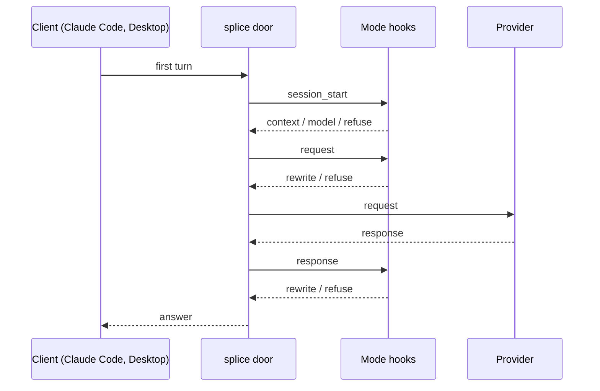

[README](../../README.md) · [Wiki Home](README.md)

# Splice Modes & Extensions

Extend what every session can do without touching the client: **modes** give the model tools splice answers and hook the door's moments, **capabilities** run your own work before a turn goes upstream, and **code mode** lets a ChatGPT model run a script of tool calls inside splice. Most of it is off until you switch it on; `ccd_session` and code mode are the exceptions.

[Modes](#modes) · [Install an external mode](#install-an-external-mode) · [Turning a mode on and off](#turning-a-mode-on-and-off) · [Door hooks](#door-hooks) · [Modes that ship](#modes-that-ship) · [Capabilities](#capabilities) · [Code mode for ChatGPT](#code-mode-for-chatgpt)

## Which extension do I want?

| You want to | Use |
| --- | --- |
| Give the model new tools, answered inside splice, on any provider | A door mode (`kind = "door"`) |
| Serve an MCP server (with optional MCP App pages) without running a process | An mcp mode (`kind = "mcp"`) |
| Add context to a session's first message, choose its model, rewrite requests or responses, or refuse a turn | A mode's [hooks](#door-hooks) |
| Run a policy check, reviewer or context gatherer before a session's first turn, as a service you write | A [capability](#capabilities) |
| Let a ChatGPT model batch tool calls in a script | [Code mode](#code-mode-for-chatgpt) (on by default) |

## Modes

A mode packages tools, guidance and the code that answers those tools. Built-in modes come from `modes/<name>/` and ship in Splice's JAR. To load a mode without rebuilding Splice, [declare its external JAR](#install-an-external-mode) in `splice.toml`.

| Kind | Who answers a call | What the client sees |
| --- | --- | --- |
| `door` (default) | splice, inside the turn | Nothing: the client never sees a door mode's call. Works on Anthropic, Chat Completions and Responses providers |
| `mcp` | The daemon itself, as an MCP server at `/mcp/<server>` on the control port (no process) | The mode's tools as ordinary MCP tools, and its pages in clients that draw MCP Apps |

The model sees each tool as `mcp__<server>__<tool>`. A mode's `prompt.md` is placed once per session, the same bytes on every request (for an mcp mode it is the server's `instructions`). A broken mode refuses boot with every finding listed at once, and `splice check-config` reads the same catalog.

```text
modes/<name>/
  mode.toml                the manifest
  prompt.md                optional: guidance for the model
  tools/<tool>.json        each tool's input schema ("type": "object")
  tools/<tool>.md          each tool's description, as the model reads it
  tools/<tool>.meta.json   optional: the tool's _meta, passed to the client untouched
  resources/               optional: an mcp mode's ui:// pages
  build.gradle.kts         plugins { id("splice.mode") }
  src/main/kotlin/         the handler, in package splice.modes.<name>
  src/test/kotlin/         the mode's tests
```

The manifest's keys, the handler contract (`splice.modes.api.Mode`, `ModeAnswer.Text` / `ModeAnswer.Error`, `ModeStore`, management routes under `/api/`) and the steps for adding a mode (copy `modes/template` or `modes/templateapp`, then `./gradlew :modes-<name>:test`) are in [`modes/README.md`](../../modes/README.md).

### An mcp mode

- **Where it is served:** the daemon answers `initialize`, `tools/list`, `tools/call`, `resources/list` and `resources/read` at `/mcp/<server>`.
- **How a client finds it:** every launch on a head where the mode is on for its caller gets one more `--mcp-config` file (for `claude` on the door, which runs no head, where the mode is on for every head for `door`), `~/.splice/state/own-mcp-<command>-<caller>.json`, or `own-mcp-door.json` for `claude` on the door (owner-only, with an MCP-scoped key). A caller on `[callers] off` gets none, nor does a caller the mode is not on for (a terminal's launch of `visual` while `splice.toml` says nothing), nor a launch that passes `--strict-mcp-config`, which asked for its own servers alone.
- **Timing:** a session already running when the mode is turned on sees it only on its next launch; turned off, the server stops answering at once.
- **Claude Desktop:** with Desktop on the gateway, a mode on for every head for `desktop` (by `splice.toml`'s `on`, else the manifest's `on` or `on_for`; no `[heads] only`, and no `"desktop"` on `[callers] off`) is listed in Desktop's `claude_desktop_config.json` as an entry naming splice's `desktop-mcp` bridge and the server, with no address or key; the bridge reaches the daemon with the MCP access key from the state folder. Splice updates that file at daemon start, at `splice desktop on` and when the mode is switched in the console or with `PUT /api/modes/<name>`, with no daemon restart, but Desktop reads it only when it starts: quit the whole app and reopen it.
- **Same name as one of yours:** a server of yours (imported, in `~/.claude.json`, the Temple's, in your usual Desktop's `claude_desktop_config.json`, or one you added to a gateway profile's, where every entry but splice's `desktop-mcp` bridge entry is yours) with the mode's server name keeps it everywhere: splice's `/mcp/<server>` answers yours, and no launch or Desktop configuration lists the mode. `splice status` and `GET /api/modes` (`server_taken`) say so. Rename yours to have the mode.
- **Who calls:** the mode is told the caller a request names: `door` for `claude` (on the door, or wrapped on the Claude head, whose entry also names that head), `head` for a head's own command, `desktop` for Claude Desktop, and a named caller is answered where the mode is on for it (`[callers] off` and `on_for` included). A request that names none, such as a host reading a page with the management key, is answered while the mode is on for any caller, and the mode is told no caller. The caller is the `X-Splice-Caller` header the client sends: any holder of the MCP access key can write any caller in it, so it grants nothing, and a mode must not decide anything that matters on it. `[callers] off` only chooses where the mode is offered.
- **Pages:** a tool whose `tools/<tool>.meta.json` says `{ "ui": { "resourceUri": "ui://<server>/<page>" } }` shows that page in clients that draw MCP Apps. Others show the tool's answer as any tool's result.

## Install an external mode

Add a `[[mods.jar]]` entry in `splice.toml` with a unique archive name, exactly one of `path` or `url`, and the trusted SHA-256 of the exact JAR. Replace the example hash with the publisher's trusted 64-digit hex digest. Relative paths start in `[mods].dir`, which defaults to `mods/` beside the configuration.

```toml
[[mods.jar]]
name = "inventory-release"
path = "inventory.jar"
sha256 = "0123456789abcdef0123456789abcdef0123456789abcdef0123456789abcdef"
```

Run `splice check-config`, then `splice restart`. Both instantiate the pinned code with the daemon account's permissions; pinning verifies the bytes, not their safety. Only configure JARs you trust. The archive name identifies the file; use the manifest's mode name in `[modes.<name>]`.

At boot, a verified URL JAR is [cached by hash](disk-and-privacy.md#settings-and-statistics). It is not auto-updated: to upgrade, change the pin and, if necessary, the URL, then restart. To stop loading the JAR, remove its entry and restart. See the [packaging, path and download requirements](../specs/server-mode.md#external-mode-jars) for details.

## Turning a mode on and off

The manifest's `on` and `on_for` are the default; `splice.toml` overrides them per mode:

```toml
[modes.tableapp]
on = true                  # every head and caller; false: none, Desktop included. heads wins for a head it names
heads = { kimi = false }   # per head; each must be a head splice.toml declares
```

For a mode, a head and a caller, in this order:

1. A head outside the manifest's non-empty `[heads] only`, or on its `[heads] off`, and a caller on the manifest's `[callers] off` (`door`, `head` or `desktop`), are never offered the mode; `splice.toml` cannot turn it on.
2. Otherwise `heads.<head>` decides, then `on`.
3. Otherwise the manifest's `on` decides, or, for a caller its `on_for` names, the mode is on.

So with nothing in `splice.toml`, `visual` (whose manifest says `on_for = ["desktop"]`) is on for Claude Desktop's own sessions and for no terminal's; `[modes.visual] on = true` turns it on for every session and `on = false` off for every one, except on a head that `heads` names, which keeps its own setting.

| Key in `[modes.<name>]` | Type | Rule |
| --- | --- | --- |
| `on` | boolean | Unset defers to the manifest |
| `heads` | inline table `{ <head> = true \| false }` | Each head must be one `splice.toml` declares |

Use `server_routes` and `server_admin_only` to [expose a mode on the team listener](team-server-mode.md#mode-routes). An unknown key or a table naming no loaded mode is a finding. Per-head switches key on declared heads; a provider served without a head of the same name follows only the every-head `on`.

| Where | What you can do |
| --- | --- |
| `splice setup` | Lists every mode with its state (`on`, `off`, or `on for Claude Desktop`), then asks "Turn on <mode>? <summary>" for each one that is off; a yes writes `on = true`. A mode on for Claude Desktop alone is not asked about; setup says where to have it in every session |
| `splice setup --update` | Offers the modes that are off and restarts a running daemon onto any you turn on |
| Console → Settings → **Modes** | One group per mode: its summary, how it is answered ("Answered inside Splice" or "MCP server"), the tools it adds, the callers it leaves out, its hooks, and an On/Off switch per command. A mode on for Claude Desktop alone (`visual`) also has an **Every session** switch: Default (on in Claude Desktop only), On (every session) or Off (none, Desktop included; a command switched On below keeps it), with a line saying what Claude Desktop and `claude` in a terminal get now; its per-command switches are the terminal's |
| `splice status` | One plain line per mode, read from the running daemon: the heads it is on for, and `for desktop` when it is on for Desktop while off for every head |
| `GET /api/modes` | Each mode's `name`, `summary`, `kind`, `server`, `prompt`, `tools`, `resources`, `hooks`, `callers_off`, `on_for`, `on` `{value, from}`, `heads` `{<head>: {on, from}}` and `callers` `{door, head, desktop: {on, from}}`, each caller's every-head value; `from` is `manifest`, `splice.toml`, `head` or `never` |
| `PUT /api/modes/{name}` | Body `{on?, heads?: {<head>: true \| false \| null}}`; `null` clears a key. The next request follows, no restart. 404 unknown mode, 400 bad body, 409 write refused, 503 when `splice.toml` can't be written |

Both routes take the management key and answer 503 before the daemon has loaded its modes.

## Door hooks

A mode may act at the door's moments, as Claude Code's hooks do inside Claude Code, whatever harness sends the turn and whatever provider answers it.

```toml
[hooks]
order = 10                 # among all modes' hooks of one moment; ties by mode name; default 0

[hooks.session_start]
timeout_s = 5              # 1 to 3600; default 30
on_failure = "closed"      # "open" (default): the turn goes on; "closed": it is refused

[hooks.request]
worker = { kind = "http", url = "http://127.0.0.1:9100/hook", auth_env = "HOOK_KEY" }
```

| Moment | When | Answers it takes |
| --- | --- | --- |
| `session_start` | A session's first turn | `context` (add text at the end of the first user message), `model` (choose the model its turns run on), `refuse` |
| `before_tool_call` | Before a harness or mode tool call runs | `rewrite` (its input), `refuse` |
| `after_tool_call` | After a harness or mode tool call finishes | `replace` (its text result), `refuse` |
| `on_stop` | The model stops without calling a tool | `continue` (a follow-up message), `replace` (the final text), `refuse` |
| `request` | The whole request, on its way to the provider | `rewrite` (replace it), `refuse` |
| `response` | The whole response, on its way back to the client | `rewrite` (its content), `refuse` |

Every moment also takes `pass`. A manifest naming any other moment is a finding.



- **Who answers.** Without a `worker`, the mode's handler answers in-process and implements `ModeHooks` (`hook(call)`, `Pass` by default). `worker.kind = "http"` posts the call as JSON and reads an HTTP 200 JSONL response; `auth_env` names a variable whose key is sent as `Authorization: Bearer`. `worker.kind = "mcp"` (with `server` and `tool`) calls a tool the MCP hub serves.
- **The wire.** Out-of-process workers receive `moment`, `session` and `body`. An MCP tool returns `{"answer":"pass"}` in its result text, or `context` / `model` / `refuse` / `rewrite` / `replace` / `continue` with `text`, `model`, `reason` or `body`. An HTTP worker puts that same JSON answer in the `text` field of a `result` line:

  ```json
  {"type":"result","text":"{\"answer\":\"pass\"}"}
  ```

  Malformed outer JSONL lines are worker failures governed by `on_failure`. Unreadable inner answer text is treated as `pass`; an answer its moment doesn't take is logged and ignored.
- **Time and failure.** Each hook has its own time limit. One that errs or runs out of time lets the turn go on and says so in splice's log, unless `on_failure = "closed"`.
- **Order.** Every mode's hooks of one moment run in `order`, ties by mode name. Each mode's switches turn its hooks off with it.
- **Kept.** What a session-start hook adds or chooses is recorded before the turn goes upstream and placed again byte for byte on every later request of the session, so the prompt cache keeps hitting. A compaction that replaces the first message ends it.
- **What it is not.** A request hook shapes what the provider sees; it cannot run a tool for the harness, which still runs its own tools with its own permissions.

## Modes that ship

| Mode (folder) | Server | Kind | Default | Callers left out | Tools |
| --- | --- | --- | --- | --- | --- |
| `ccdsession` | `ccd_session` | door | **on** | `desktop` | `spawn_task`, `dismiss_task`, `mark_chapter` |
| `tableapp` | `tableapp` | mcp | off | none | `render_table` (page `ui://tableapp/table`) |
| `template` | `template` | door | off | `desktop` | `say_back` |
| `templateapp` | `templateapp` | mcp | off | none | `show_note` (page `ui://templateapp/note`) |
| `visual` | `visual` | mcp | **on** for `desktop` | none | `read_me`, `show_widget`, `html_render` (page `ui://visual/reply.html`) |

`template` and `templateapp` are working examples to copy, not features; `splice setup` does not offer them.

### `ccd_session`: suggested tasks and chapters

On by default for door and head sessions, not for Claude Desktop's own sessions. The model can:

- queue an out-of-scope follow-up as a suggested task (`mcp__ccd_session__spawn_task`) without interrupting its work,
- withdraw one that is no longer relevant (`dismiss_task`),
- mark a chapter boundary when the session shifts into a new phase (`mark_chapter`).

The console's Sessions page shows suggested tasks as chips you can start in a new session, run in this session, or dismiss, and shows chapters in its rail. See [Suggested tasks and chapters](console-and-sessions.md#suggested-tasks-and-chapters).

| Route (management key) | What it does |
| --- | --- |
| `GET /api/suggested-tasks` | List suggested tasks |
| `POST /api/suggested-tasks/{task_id}/claim` | Claim one (body such as `{"surface": "console"}`) |
| `POST /api/suggested-tasks/{task_id}/resolve` | Record its `outcome`: `started` (with `session_id`), `here`, `dismissed` or `released` |
| `GET /api/chapters` | List chapters |

To turn it off (the table key is the folder name, not the server name):

```toml
[modes.ccdsession]
on = false
```

### `tableapp`

An mcp mode, off by default. `render_table` turns a Markdown pipe table into a sortable table page beside the conversation in clients that draw MCP Apps, and returns a clean plain-text table otherwise. Turn it on with `[modes.tableapp] on = true`.

### `visual`

An mcp mode that lets the model draw in the conversation, as its reply or in the middle of it. On by default for Claude Desktop's own sessions, which draw MCP Apps; not offered to a terminal's, which draw nothing. `[modes.visual] on = true` turns it on for every session (for a machine whose app draws from a session's transcript), and `on = false` turns it off everywhere, Desktop included.

- `read_me` gives the guidance on call, so it costs nothing until the model asks: when a visual beats text and when it does not, the rules every visual keeps (the host's theme variables, no network, a fluid width), and one module per kind of visual: `chart`, `comparison`, `diagram`, `diff`, `explainer`, `tool`, `page`. `modules` picks some; without it, every one comes back. The mode's `prompt.md` is one line that names the tools and says to call `read_me` first.
- `show_widget` takes `title`, optional `loading_messages`, and `widget_code`, an HTML or SVG fragment of at most 256 KiB.
- `html_render` takes `title`, `html`, a whole document of at most 256 KiB, and optional `height` (1 to 10000 CSS pixels). The mode keeps the page, and its answer names it as `vp_` and twelve hex digits. It takes the page as `html` only: a call naming `path` is refused, because the daemon may serve other machines and an mcp mode's call carries neither the session's folder nor who is calling, so a file read on the model's word could not be held to what that caller may read.
- Both drawing tools name one view, `ui://visual/reply.html`, so every host that draws MCP Apps draws them the same way. The view loads nothing from any origin and its `_meta.ui.csp` allows none, so a visual's own code reaches no network either. Both declare `_meta.ui.visibility = ["model"]`, so a host that follows MCP Apps refuses a drawn visual's own call of them; the mode cannot tell such a call from the model's when a host passes it on. A client that does not draw MCP Apps shows the tool's answer, which says what was drawn and asks the model to say it in words.
- Kept pages survive a restart and have no expiry by age: at most 200 pages, the 201st taking the oldest's place. See [Disk and privacy](disk-and-privacy.md).

| Route (management key) | What it answers |
| --- | --- |
| `GET /api/visual/view?uri=<ui://…>` | `{ html, meta }`: a view the mode declares, as `resources/read` gives it, `meta` its `_meta`; 404 for a view it does not have |
| `GET /api/visual/pages/<vp_…>` | `{ html, title, height }`, `height` only when the call gave one; 404 for a page it does not keep |

## Capabilities

A capability is work splice runs for a session before its first turn goes upstream: a policy check, a reviewer, a helper that gathers context. Its worker is an HTTP service you write, a tool of an MCP server, or the Context Getter that ships with splice. What it returns goes into the session's first user message. Each one is its own table in `splice.toml`:

```toml
[capabilities.policy]
heads = ["claude"]                 # the heads it is on for; absent or empty, it is declared and off
call = "rule"                      # splice calls it, by the rule in `when`
when = { turn = "first", thread = "main", mode = "interactive" }
place = "first-user-message"       # or "none" for one that only lets a turn pass or refuses it
may = "add"                        # "add", "refuse" or "add-or-refuse"
message = "Checking the request"   # what the held turn says while it starts
color = "cyan"
timeout_s = 60                     # 1 to 3600
on_failure = "open"                # "open": the turn goes on as today; "closed": the turn is refused
send = ["first_user_message", "folder", "model"]   # also "head"; the worker gets nothing else
worker = { kind = "http", url = "http://127.0.0.1:9000/check", auth_env = "POLICY_WORKER_KEY" }
```

| `when` key | Values | Default |
| --- | --- | --- |
| `turn` | `"first"`, `"any"` | `"first"` |
| `thread` | `"main"`, `"subagent"`, `"any"` | `"main"` |
| `mode` | `"interactive"`, `"print"`, `"any"` | `"interactive"` |
| `models` | Model ids it runs for | Every model |

splice never calls a capability for a side request without tools, for Claude Code's auto-mode review, or for a session first seen mid-conversation. Where two capabilities match a request, they run one at a time, in the order `splice.toml` declares them.

### The worker's wire

While a capability works, the turn is held: Claude Code shows a live turn, and nothing goes to the provider until the work is done. splice posts the worker one JSON object, with `Authorization: Bearer <key>` when `auth_env` names an environment variable holding its key, and never a session's or a provider's credentials:

```json
{"capability": "policy", "session": "<session id>", "turn": "<turn id>",
 "fields": {"first_user_message": "…", "folder": "/home/me/project", "model": "astra-large"}}
```

The worker answers 200 with JSON lines: any number of `{"type": "progress", "message": "…"}`, then one `{"type": "result", "text": "…"}` or one `{"type": "refusal", "reason": "…"}`.

| Outcome | What happens |
| --- | --- |
| `result` | Its text is added as a block of its own at the end of the session's first user message, after your words. The same bytes ride on every later request, so the prompt cache keeps hitting; the worker is not asked again |
| `refusal` | Ends the turn with the worker's reason, from a capability whose `may` allows it |
| Worker fails or passes `timeout_s` | `on_failure = "open"`: the turn goes on as today. `"closed"`: it is refused, naming the capability |
| Turn over its budget | Refused before the worker is called |

### The status line while a turn is held

The session's status line leads with what the capability is doing, in its `color`, and how long ago it said so: `Checking the request · 4s ago`, then the model's name. The capability's `message` comes first; each progress line the worker sends takes its place, its age starting again. A message that keeps changing reads as working; one whose age keeps growing reads as stuck. With two turns of the session held (a subagent's beside the main thread's), the line adds `· 2 turns`. A turn waiting on a usage limit says so in the same place. When no turn is held the line is as it always is, and no other session's line changes.

### Checking, listing, switching off

- A declaration splice cannot read stops the daemon from starting, with every finding listed at once and none quoting a value that could be a secret. `splice check-config` runs the same check.
- `splice status` lists each declared capability with the heads it is on for (`off` when none) and its worker.
- With none declared, splice says nothing of capabilities and sends every request as it does today.
- Switching a capability off stops new calls; a session that already carries its text keeps it.

### The model can call a capability

With `call = "agent"` (or `"both"`) and a `tool = { name, description, input }` table, a capability is offered as a tool after Claude Code's own, on a head that passes Anthropic's Messages through. Claude Code never sees that call: splice holds the turn, asks the worker with the call's input, gives the model the worker's text as the call's result, and streams the answer on as the rest of the same message. splice keeps each call and puts it back on the session's later requests, so the provider sees the conversation it produced.

### An MCP tool as the worker

`worker = { kind = "mcp", server = "<server>", tool = "<tool>" }` calls a tool of an MCP server the hub runs, with the fields `send` names (and `input`, for a call the model made) as its arguments. splice finds the server the way the hub would for the session's folder, and starts it there for the call when nothing hosts it yet. The server's progress notifications are the held turn's messages, and its text content is the result. See [MCP hub and sync](mcp-hub-and-sync.md).

### The Context Getter

One capability ships with splice, off until you switch it on for a head. It gathers what another agent needs to start on the session's first message (the files that matter, with paths and line ranges, how the project builds and tests, and what its instructions say) and places it in that message:

```toml
[capabilities.context-getter]
heads = ["claude"]
worker = { kind = "builtin", name = "context-getter" }   # model = "<id>" picks its model
```

It runs a Claude Code session in print mode, in the session's folder, on the head's fast model at that model's own effort. The held turn says `Exploring files with <model>` and then each step it takes. It stops at 180 s unless `timeout_s` says otherwise, and the turn goes on without it when it stops early or cannot run.

The full design is [`docs/specs/harness.md`](../specs/harness.md); every key is in the [Configuration Reference](configuration-reference.md#modes-and-capabilities).

## Code mode for ChatGPT

Code mode lets a ChatGPT model write one script that makes many tool calls, which splice runs itself. It is **on by default** for Claudex-compatible providers (`auth.kind = "chatgpt-oauth"`, `dialect = "openai-responses"`), including custom head names, and exclusive to them. To turn it off, in the provider's existing quirks section:

```toml
[providers.codex.quirks]
code_mode = false # true or omitted enables both runner and guidance on Claudex-shaped providers
```

Every head using that provider shares the setting, and it is read only when the daemon boots: finish ongoing work, edit the TOML, then run `splice restart` for a **full daemon restart**. A head restart alone does not reload TOML. Pending JavaScript execution cannot survive a daemon restart, and splice never reruns lost source automatically.

### What the session sees

The script runs inside splice and never reaches Claude Code. The session shows the model's reasoning summaries and each tool call the script makes, never the program. Every real operation runs through Claude Code's permission-checked client handlers.

When on, an eligible turn declares `exec`, with hosted tools other than tool search beside it, the way Codex does for a model its catalog runs code-mode-only. `exec` is splice's bundled JavaScript runner: its description lists every fully declared tool as a TypeScript declaration, with deferred tools named in `ALL_TOOLS`, called in a script as `await tools.Read({...})`. Orchestration guidance is appended to the caller's instructions.

### Which models

| Source | Effect |
| --- | --- |
| Models the Codex backend marks `tool_mode = "code_mode_only"` in its model list | Eligible. splice reads the list at start, keeps it for the next start, and checks the current roster on every turn, so a model the backend adds needs no edit |
| `code_mode_models` in the same quirks section | Adds ids; the only way to name a model the backend hides from its list, such as `codex-auto-review` |
| No list known at start (no answer and none kept) | Only `code_mode_models` runs code mode, and the head's log says so once |

Toolless turns and forced named-tool choices keep the ordinary path. A compaction is built exactly like the turn before it, so its prompt cache still hits.

### How a script runs

- A script starts once its complete tool item arrives (`response.output_item.done`), as in Codex. It does not wait for the response terminal, and incomplete source never executes. Tool callbacks can reach Claude Code while the upstream reader is still collecting the response's final status and usage.
- A later stream failure keeps the completed item and accepted callback results; recovery continues from that evidence rather than running the same source again.
- `Promise.all` and `Promise.allSettled` dispatch as one batch only when every element is a direct call on the `tools` object with no spread, at most eight calls to a batch.
- A failing cell reports why (the rejected tool's error text, or a syntax error's position) with whatever it logged before failing.
- Logged text past the log budget ends with a `[truncated N chars]` marker; returned text past 64 KiB is cut with no marker. Neither fails the cell.
- A single tool result larger than the runner's 64 KiB text frame is truncated at admission behind a `[truncated N chars]` marker and the turn completes. Only its text is cut: an image in it reaches the model whole, with the MIME type and base64 Claude Code sent, in the script's output and on every later turn.

### Runtime: hosts and engines

The runner needs no Codex or Node installation because it runs inside splice; the launch shim is plain `sh` and `curl`, so no Node is needed anywhere.

- Each script has an independent GraalJS context with no guest host or file access.
- Scripts with the same persisted session, conversation and model key share one engine, isolate, guest heap and collector; another key gets its own.
- Hosts start only when a cell is admitted. A new session goes to the fullest existing host with a free slot, up to four engines, before another host starts, subject to the host and memory caps. It stays pinned there. An emptied host drains, and its JVM exits after the idle time.
- A host JVM starts with a 16 MiB heap that grows on demand up to its configured heap.

The provider's quirks set the head's host and memory admission limits:

| Setting | Default | What it limits |
| --- | --- | --- |
| `code_mode_workers` | 6 | On-demand host JVMs per head |
| `code_mode_heap` | 512 MiB | Each host JVM's heap; each session's guest heap is 384 MiB at this default |
| `code_mode_memory_mb` | 24576 MiB | The head-wide admission reservation, not an operating-system resident-memory limit |

The reservation includes doubled heap allowances and native reserves. At the default heap size, each host reserves 1152 MiB and each session engine reserves 832 MiB. Six host reservations and 21 engines reserve 24384 MiB; retaining a 22nd engine would need 25216 MiB, over the default budget. Admission fills existing hosts to four engines before reserving another host. When no empty engine can be reclaimed, admission refuses before dispatch: the refusal names the memory budget, host cap, engines-per-host cap and both admission settings in the script's interrupted tool output, and the turn continues rather than returning an HTTP 502. Capacity pressure reclaims only known-dead sessions or unknown sessions past their 5-minute lease; live and fresh-unknown parked cells keep their pending calls resumable.

For a 40–50 session sizing profile, these provider overrides admit 50 engines under the current reservation model; they do not change the defaults:

```toml
[providers.codex.quirks]
code_mode_workers = 32
code_mode_heap = 256
code_mode_memory_mb = 32768
```

At a 256 MiB host heap, each host reserves 640 MiB and each guest engine reserves 448 MiB. Packing 50 engines uses 13 host reservations and 50 engine reservations (30,720 MiB total), within the 32,768 MiB budget. This is an accounting profile; it is not a measured runtime guarantee.

### When engines and cells close

- An engine closes on explicit session close, whole-session state expiry, or session death after its last active record. Empty engines are eligible for idle eviction after one minute, and admission reclaims the least-recently-used empty engine first.
- Silence alone never reclaims a parked live cell. If a host dies, only its pinned cells fail; their next cells use a fresh host in the same slot, and lost source is not rerun.
- Parked script contexts hold no permit or thread, but their session's engine still counts toward the head's admission limits. Known-dead sessions are reclaimed on the next sweep, and unknown sessions after 5 minutes idle, by the sweep or, oldest first, by a full pool.
- A session is unknown when the Claude Code registry does not list it: every subagent and headless client and every ended session. A listed session idle at its prompt leases its parked cells the same way, from the last moment it was seen at work, because it cannot be running the calls they wait on; a busy, waiting or shell session keeps them however long it is quiet.
- Known-alive and fresh-unknown parked cells remain resumable under capacity pressure, and known-live persisted records remain protected from stored-byte eviction.
- A capacity refusal becomes an exec result asking the model to retry after a running script finishes. A closed script is never rerun; its evidence (results so far, unresolved calls, the reason) is what the model sees. That evidence is bounded only by the output ceiling of 1,048,576 characters; past it, each result is cut to an equal share behind a `[truncated N chars]` marker rather than the turn failing.
- An admitted script's failure that no retry can change ends the turn with a readable line (the warning mark and `splice`, then a bracketed code and the reason) instead of an API error, so the failure stays visible without starting an identical retry.

### Interrupted and unmatched scripts

When a streamed exec call is interrupted, replayed history uses its admitted source prefix and completed-call evidence rather than an uncertified raw input. The original retained call is not rewritten, and replaying history never reruns JavaScript. The daemon logs structural interruption causes without copying source text or upstream message text into that diagnostic.

If splice can no longer match a completed script to the conversation (the record aged out, the session switched model, the conversation moved underneath a running script), it sends the client's own history upstream instead, where the script's client calls are ordinary tool calls, and logs one `[code-mode]` line for the head. The conversation continues; only that script's batching is lost from the model's view.

## Related pages

- [MCP hub and sync](mcp-hub-and-sync.md): the hub that serves mcp modes and MCP workers
- [Console and sessions](console-and-sessions.md): Settings → Modes, and suggested tasks and chapters on Sessions
- [Providers and accounts](providers-and-accounts.md#code-mode-and-capabilities): which providers get code mode
- [Configuration reference](configuration-reference.md#modes-and-capabilities): every `[modes]`, `[capabilities]` and quirk key
- [The Door, Launchers & Terminal Profiles](door-and-launchers.md): the door these hooks act on
- [Architecture and troubleshooting](architecture-and-troubleshooting.md)
- Mode authoring: [`modes/README.md`](../../modes/README.md); capability design: [`docs/specs/harness.md`](../specs/harness.md)
