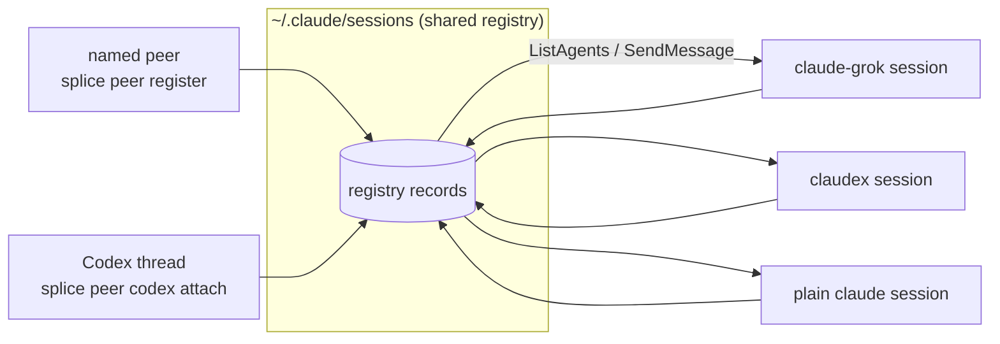

[README](../../README.md) · [Wiki Home](README.md)

# Peer Messaging, Multi-Harness Catalog & LAN Sharing

Sessions on different models can message each other, and so can Codex threads, scripts and bots you register as peers. This page covers how they find each other, how teams bind sessions to roles, the harness catalog Claude Desktop and MCP sync share, and sharing one machine's door with your others.

[Heads that see each other](#heads-that-see-each-other) · [Teams](#teams) · [Named peers](#named-peers) · [Codex threads](#a-codex-thread-as-a-peer) · [Harness catalog](#the-harness-catalog) · [LAN sharing](#share-a-door-on-your-lan)

## Who can talk to whom

| Participant | Seen in `ListAgents` as | How it joins |
| --- | --- | --- |
| A Claude Code session on any splice head, the door, or plain `claude` | Its session name | Automatically, through the shared `~/.claude/sessions` registry |
| A named peer (a bot, a script, another agent harness) | The name you registered | `splice peer register <name>` |
| A native Codex conversation | `codex-<thread id>` | `splice peer codex attach`, usually from Codex's hooks |



## Heads that see each other

Ask a session on one backend to get a review from a session on another. Both appear in Claude Code's `ListAgents`, and `SendMessage` carries the request and the reply. This works across splice heads and plain `claude` sessions on the same machine.

Claude Code discovers peers through a `sessions` directory. Each head has its own config folder, which would hide the other heads' sessions, so on the first launch of each head splice links that head's `sessions` directory to the shared registry under `~/.claude/sessions`, creating the registry if plain `claude` has never run.

There is nothing to configure:

| To | Do this |
| --- | --- |
| Share sessions across heads (the default) | Nothing; `sessions` is in the default `[claude].share` list |
| Wall one head off | Put `sessions` in that head's `isolate` list |
| Turn the feature off everywhere | Remove `sessions` from `[claude].share` |

Release tests check this on a clean install.

### Transcripts and resuming across heads

Transcripts are shared the same way: `projects` is in the default `share` list, so `-r` and the resume picker on any head see the sessions every head wrote.

| You run | What happens |
| --- | --- |
| `-c` | Stays with its head: resumes the newest session that head started or resumed in the folder. When there is none, it starts a new session and says so, instead of picking up another head's |
| `-r <id>` of a session another head wrote, whose replies name a model this head does not serve | Goes on as a copy under a new id, with the copy's replies moved onto this head's model. The original stays as its head wrote it, and the launch names the new id |
| Pick a session from the picker, or `/resume` inside Claude Code | Picked before splice sees it, so splice moves that session onto the head's model in place, after keeping its original |
| `-r` on a head with `isolate = ["projects"]` | That head keeps its own transcripts; `-r` of another head's session copies it in under the same id |

## Teams

A team gives each session a role, a goal and instructions, and tells it where to reach the lead. Create one with `PUT /api/teams` on the control plane: give it a repo, a goal and role slots, each with a role, a head, its own instructions and a session.

- On its next turn through splice, a session bound to an active team gets its role, the team goal, the slot's instructions and where to reach the lead.
- A slot marked to join by rule (`bind_by_rule`) takes the next session started on its head inside the team's repo while the slot has no running session, so a member joins without being bound by hand.
- The teams API reports each slot's role, head, model, account, instructions, bound session and earlier sessions, plus the team's hand-offs and sampled activity for a day.
- `GET /api/teams/{id}/economics` aggregates turns, tokens and estimated dollars at API rates per slot, and each slot's turns and tokens in the last 5 hours and 7 days on each plan account it used.
- A plain `claude` session can hold a slot, but its own messages don't pass through splice, so the teams API shows only what it receives.

Sessions that bind by rule tell splice where they started from a hook:

| Client | Hook | Route |
| --- | --- | --- |
| Claude Code on the door | `splice-door-start-hook.sh` (SessionStart `startup`), staged at each door launch under `~/.splice/state/door-login/` | `POST /hooks/resume/door` |
| A Claude Desktop Code-tab session on Antigravity (ACP) | Sent by the ACP bridge when a session starts; foreground tool activity also goes to `POST /hooks/foreground/door` | `POST /hooks/resume/door` |

The console's Teams page shows teams grouped by project. Other team routes (archive, restore, end, slot start/stop, chat, activity) are in the [CLI reference](cli-reference.md#local-daemon-control-and-console).

## Named peers

A peer is a name you register with splice. Every Claude Code session on this machine sees it in `ListAgents` and can `SendMessage` to it, though no Claude Code session runs behind it. The peer keeps what it receives in a local journal, can push each message to a webhook, and can send to any session or peer under its own name.

Nothing runs until you register a peer: no listener, socket, process, file or registry entry. One `peer-host` process serves every peer and leaves 10 s after its last peer ends.

```bash
splice peer register gary                          # prints its name, session id, key file path and socket; never the key
splice peer inbox --as gary --follow               # read what it receives, polling every 2 s
splice peer send --as gary walk-a "reply with the word PONG"
splice peer status --as gary <msgId>               # the send's outcome and any receipt
splice peer list                                   # each peer: running, pid, send scope, webhook host, unread count
splice peer revoke gary                            # stop it; add --purge to delete its journal too
```

| Rule | Value |
| --- | --- |
| Name | 2 to 32 characters: a lowercase letter, then lowercase letters, digits or `-` |
| Reserved names | `system`, `user`, `operator`, `human`, `assistant`, `claude`, `anthropic`, `splice`, `splice-console`, plus any you list in `[daemon] reserved_peer_names` |
| Peers per user | 16 registered by hand (Codex threads are counted apart, at most 64) |
| Text size | At most 32,768 bytes |
| Send rate | A burst of 20, then 60 a minute; `splice peer limit <name> <per-minute> <burst>` sets 1–600 and 1–100 |
| Key file | `<settings dir>/peers/<name>/peer.key`, mode 0600 |

```toml
[daemon]
reserved_peer_names = ["inbox"]   # each must itself be a peer name, or boot refuses; read at the daemon's start
```

Register options: `--cwd DIR` (the working directory the registry record shows; default your home folder), `--send-to A,B,…` (who it may send to; default anyone), `--owner PID` (bind it to a running process so it ends with that process). Registration beneath a running `codex` or `claude` binds to that ancestor automatically. Register is safe to run every time a program starts: a repeat answers the same peer and key.

For scripts, `SPLICE_PEER_KEY_FILE=<path>` replaces `--as`; the key goes as a bearer header and never appears on the command line or in output.

`check: registered` on an inbox record means the sender's address names a live session or peer, not which process wrote the bytes. The trust boundary is your Unix user. Webhook signing, idempotent sends with `--id`, receipts, exit codes and the storage layout are in [`docs/peers.md`](../peers.md).

## A Codex thread as a peer

A native Codex conversation can be a peer too. Every Claude Code session then sees it as `codex-<thread id>`, and a message sent to it arrives in the conversation as a turn. The thread answers with `splice peer send`, which inside the conversation acts as its Codex peer without `--as`.

```bash
splice peer codex attach                                   # the current thread
splice peer codex attach <thread id> --peer-name research --codex-home ~/.codex --cwd ~/work
splice peer codex detach                                   # revoke it; --purge deletes its journal
```

### Codex hooks: installed and migrated by setup

Codex reaches splice through three hooks in `~/.codex/hooks.json` (or `$CODEX_HOME/hooks.json`). splice can write them for you:

| Event | Command | Timeout |
| --- | --- | --- |
| `SessionStart` | `splice peer codex attach` | 30 |
| `UserPromptSubmit` | `splice peer codex attach` | 30 |
| `SessionEnd` | `splice peer codex detach` | 3 (as long as Codex lets that event run) |

No `matcher` on any of them, so SessionStart runs for `startup`, `resume`, `clear`, `compact` and `fork`.

- **Where it's offered:** only inside `splice setup` (on a terminal with Codex installed; install defaults No, migration defaults Yes) and `splice setup --update`. There is no command of its own for installing or migrating the hooks.
- **What counts as needing migration:** entries that wrap the call in `sh -c '… jq …'` (which eats stdin, so the hook loses `cwd`), a SessionEnd timeout other than 3, a matcher on splice's hook, duplicate splice entries, or a missing event.
- **What migration does:** rewrites them to direct `splice peer codex attach|detach`, keeping a custom binary path and flags, stripping redirects and `$var` / `$(…)` placeholders, keeping your other hooks and handler fields, following a symlinked file, and backing up to `hooks.json.bak` (0600). A file splice can't read or parse is never overwritten.
- **`splice doctor`** has a `codex peer hooks` row: OK when current, INFO when missing, WARN when it needs migration, with the fix `splice setup --update`.

Hooks that already match [`docs/peers.md`](../peers.md#a-codex-thread-as-a-peer) are reported current. A hook writes nothing to stdout and never exits 2, so it never blocks a Codex turn.

There is no separate peer-hook migration for Claude Code: the door's own hooks (`/login`, `/fast`, `/ultrafast` and the session-start hook above) are written fresh at each door launch. See [The Door, Launchers & Terminal Profiles](door-and-launchers.md#sign-in-and-speed-commands).

## The harness catalog

A harness is the program a session runs in. splice keeps one validated catalog of them, shared by Claude Desktop's harness map and by [MCP sync](mcp-hub-and-sync.md#sync-to-other-harnesses), so the registry, the CLI and Desktop agree on names.

| Harness | Desktop-map id | MCP sync name | What it is |
| --- | --- | --- | --- |
| Claude Code (Splice) | `claude-code` | `claude` | Claude Code started through splice's gateway, on the model the session picked |
| Codex CLI | `codex` | `codex` | OpenAI's Codex CLI, started by a session launcher that reads splice's harness map |
| Antigravity | `antigravity` | `agy` | Google's `agy`, started through `splice desktop acp` in place of Claude Code |

To list another **local** ACP program, declare it in `splice.toml`, not through the console:

```toml
[harnesses.local-agent]
name = "Local ACP agent"
description = "Optional description for launchers"
protocol = "acp"
argv = ["/path/to/agent", "--acp"]
```

| Key | Rule |
| --- | --- |
| id (`local-agent`) | A lowercase letter, then lowercase letters, digits or hyphens; cannot replace a shipped id |
| `name` | Required, nonblank |
| `description` | Optional; default `""` |
| `protocol` | Must be `"acp"` |
| `argv` | An absolute executable path, then separate arguments; no shell. Keep credentials out of it |

An invalid table refuses boot, with every finding listed. A declared harness is listed in the Desktop map only: it routes no models, adds no console routing choice and registers no peer. Which program runs each Desktop model family is chosen in Settings → **Desktop harnesses**; see [Choose a Desktop harness](claude-desktop.md#choose-a-desktop-harness).

## Share a door on your LAN

One machine can put its door on your LAN so your other machines run Claude Code on its logins. A machine shares its door **as a whole**: no single command, login or model list.

```bash
splice share on                          # on the machine with the logins: opens port 3097 and prints the add line
splice remote add http://devbox.lan:3097 # on another of your machines
claude
```

| Fact | Detail |
| --- | --- |
| What the second machine keeps | One `[remote.claude]` line in its `splice.toml`; no login, key, token or copy of the models |
| Who is answered | Private and link-local addresses, an IPv6 address on one of the machine's own /64s, and peers on its tailnet; the `Host` must name the machine, and browser pages are refused |
| Encryption | None: prompts and replies cross the LAN unencrypted. Turn sharing on only on a network you trust |
| Refused at add time | An address naming one command, or one with `?auth=` or `?models=` |
| Beside a team server | A daemon runs share mode or [server mode](team-server-mode.md), never both |

The full walkthrough, `--as`, `splice remote` and the first-build migration are on [Use one machine's door from another](door-and-launchers.md#use-one-machines-door-from-another). Design history: [`docs/specs/lan-share.md`](../specs/lan-share.md) (superseded by [`docs/specs/door-network.md`](../specs/door-network.md)).

## Related pages

- [The Door, Launchers & Terminal Profiles](door-and-launchers.md): door hooks and LAN sharing in full
- [MCP hub and sync](mcp-hub-and-sync.md): syncing MCP servers to Codex, agy and Desktop
- [Claude Desktop](claude-desktop.md): Desktop harness routing and Antigravity
- [Team server mode](team-server-mode.md): serving a team by key instead of a LAN
- [Console and sessions](console-and-sessions.md): the Sessions and Teams pages
- [CLI reference](cli-reference.md#peer-messaging): every `splice peer` verb
- [Configuration reference](configuration-reference.md#door-launch-profiles-local-harnesses-and-lan-sharing)
- Specs: [`docs/peers.md`](../peers.md), [`docs/specs/peer-messaging.md`](../specs/peer-messaging.md)
