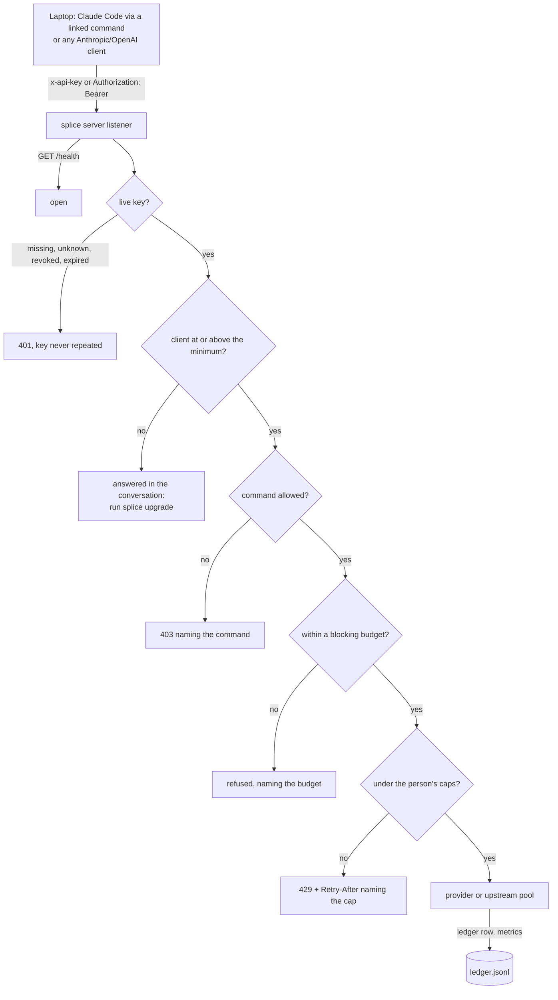
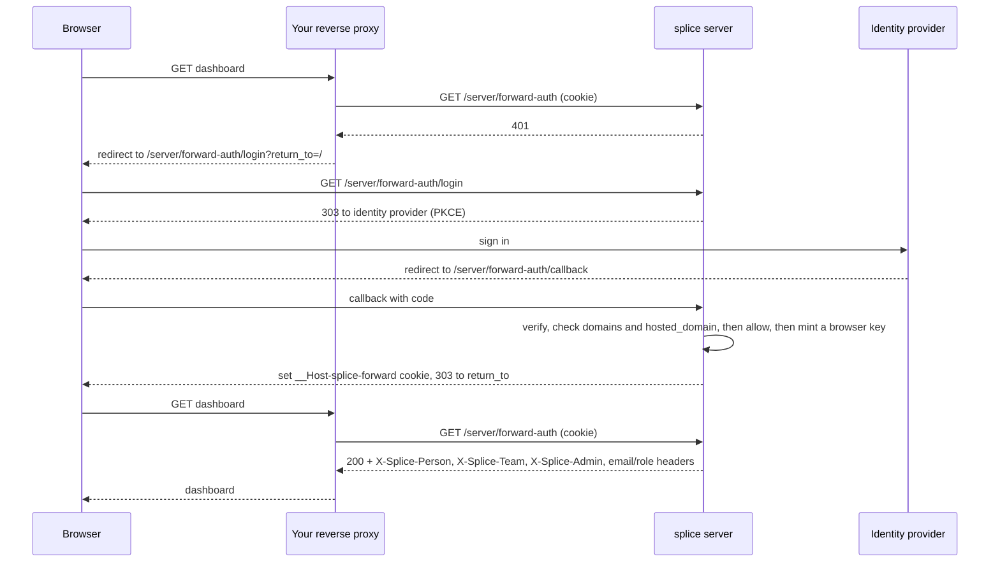

[README](../../README.md) · [Wiki Home](README.md)

# Team Server Mode, Identity & Observability

Serve a team's models from one machine: give splice a `[server]` table and it serves the commands you list on an address of its own, to anyone holding a key it issued, and to nobody else. This page covers keys and sign-in, caps and budgets, the team door, the dashboard auth check, client distribution, audit and backups, and the telemetry, metrics and cost meters an operator reads.

[Configure](#configure-a-server) · [Keys](#give-each-person-a-key) · [Sign-in](#sign-in-with-your-identity-provider) · [Laptops](#the-laptop-side) · [Team door](#the-team-door) · [Dashboards](#forward-auth-for-your-dashboards) · [Upstreams](#several-model-servers-behind-one-provider) · [OpenAI clients](#openai-compatible-clients) · [Operations](#operations-audit-backups-and-the-console) · [Observability](#observability)

Sharing (`splice share`) is for your own machines on one LAN; a server is for a team. A daemon runs one or the other, never both. See [Share a door on your LAN](peers-and-harnesses.md#share-a-door-on-your-lan).

## How a request is admitted



## Configure a server

```toml
[server]
listen = "0.0.0.0:3443"
commands = ["claude-team"]
tls_cert = "/etc/splice/tls/fullchain.pem"   # both, or neither when a proxy in front of it speaks TLS
tls_key = "/etc/splice/tls/privkey.pem"
trusted_proxies = ["192.0.2.10"]             # replace with your proxy's address; omit without a proxy
admins = ["ops@team.example"]
keepalive_seconds = 10                       # keeps a streamed turn's connection alive through a long prefill

[server.limits]
inflight_per_person = 3                      # 0, or no line, is no cap
rpm_per_person = 30
tpm_per_person = 200000                       # tokens of a person's turns that ended in the last minute
inflight_total = 8                           # the whole server's turns in flight at once

[server.client]
minimum = "0.6.0"                            # an older splice is told, in the conversation, to run `splice upgrade`

[server.telemetry]
forward_to = "http://otel.team.example:4318" # your OTLP/HTTP collector; each person's Claude Code telemetry goes there
```

| `[server]` key | Default | Meaning |
| --- | --- | --- |
| `listen` | `""` (off) | `host:port`; there is no implicit port |
| `commands` | empty | What key holders may use: a head's command or a provider key |
| `tls_cert`, `tls_key` | unset | PEM certificate chain and unencrypted PKCS#8 PEM private key, both or neither; relative to the config folder |
| `trusted_proxies` | empty | Addresses or CIDRs whose `X-Forwarded-*` headers are trusted |
| `admins` | empty | Admin emails |
| `admin_cidrs` | empty (unrestricted) | Where admin routes may be reached from ([below](#admin-addresses-and-the-audit-log)) |
| `keepalive_seconds` | 0 | SSE keepalive for streamed turns ([below](#keepalive-through-a-long-prefill)) |
| `key_prefix` | `spk_` | The mark on newly minted keys ([below](#key-format-and-import)) |
| `metrics_prefix` | `splice_server_` | Prefix of every Prometheus series ([below](#prometheus-metrics)) |

Every key, including `[server.limits]`, `[server.budgets]`, `[server.teams]`, `[server.reference]` and `[server.export]`, is in the [Configuration Reference](configuration-reference.md#server-mode).

If your existing key is in another format, convert it to an unencrypted PKCS#8 PEM in a new, owner-only file, then point `tls_key` at that file:

```bash
(umask 077; openssl pkcs8 -topk8 -nocrypt -in original.pem -out splice-key.pem)
```

### What refuses to start

splice refuses to start a server:

- beside `splice share on` (share mode answers anyone on the LAN; server mode answers only keys),
- with a command no head or provider here runs,
- with a command that is a head's command and also another provider's key (rename one so the name means one provider),
- with a command whose head signs in with a person's plan login (a Claude or ChatGPT subscription, for example): a plan's terms are for one person, so a server serves only heads that sign with an API key or a self-hosted provider.

## Give each person a key

```bash
splice server key create --person ann@team.example --name laptop --expires 90d   # prints the key, once
splice server key list --person ann@team.example
splice server key revoke spk_ab12cd34                # one key, by the prefix the list shows
splice server key revoke-person ann@team.example     # every key of someone who left
splice server person set ann@team.example --inflight 5 --rpm 60 --tpm 400000 --upstream gpu-2
splice server team set core --commands claude-team             # the commands a team's people may use
splice server person set ann@team.example --commands all       # a person's own setting wins over their team's
```

A person runs Claude Code against a command with their key, as against any Anthropic-compatible gateway:

```bash
ANTHROPIC_BASE_URL=https://gateway.team.example:3443/claude-team ANTHROPIC_API_KEY=spk_… claude
```

| Situation | Answer |
| --- | --- |
| `GET /health` | Open |
| Missing, unknown, revoked or expired key | 401 that never repeats the key; nothing reaches the model |
| A revoke | Holds from the key's next request |
| Past a cap | 429 with `Retry-After` naming the cap; everyone else is still served |
| A command the person may not use | 403 naming it. Someone neither a team nor their own setting names may use every command |
| A splice older than `[server.client] minimum` | Answered in the conversation with the version it runs, the minimum and `splice upgrade`; reaches no model. A chat completion and a turn at the door meet the same minimum |

The server keeps each key only as its SHA-256, bound to the person's email (see [Disk and privacy](disk-and-privacy.md#credentials-and-keys)). An admin's key also manages keys over the listener at `/server/api/keys`.

A team whose own launcher wraps Claude Code can point the minimum at that launcher instead:

```toml
[server.client]
minimum = "0.10.0"
version_header = "x-team-launcher"     # read the version from this header ("team-launcher/0.10.2" reads as 0.10.2); x-splice-client when left out
outdated_status = 426                   # 200 (the default) tells it in the conversation; 400 or 426 (Upgrade Required) refuses the turn
outdated_message = "Run team-update: {version} is older than {minimum}."   # splice's own words when left out
checkin = true                          # take POST /server/client/checkin {"version": "0.10.2"} under a person's key
```

With `checkin`, a launcher that sends no version on each turn reports it once at `POST /server/client/checkin`; the server keeps each person's latest report in memory (a restart forgets it) and judges their turns by it while a turn names no version itself. The answer says the version kept, the minimum and whether it is served. A request that names no version and has no check-in is served, as a script's always was.

A client that cannot change its base path, such as an OpenAI tool fixed on `/v1`, reaches a command through a path alias:

```toml
[server.aliases]
"/v1" = "claude-team"   # /v1/chat/completions, /v1/models, /v1/messages and /v1/messages/count_tokens are claude-team's
```

The path is read as the one it stands for before anything judges it, so the key, the caps, the allowlist and the minimum client hold at `/v1/...` exactly as at `/claude-team/v1/...`. An alias is one path segment after a `/` and cannot be `/server`, `/health`, `/door` or a served head's own key or command. It targets a served head by key or command, or `door`. A provider key served without a head has no per-command routes and is not a valid target. For a provider-only deployment, use:

```toml
[server.aliases]
"/v1" = "door"
```

The door serves Messages, token counts and model discovery, not OpenAI `/v1/chat/completions`.

A person is a lowercased email. Their team comes from `[server.teams] by_domain` unless `splice server person set <email> --team <team>` sets one. `person set` with an empty `--upstream ""` takes the upstream preference back.

### Key format and import

A key is `<key_prefix><8 lowercase letters or digits>_<secret>`. splice mints 40-character secrets and admits secrets of 32 to 128 letters and digits, so a key imported from another splice server verifies by the same rule.

| Setting | Rule |
| --- | --- |
| `[server] key_prefix` | Default `spk_`. A letter first, `_` last, at most 24 characters of ASCII letters, digits, `-` and `_`. Only new keys use it; stored keys keep working |
| Existing `spk_` keys | All keep working |

To move keys from another server without moving secrets, an admin posts to `POST /server/api/keys/import` over the listener:

```json
{"person": "ann@team.example", "prefix": "spk_ab12cd34", "hash": "<64 hex: SHA-256 of the complete key>",
 "expires_at": "2027-03-01T00:00:00Z"}
```

`revoked_at` is optional too. The answer never includes the hash or the key. A duplicate hash or prefix, revoked rows included, is a 409. There is no CLI verb for import.

### Keys never leave the server

A key is the server's secret on the way out too:

- A turn never forwards the caller's own `Authorization` or `x-api-key` to the provider.
- A head sends its provider the headers that provider's `forward_headers` names ([Headers for a gateway in front of a provider](configuration-reference.md#headers-for-a-gateway-in-front-of-a-provider)). One whose value holds a key the server issued, the person's own or anyone else's, anywhere in it, is not sent: the turn is answered without that header, streamed or not, and the daemon log names the header and never the key. The same holds for a browser forward-auth cookie.
- A query parameter carrying a key is dropped, and the log says so without repeating it.
- Any key-shaped text is checked against the stored hashes, so only real keys are withheld; text that merely looks like one is sent.

## Sign in with your identity provider

A team can sign in with its identity provider instead of being handed keys. Register the server as an OpenID Connect client there (Google, Okta, Entra ID or any other) with a loopback redirect, and add a `[server.signin]` table:

```toml
[server.signin]
issuer = "https://accounts.google.com"
client_id = "1234.apps.googleusercontent.com"
client_secret_env = "SPLICE_SIGNIN_SECRET"   # the variable the daemon reads the client secret from
domains = ["team.example"]                  # whose verified emails may sign in
key_days = 30                               # how long a signed-in key lives; 30 when left out
rate_per_minute = 20                        # sign-ins per address a minute; 0 is no cap, 20 when left out
hosted_domain = "team.example"              # optional: also require the ID token's hd claim to equal this
```

`hosted_domain` (for Google Workspace) requires the verified ID token's `hd` claim to match; a matching email suffix alone is then not enough. The server refuses a `redirect_uri` that is not a loopback `/callback`; `splice login` already uses one.

## The laptop side

| Step | Command | What happens |
| --- | --- | --- |
| Sign in | `splice login https://gateway.team.example:3443` | Opens the provider's sign-in in the browser and prints its address too, for a browser on another machine. The server trades the code, checks the ID token and mints this device a key, which the laptop keeps in an owner-only file |
| Or keep an issued key | `splice login https://gateway.team.example:3443 --key-stdin` | Reads a key from `splice server key create` on stdin, checks it against the server, says whose it is, and keeps it in the same file. A key the server refuses is said in the server's words and none of it is kept |
| Link one command | `splice remote add https://gateway.team.example:3443/claude-team` | Claude Code gets the key from an `apiKeyHelper`, never from its environment |
| Link everything offered | `splice remote add https://gateway.team.example:3443` | Links every command the server's profile lists |
| Follow changes | `splice remote refresh https://gateway.team.example:3443` | Links new commands and unlinks dropped ones, naming each; your own commands and ones you removed with `splice remote remove` are left alone |
| Pin a window | `splice remote set claude-team --window 64000` | Kept as the command's `window` in `splice.toml` and listed by `splice remote`; `--window server` gives back the server's |
| Forget the key | `splice logout https://gateway.team.example:3443` | Forgets the local key (it does not revoke it on the server) |

- Signing in again from the same laptop replaces that device's key: the old one keeps working until the new one is first used, and a running session gets the new one the next time Claude Code asks its helper.
- A sign-in the server refuses is a 401 that says why and mints nothing.
- A linked command launches with the context window the server declares for its model.
- Every launch of a linked command names the laptop's splice in an `x-splice-client: <version>` header, beside any `ANTHROPIC_CUSTOM_HEADERS` the shell already sets. That is how `[server.client] minimum` knows which laptops to tell to upgrade.

`GET /server/profile` tells any key holder what the server offers: each command with its models and each model's context window, the sign-in's issuer, client id and domains (never the secret), the telemetry relay, the minimum client and the client download URL, each null while the server has none.

### Client distribution

```toml
[server.client]
minimum = "0.7.0"
download_url = "https://releases.team.example/splice"
```

Set `download_url` to an HTTPS base hosting `install.sh`, `sha256sums.txt` and the release files. Serve `/server/install` over HTTPS as well, and require HTTPS at every redirect on both paths: the laptop executes the downloaded installer before checksums or attestation can protect it. A new laptop joins with one line:

```bash
curl -fsSL --proto "=https" --proto-redir "=https" https://gateway.team.example:3443/server/install | sh
```

`GET /server/install` needs no key and returns a POSIX `sh` script that sets `SPLICE_RELEASE_BASE_URL`, sets `SPLICE_VERSION` to the minimum when there is one, runs the installer from the download URL, and then runs `splice remote add <this server>`. The server hosts no binaries itself, and in `install.sh` the base URL takes precedence over `SPLICE_VERSION`, so the version a laptop gets is what the base URL serves. Without `download_url` the route is a 404 "client distribution is not configured on this server". `download_url` is also advertised in the profile.

If a reverse proxy terminates TLS, keep the plaintext listener reachable only by that proxy and list only the proxy in `trusted_proxies`. Have the proxy overwrite `X-Forwarded-Proto` with `https` and `X-Forwarded-Host` with the public hostname (and port if nonstandard). Otherwise the bootstrap can generate an `http://` origin for `splice remote add`.

## The team door

Besides each command's own routes, the server answers the same door every local caller has, with a person's key:

| Route | What it does |
| --- | --- |
| `POST /door/v1/messages`, `POST /door/v1/messages/count_tokens` | A turn, or a token count, on whatever provider the model names |
| `GET /door/v1/models` | The models this person may use |

The gateway resolves the model a request names (`claude-<provider>--<id>`, an old head-prefix selector, a `[door.selector_aliases]` entry, or a readable name) to the provider that serves it, and serves the turn on that provider directly; no head is read. The person's allowlist, caps, budget, ledger row and minimum client apply to that **resolved provider**, never to the selector string. A refused provider is a 403 naming it. The `/<command>/...` routes of existing heads keep working beside the door.

## Mode routes

To let a mode answer team requests on the same listener, enable `server_routes` for its manifest name in `splice.toml`. For a mode named `inventory`:

```toml
[modes.inventory]
server_routes = true
server_admin_only = true
```

Restart the daemon, then call `/server/mod/inventory/...` with a live personal key. Without a live key the listener returns 401. A missing or disabled mode returns 404 to an authenticated caller. With `server_admin_only`, callers must be listed in `[server].admins` and satisfy `admin_cidrs` if set; otherwise they get 403. Omit that setting to allow any authenticated key holder.

The mode receives the caller's email, team and admin status, not their key. A mode exposed here may not use `server`, `door`, `health`, or a name in `[server].commands` (including the key and command of any head named there). See the [mode route contract](../specs/server-mode.md#mode-routes) for forwarded request fields and limits, and [installing an external mode](modes-and-extensions.md#install-an-external-mode) if the mode is not built in.

## Forward auth for your dashboards

The server can be your reverse proxy's auth check (nginx `auth_request`, Traefik or Caddy `forward_auth`) for the team's dashboards, on the same identities. Admins are always admitted; everyone else must match `allow`.

```toml
[server.forward_auth]
allow = ["ada@team.example", "@team.example"]
browser_origin = "https://dash.team.example"   # turns on browser sign-in; needs [server.signin]
session_seconds = 3600
email_header = "X-Auth-Request-Email"
role_header = "X-Auth-Request-Role"            # optional; values are admin or user
# A distinct web OAuth registration is optional and uses the same issuer and sign-in policy:
# client_id = "dashboard-web-client"
# client_secret_env = "SPLICE_DASHBOARD_OIDC_SECRET"
```

| Key | Default | Rule |
| --- | --- | --- |
| `allow` | `[]` | Emails or `@domain` entries |
| `browser_origin` | none | HTTPS origin, no path, query or fragment; requires `[server.signin]` |
| `session_seconds` | 3600 | 1 to 86400 |
| `email_header` | `X-Auth-Request-Email` | Must start `X-` or `Remote-`, and not `X-Splice-`, `X-Accel-`, `X-Forwarded-` or `X-Sendfile` |
| `role_header` | none | Same rules, distinct from `email_header` |
| `client_id`, `client_secret_env` | none | A separate web client at the same issuer; if the named variable is unset or empty, the listener refuses to start |

Without the table, the endpoint is a 404.



- **Check route:** `GET` or `HEAD /server/forward-auth`. It accepts a key as `x-api-key` or `Authorization: Bearer`; otherwise, without `browser_origin`, the `splice_forward_auth` cookie holding a splice key; with `browser_origin`, the signed session cookie instead. It answers 200 with `X-Splice-Person`, `X-Splice-Team` (when the person has one), `X-Splice-Admin` (`true`/`false`), the `email_header` and, if set, the `role_header`; 401 with no live key or session; 403 when not allowed; always `Cache-Control: no-store`.
- **Browser routes** (only with `browser_origin`): `GET /server/forward-auth/login?return_to=<same-origin path>` and `GET /server/forward-auth/callback`. Register `<browser_origin>/server/forward-auth/callback` with the identity provider. `return_to` must be a local path of at most 1024 characters.
- **Cookies:** a flow cookie `__Host-splice-forward-flow` (300 s) and a session cookie `__Host-splice-forward` (`Max-Age` = `session_seconds`), both `Path=/; Secure; HttpOnly; SameSite=Lax`, signed with a key held only in memory, so **restarting the server signs every browser out**.
- **Revoking:** browser sessions are in the key list with source `browser`; revoke one by prefix, or all of a person's with `key revoke-person`. Expired unrevoked browser rows are dropped the next time any key is minted.

Proxy setup: expose `/server/forward-auth/login` and `/server/forward-auth/callback` on the dashboard origin **without** the auth check, strip incoming identity and role headers and copy them only from a successful auth response, don't cache auth responses, and don't pass the splice cookie to the protected app. Keep your identity provider's account policy current so a revoked person cannot sign in again.

## Several model servers behind one provider

A team's model often runs on more than one machine. A provider that speaks `openai-chat` can list its servers in place of its one `base_url`:

```toml
[providers.box]
dialect = "openai-chat"
auth = { kind = "api-key", env = "BOX_KEY" }
health_seconds = 5                           # how often each server is asked /health; 5 when left out

[[providers.box.upstreams]]
name = "gpu-1"
url = "http://10.0.0.21:8080/v1"

[[providers.box.upstreams]]
name = "gpu-2"
url = "http://10.0.0.22:8080/v1"
```

- splice asks each server `GET /health` beside its API root (`http://10.0.0.21:8080/health`), where llama-server and vLLM answer it. A server that answers anything but a 2xx takes no turn until it does again.
- A turn goes to the healthy server with the fewest turns in flight, or to the one its person was set to with `--upstream` while that one is healthy.
- A Claude Code session's later turns (by its `X-Claude-Code-Session-Id`) go back to the server that served its last one while it is healthy, however busy, because that server holds the session's prompt in its cache. A session whose server goes down moves once and stays where it moved when the old one is back.
- A server that refuses a connection is left at once and the same turn goes to another.
- With none up, a turn is refused within seconds in words that name them: a 503 once a health check or an earlier turn has found them down, and an overloaded error from the turn that finds them down itself.
- `GET /api/server/upstreams` on the control plane lists each server's provider, name, address, health and turns in flight.

### Pool limits, draining and stalled streams

A small fixed pool of model servers takes only so many turns at once, whoever sends them. `[server.limits] inflight_total` caps the whole server's turns in flight, and `inflight_per_upstream` caps each server of a provider that lists `[[providers.<p>.upstreams]]`: a turn on such a provider is refused while every healthy server holds that many. A turn past either is refused at once, never queued, with `busy_status` (429, the default, which Claude Code and the OpenAI SDKs back off and retry on, or 503), `Retry-After: busy_retry_after` (5 seconds when left out) and `busy_message` or splice's own sentence naming the cap; it holds no slot of its person's and spends none of their turns a minute. With `inflight_per_upstream` a session's own server, or a person's preferred one, that is full hands the turn to a healthy server with room. A client that hangs up gives its place back at once, as it does its person's.

`[server] drain_seconds` makes a stop gentle. From the moment the daemon starts to stop, every request a key makes, turns on every route included, is a 503 with `Retry-After`, `GET /health` answers 503 `{"status":"draining"}` so a load balancer sends the server no more, and the turns in flight get up to that many seconds (45 at most) to finish before the listener closes. Without it, or at 0, the listener gives them its one second, as before.

`[server] stream_idle_seconds` ends a streamed answer whose model server goes silent partway through and stays silent: once that many seconds pass after the answer's last word, the model server is hung up on and the stream ends with an error event, which Claude Code retries, never with a quiet end. It holds on the team's door too. The wait for the first word is a prefill and is never timed, and a keepalive, a `ping`, splice's own wait notice or an OpenAI chunk that only names the role is no word. It is off by default, at 0, because a model may think in silence: set it above the longest silence your models keep mid-answer.

### Keepalive through a long prefill

A model server prefilling a long prompt can say nothing for minutes, and a proxy in front of the server closes a connection that carries nothing for that long.

| Route | With `keepalive_seconds` set |
| --- | --- |
| `/<command>/...` and the OpenAI route | A streamed turn whose answer has not started within a second has its stream opened then, and gets an SSE comment (`: keepalive`) at least that often until the answer comes and whenever it falls silent after. Claude Code and every SSE client skip it |
| The team door (`/door/v1`) | The gateway pings its client every 2 s while the answer is silent; `keepalive_seconds` only shortens that when below 2 (`1` = every second). `0` or any value from 2 up adds nothing |

Tokens are relayed as the model server sends them. Such a turn has answered 200 before its model server did, so a failure after that arrives as the stream's `error` event. A turn that asks for no stream gets one JSON body and no keepalive, so give those the proxy's longer read timeout. Without the key, or at 0, a turn waits on its model server as before.

## OpenAI-compatible clients

A script or another tool that speaks OpenAI's API uses the same server and keys. A command whose provider speaks `openai-chat` also answers `POST /<command>/v1/chat/completions`, `GET /<command>/v1/models` and `GET /<command>/v1/models/<id>`:

```bash
OPENAI_BASE_URL=https://gateway.team.example:3443/claude-team/v1 OPENAI_API_KEY=spk_… python script.py
```

| What | Behavior |
| --- | --- |
| Request body | Goes to the provider's own server as the client sent it, under the provider's key and its `extra_headers` |
| Client headers | Only the ones the provider's `forward_headers` names ride on. The person's key stays on the server in whatever header it came (some tools send it as `api-key` beside `Authorization`), and so do cookies, the client's address and its `User-Agent`. A named header or query parameter holding one of the server's keys is not sent, and the log says so |
| Answer | Status, body, content type and, on a refusal, `Retry-After`, as the server gave them; a stream event by event. The server's other response headers (cookies, request ids, rate-limit counts) stay on the server |
| Usage | A streamed request always asks for usage (`stream_options.include_usage`); it reaches a client only when it asked, whether sent as its own chunk or on the finishing chunk. A stream the server ended whole ends with `data: [DONE]` |
| Broken-off answer | A stream ends, after the chunks already relayed, with one `data: {"error": {…}}` event and no `[DONE]` (the OpenAI SDKs raise it); a non-streamed answer is a 502 with an error body. The log names the server that broke off |
| Refusals | OpenAI's error shape: 401 without a live key, 429 with `Retry-After` at a cap, 503 naming the upstreams when none is up |
| Keepalive | With `keepalive_seconds`, as a streamed turn: when the answer hasn't started within a second the stream opens and gets SSE comments, which the OpenAI SDKs skip; it ends with `data: [DONE]`. A refusal or failure after that arrives as one error event, the model server's own where it gave one. A non-streamed completion gets one JSON body and no keepalive |
| Models | The provider server's own list; a lookup is answered from it, or a 404 in OpenAI's error shape for any other id. Claude Code's models request (which carries `anthropic-version`) is answered by the command as before |
| Caps | A chat completion counts against its person's caps like any turn, and a multi-server provider places it like one |

A command whose provider speaks another dialect answers no chat completions.

## Operations: audit, backups and the console

### Admin addresses and the audit log

```toml
[server]
admin_cidrs = ["192.0.2.0/24"]
```

With `admin_cidrs` set, every admin route on the listener (`/server/api/*` and `GET /server/metrics`) needs an admin key **and** a client address in one of the prefixes; it also decides whether a forward-auth caller gets the admin role. Behind a proxy, the client address comes from `X-Forwarded-For` only when the proxy is in `trusted_proxies`; a missing or invalid address is a 403. The loopback control plane is unaffected.

Every administrative action is appended to `~/.splice/state/server/audit.jsonl` as `{ts, actor, action, target, details?}`, never with a key secret. Actions: `key.create`, `key.import`, `key.revoke`, `key.revoke_person`, `person.set`, `team.set`, `budget.set`. The actor is the admin's email over the listener, or `control` for the control plane and CLI.

```bash
splice server audit --tail 50          # ts  actor  action  target
splice server audit --json
```

The same comes from `GET /api/server/audit?tail=N` (control plane) and `GET /server/api/audit?tail=N` (admin over the listener); the default tail is 100, at most 2,000.

### Durable state snapshots

```toml
[server.backup]
to = "s3://team-backups/gateway"     # or file:///var/backups/splice
endpoint = "https://s3.us-east-1.amazonaws.com"
region = "us-east-1"
path_style = false
access_key_env = "BACKUP_S3_KEY"     # names of variables, never the secrets
secret_key_env = "BACKUP_S3_SECRET"
every = "1h"                          # <n> then s, m, h, d or w
```

- The server's state is plain JSON and JSONL files in `~/.splice/state/server/`; there is no database. A snapshot is one JSON bundle of those files, `{version: 1, taken_at, files: {name: text}}`.
- Snapshots `keys.json`, `people.json`, `budgets.json`, `ledger.jsonl`, `audit.jsonl` and `cost-meters.jsonl` from `~/.splice/state/server/` to `splice-state/YYYY/MM/DD/HH.json` (UTC) and `splice-state/latest.json` under the target. Keys are stored only as hashes, so no secret is in a snapshot.
- **Restore on a fresh disk:** when the server folder holds none of those files and `[server.backup]` is set, startup fetches `latest.json` and restores it. If the store can't be reached or authenticated, or the snapshot is corrupt, server mode refuses to start rather than start empty; the rest of the daemon keeps running. A store that has no snapshot yet starts fresh.
- `splice server backup --now` (or `POST /api/server/backup`, or `POST /server/api/backup` for an admin) takes one now: 409 with no `to`, 502 when the write fails.

To move a server to a new machine: set `[server.backup]`, run `splice server backup --now` on the old one, and let the new one restore on first start.

### The console's Server page

The console has a **Server** page (between Activity and Settings). On a machine running `[server]` it shows live keys and upstream health and lets you mint and revoke keys, revoke a person's keys, set a person's caps, team and commands, set a team's commands, set a daily budget, view usage by person over 7 days, read the last 50 audit entries, and take a backup. Without server mode it says server mode is off. It uses only the loopback control-plane routes. See [Console and sessions](console-and-sessions.md).

### Budgets and usage

```bash
splice server budget set --person ann@team.example --daily-usd 50 --action block   # or --team core; warn serves and reports over
splice server budget list
splice server usage report --by team --since 7d                                    # Markdown by default; --format json|csv|md
splice server usage rows --person ann@team.example --since 1h --json
splice server usage export --now                                                   # to [server.export] to
```

A blocked budget refuses before the upstream with a message naming the budget. Report groups are `person` (default), `team`, `current-team`, `day`, `model` and `device`. Every verb is in the [CLI reference](cli-reference.md#team-server-administration).

## Observability

### Telemetry relay with identity attributes

The relay is new in 0.7.0: a 0.6.4 server had no `[server.telemetry]` table. On a server with `[server.telemetry]`, the profile names its relay, `<server>/server/otlp`, and a linked command launches Claude Code with its own telemetry on and its metrics and logs exported there over OTLP/HTTP.

- The person's key goes in an `otelHeadersHelper` that prints it from the owner-only key file, never in the session's environment.
- Prompts are never logged: splice sets no `OTEL_LOG_USER_PROMPTS` and clears one the shell sets, along with `OTEL_EXPORTER_OTLP_HEADERS` and any per-signal OTLP endpoint, protocol or headers, which would send the key elsewhere.
- The server takes JSON or protobuf, gzipped or not, on `POST /server/otlp/v1/{logs,metrics,traces}`; stamps the person, email and team on every resource over whatever the client claimed (a person on no team gets no team attribute); keeps everything else; and posts it to `forward_to` under the same signal's path in the same encoding, without the person's key.
- A collector that fails or can't be reached is a 502, 503 or 504, which Claude Code's exporter retries.
- Where the organisation's managed settings set telemetry of their own, splice adds none: the machine's `managed-settings.json` (`/etc/claude-code` on Linux, `/Library/Application Support/ClaudeCode` on macOS, `C:\Program Files\ClaudeCode` on Windows), each `*.json` in the `managed-settings.d` folder beside it, and the `remote-settings.json` in the command's config folder. A file that is malformed or can't be read sets nothing, as Claude Code reads it.
- The relay is followed at `splice remote add` and `refresh`, and each says in one line where the commands' telemetry goes when it starts or changes. A server that stops relaying stops getting telemetry from the next launch after a refresh.
- Behind a proxy that speaks TLS, list it in `trusted_proxies` so its `X-Forwarded-Proto` and `X-Forwarded-Host` name the relay at the address laptops reach.

The attribute names default to `splice.person`, `user.email` and `splice.team`, and can be changed:

```toml
[server.telemetry]
forward_to = "http://otel.team.example:4318"

[server.telemetry.identity_attributes]
person = "splice.person"
email = "user.email"
team = "splice.team"
```

The three must be different, nonblank names. Client-supplied values under both the configured and the default names are stripped.

### Prometheus metrics

An admin's key scrapes per-person series as Prometheus text from `GET /server/metrics` (401 without a key, 403 for anyone else): request and token counters by person, team and command, latency and throughput histograms, and in-flight gauges. The families are listed in [Server mode's per-person families](../observability/exporters.md#server-modes-per-person-families).

```toml
[server]
metrics_prefix = "team_gateway_"   # include your own separator
```

`metrics_prefix` replaces the literal `splice_server_` on that scrape, including HELP and TYPE lines and histogram series. It must be a valid Prometheus name and must not start with `__`. It does not rename the operator OTLP export or splice's identity-free metrics. For splice's own performance surfaces, see [Inspecting Splice performance](../observability/README.md).

### External hourly cost meters

A provider the team rents by the hour, such as a GPU box, says what it costs with `hourly_usd = 2.5` in its provider table. `splice server usage report --format json` then meters it over the report's window from the host's boot time as the kernel reports it, so a daemon restart does not restart the meter: `fixed` lists each such provider with its hours and cost, and `totals` carries `cost_usd` (the rate cards), `fixed_usd`, `actual_usd` (the two together) and `reference_cost_usd`.

For a separately billed resource that isn't up whenever the host is, add a named meter that bills only confirmed running time:

```toml
[server.cost_meters.gpu]
hourly_usd = 3.25
file = "/run/example/gpu-running"   # trimmed text "true" (at most 64 bytes)

[server.cost_meters.storage]
hourly_usd = 0.6
url = "http://127.0.0.1:8081/running"   # GET returning 2xx; body ignored

[server.cost_meters.worker]
hourly_usd = 1.25
argv = ["/usr/local/libexec/worker-running", "worker-1"]   # exit 0
poll_seconds = 30                                           # default: 60
```

| Rule | Detail |
| --- | --- |
| Name | Letters, digits, `_` and `-`, starting with a letter or digit; not a provider key |
| Signal | Exactly one of `file` (relative to `splice.toml`'s folder), `url` (http(s), no credentials, no redirects followed) or `argv` (absolute path, no shell, empty environment, closed stdin, run in the config folder) |
| Timeouts | 5 s for a URL's headers or a command's exit |
| Billing | Only time between consecutive affirmative polls no more than one interval plus 5 s apart; no backfill |
| Report | Each meter is in `fixed` with its name in `provider` and `"source": "external"`; it counts toward `fixed_usd` and `actual_usd`, not token charges or budgets |
| Storage | Confirmed intervals keep their original rate in `~/.splice/state/server/cost-meters.jsonl`, included in backups |

Meter settings take effect on daemon restart; with no table, no probes run. Full rules: [External hourly costs](../specs/server-mode.md#external-hourly-costs).

## Related pages

- [Peers and harnesses](peers-and-harnesses.md): LAN sharing for your own machines
- [The Door, Launchers & Terminal Profiles](door-and-launchers.md): the door the team door mirrors
- [Providers and accounts](providers-and-accounts.md): providers, selectors and `[door.selector_aliases]`
- [Configuration reference](configuration-reference.md#server-mode): every `[server]` key
- [CLI reference](cli-reference.md#team-server-administration): every `splice server` verb and listener route
- [Console and sessions](console-and-sessions.md)
- [Disk and privacy](disk-and-privacy.md): what the server keeps on disk
- [Architecture and troubleshooting](architecture-and-troubleshooting.md)
- Design and plan: [`docs/specs/server-mode.md`](../specs/server-mode.md); performance: [`docs/observability/README.md`](../observability/README.md)
