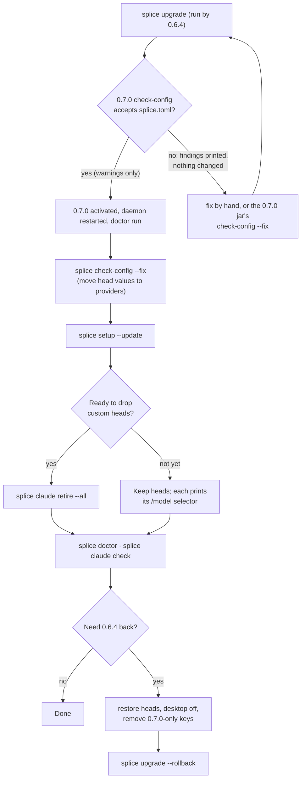

[README](../../README.md) · [Wiki Home](README.md)

# Upgrading to v0.7.0

This guide takes a working 0.6.x install (0.6.4 most often) to v0.7.0. Nothing in it is mandatory: an unchanged 0.6.4 `splice.toml` boots on 0.7.0, your heads keep their commands, and your logins, keys and sessions stay where they are. Four commands cover the upgrade: `splice upgrade` installs the release, `splice check-config --fix` moves head-held values to their providers, `splice setup --update` offers what 0.7.0 adds, and `splice doctor` confirms the result.

The main change is that splice is now **one gateway with one model list**. Every provider in `splice.toml` is served at the door, and Claude Code, Claude Desktop, the LAN door and a team server all read the same catalog. Custom heads still work, but they are deprecated. The rest of this page lists what changed, who is affected and what to do. For the complete record, see the [CHANGELOG](../../CHANGELOG.md).

## At a glance

| Area | What 0.7.0 brings | Read more |
| --- | --- | --- |
| Gateway and models | One model list for every client; provider tables carry `pinned_model`, `model_slots`, `context_window`, standing prompts and `overrides`; `splice add provider`; `[door.commands]` and `[door.selector_aliases]`; custom-provider keys (`credential_command`, `ca_file`, `served_window`, `error_messages`, `max_output_tokens`, `picker`) | [Providers and accounts](providers-and-accounts.md) |
| Custom heads | Deprecated; each head command now starts Claude Code through the gateway; `splice claude retire`, `restore` and `check` | [Door and launchers](door-and-launchers.md) |
| Launchers | `splice launch claude [--profile <name>]` and `splice launch claude-desktop` run splice beside your own `claude` and Desktop; `[launch.profiles.<name>]`; setup no longer wraps `claude` | [Door and launchers](door-and-launchers.md) |
| Claude Desktop | `splice desktop on` puts Chat, Cowork and the Code tab on splice with nothing to paste; managed `processWrapper` through `splice desktop wrapper`; console policy overrides; profile sync of MCP servers, extensions and skills | [Claude Desktop](claude-desktop.md) |
| Antigravity (`agy`) | Gemini models in Desktop's Chat and Code tab, live `set_model` switching, subagent Task panes, skills in autocomplete, the Desktop harness map | [Claude Desktop](claude-desktop.md) |
| MCP | Opt-in import into a Splice MCP registry, console import UI, sync to agy, Codex and Desktop, daemon auto-sync, stale-entry pruning in agy | [MCP hub and sync](mcp-hub-and-sync.md) |
| Accounts and peers | Bare `splice login` and `/login` open the console's Accounts page; `splice setup` installs and migrates Codex peer hooks | [Providers and accounts](providers-and-accounts.md), [Peers and harnesses](peers-and-harnesses.md) |
| Team Server Mode | The team door at `/door/v1`, key prefixes and 32 to 128-character secrets, key import, `admin_cidrs`, forward auth with browser sign-in, client distribution, audit log, state snapshots, the console's Server page, OTLP relay, `metrics_prefix`, external cost meters | [Team server mode](team-server-mode.md) |
| Modes | `[modes.<name>]`, door hooks, MCP-kind modes, the `ccd_session` mode on by default, the `tableapp` sample | [Modes and extensions](modes-and-extensions.md) |
| Console | Rebuilt pages, old addresses redirect, the Server page, `/reply-view/`, live replies | [Console and sessions](console-and-sessions.md) |
| Lifecycle | Restarts and upgrades hand over at once (`--wait` brings the full wait back), `splice setup --update`, upgrade aftercare, rollback that checks your config first | This page |
| Turns | LAN share is the door alone, compaction is refused only against a known ceiling, empty error tool results are repaired | [Door and launchers](door-and-launchers.md), [Architecture and troubleshooting](architecture-and-troubleshooting.md) |

## Upgrade step by step

### 1. Upgrade the release

Run the upgrade in a terminal:

```bash
splice upgrade --check   # optional: says whether a newer release is published
splice upgrade           # fetch, verify, check your config, activate, restart, run doctor
```

`splice upgrade` downloads the release, checks it against the release's `sha256sums.txt` (and its build provenance when the GitHub CLI is signed in), and stages it under `~/.local/share/splice/releases/`. It then has the new release's own `doctor` and `check-config` read your install before anything stops. A release whose `check-config` refuses your `splice.toml` is never activated, and the running daemon stays as it was.

The command you run belongs to the release you are leaving, so on this one hop **0.6.4's** `splice upgrade` does the work:

- 0.6.4's `upgrade` takes `--to vX.Y.Z`, `--now` and `--rollback`. Its default waits up to 30 minutes for in-flight turns to finish; `--now` skips that wait. `--wait` arrives with 0.7.0 and is refused by 0.6.4.
- An unchanged 0.6.4 file passes 0.7.0's check: head values that belong on a provider are warnings in 0.7.0, not refusals. If 0.7.0 does refuse your file, 0.6.4 prints every finding, removes the download and changes nothing. You can fix the findings by hand, or run 0.7.0's fix session from a downloaded copy of its jar, then run `splice upgrade` again:

  ```bash
  mkdir -p /tmp/splice-0.7.0 && cd /tmp/splice-0.7.0
  curl -fsSLO https://splice.torad.ai/download/v0.7.0/splice.jar
  curl -fsSLO https://splice.torad.ai/download/v0.7.0/sha256sums.txt
  grep ' splice.jar$' sha256sums.txt | sha256sum -c -   # macOS: shasum -a 256 -c -
  java -jar splice.jar check-config --fix
  ```

  Use the Java your install runs on. The fix session edits your usual `splice.toml` and backs it up first.

- 0.6.4 does not run 0.7.0's aftercare, so after this hop run `splice setup --update` yourself (step 3).

From 0.7.0 on, `splice upgrade` works as shown below. It has `--wait`, it offers the new release's fix session on a terminal, and it runs aftercare. Later upgrades use this behavior.

| Form | What it does |
| --- | --- |
| `splice upgrade` | Hands over at once under splice's systemd unit. Answers and compactions already arriving finish on the old daemon while the new one takes every new request. It still waits for compactions the restart would cut: on a provider that stops whole (Muse), on a local runtime with `slot_affinity` on, or on a daemon running outside the unit. |
| `splice upgrade --wait` | Waits for in-flight work on every command before restarting, up to the daemon's whole-turn cap (30 minutes by default). |
| `splice upgrade --now` | Still accepted; prints that it is no longer needed and upgrades without waiting. `--now` and `--wait` together are refused. |
| `splice upgrade --to vX.Y.Z` | Installs one version, including one listed in `upgrade-rejected`. |
| `splice upgrade --check` | Says what is installed and what is newest; stands alone. |
| `splice upgrade --rollback` | See [Roll back to 0.6.4](#roll-back-to-064). |

When a 0.7.0 or later `splice upgrade` finds that the new release refuses your `splice.toml`, it runs that release's own `check-config --fix` in your terminal, checks again, and continues only when the file passes (`✓ config <version> accepts splice.toml now`). Without a terminal, for example from a script, it refuses and tells you to run `splice upgrade` in one. A successful upgrade also re-lays `splice.service` from the new jar, but a unit you override in `~/.config/systemd/user` stays yours. Its aftercare lays the Antigravity shim, refreshes the MCP hub's units where the hub is installed, and on an interactive upgrade prints a **What's new / action needed** list that ends by pointing at `splice setup --update`.

### 2. Read and move the configuration warnings

```bash
splice check-config          # read-only: exit 0 (clean or warnings), exit 3 (this build would refuse boot)
splice check-config --fix    # interactive: findings first, then warnings; nothing moves without your answer
```

A 0.6.4 head can hold values the gateway now reads from its provider. In 0.7.0 these are warnings: `check-config` prints them and exits 0, `splice doctor` shows them as WARN, and `daemon.log` names them with `[config] warning:` lines. Until you move them, the gateway serves the provider with a head's value when every head on it that says that value says the same one. If they disagree, the provider is served without the value and the warning says so.

| A 0.6.4 head holds | The move offered |
| --- | --- |
| `context_window` | To `[providers.<key>]` |
| `model_slots`, or `slot` on its `models` rows | To a `model_slots` map on `[providers.<key>]`; the head keeps its rows |
| `system_prompt`, `system_prompt_file`, `system_prompt_mode` | To `[providers.<key>]`, all three together in one move |
| An `overrides` knob a turn is served by (for example `maxInflight`) | To `[providers.<key>.overrides]` |
| A custom `discovery_prefix` | To `[door.selector_aliases]`; the head keeps its prefix |

The table is what `--fix` offers when the move is safe. A window, tier map, prompt or `overrides` knob moves only when the provider says none of it and every head on that provider would be served exactly what it is served now once the value is on the provider. When two heads on one provider hold different values, or another head says nothing and would start reading the moved value, the warning stays and no `[m]` is offered: moving either value would change how the other head is served. Nothing is written for such a warning unless you pick `[d]`, `[v]` or `[e]`, and each head keeps being served its own value meanwhile. To clear it, write the value the gateway should serve in `[providers.<key>]` yourself (`[e]` opens the file). A head that says the same value then stops warning. A head that says another keeps a warning ("says another, which the gateway serves; the head keeps its own") and keeps its own value until you remove its line, which serves it the provider's, or set it to the same value.

A head's `pinned_model` and its display and trace settings stay on the head. `model_slots` is not a new key: it existed on heads in 0.6.4. What's new is that a provider carries it and the door serves every mapped tier.

`--fix` works only in a terminal. Off one, it says so and only checks. It copies `splice.toml` once into `<state>/config-backups/` (by default `~/.splice/state/config-backups/`) before its first change. Each item offers these keys:

| Key | Action |
| --- | --- |
| `[m]` | Move the value (or a head's prompt keys together) to the table where the gateway reads it |
| `[d]` | Remove the line |
| `[v]` | Set a new value |
| `[e]` | Open your editor at the line (`$VISUAL`, else `$EDITOR`) |
| `[c]` | Clear a saved setting (offered only for one) |
| `[s]` | Skip this one for now |
| `[q]` | Quit |

The fix session checks a move before offering it. It offers `[m]` only when the result passes the same strict check boot uses. A standing prompt moves as one unit, and only if the provider has no prompt of its own and every head on that provider is served the same prompt, so one head's `append` never becomes another's `replace`. When a move isn't safe, including when sibling heads disagree, the warning says why and no `[m]` is offered. A key that isn't on offer, or a bare Enter, is answered with the keys that are, and the warning is not repeated. Multi-line strings move whole with their comments, and Windows line endings are kept.

Boot still refuses a provider `context_window` of zero or less, and a provider that sets both `system_prompt` and `system_prompt_file`. A retired knob saved in splice's state is cleared at daemon start after a copy to `config-backups/`. A retired knob set in your environment must be unset where you export it (a shell profile or a systemd unit).

### 3. Set up what 0.7.0 adds

```bash
splice setup --update
```

This is the checkup for an existing install. It asks nothing about the plans and heads you already have, and offers only what this release adds, in this order:

1. The side-by-side launchers you don't have yet: the `claude-splice` command and, where Claude Desktop is installed, the **Claude (Splice)** app.
2. Putting all of Claude Desktop on splice (`splice desktop on`), or moving it off the older Code-tab door.
3. MCP import and harness sync.
4. Codex peer hooks. Hooks written by hand for 0.6.4 that wrap the call in `sh -c '… jq …'`, set a SessionEnd timeout other than 3, use a matcher or repeat an entry are offered a migration to direct `splice peer codex attach|detach` lines. The old file is backed up to `hooks.json.bak` first.
5. Modes that are off. A running daemon restarts onto any mode you turn on.
6. `[daemon] auto_update`.

What only an administrator can change (Claude Code's managed settings), or what needs a program splice doesn't install (systemd for the MCP hub), is printed with what to do. The checkup lays the Antigravity shim where it is missing and ends on `splice doctor`. Without a terminal, it only lists the gaps.

### 4. Check the result

```bash
splice doctor
splice claude check
```

`splice doctor` has a new **tools** section: Claude Desktop and its mode, Claude Code's managed settings for the Code tab, `agy` and `codex` with their Splice MCP sync, the Antigravity shim, Codex peer hooks, and systemd for the MCP hub. These rows are OK, INFO or WARN only, so they never turn the exit code red. Each head your install still links prints a deprecation line with its replacement selector. `splice claude check` reports every way Claude Code still starts past the gateway and every model list it finds.

### The decision path



## Breaking and behavioral changes

### Defaults that changed

| What you'll notice | Who it affects | What to do |
| --- | --- | --- |
| Head-held provider values are **warnings**, not refusals. | Every 0.6.4 file with `[heads.*]` | Optionally `splice check-config --fix` |
| Restart and upgrade **don't wait for compactions** by default, except where a restart would cut them | Scripts that relied on the full wait | Add `--wait` (or `?wait=1` on `POST /api/daemon/restart`) |
| Bare `splice login` opens the console's **Accounts** page; `--no-browser` prints its address | Scripts that ran bare `splice login` | Name the head: `splice login <head>` |
| `splice setup` no longer wraps plain `claude`; an existing wrap stays | New setups | Use `splice launch claude` beside it, or keep the wrap |
| LAN share is the **door alone**; per-command share addresses stop working | Machines that added another machine's command | Re-run `splice remote add http://<box>:<port>` |
| **Antigravity is on** when `agy` is installed and signed in | Desktop users with `agy` | `[daemon] antigravity = false`, or the console switch |
| The **`ccdsession` mode is on**; other shipped modes are off | Door and head sessions | `[modes.ccdsession] on = false` to turn it off |
| Console pages moved: `requests.html` and `usage.html` → `activity.html`, `models.html` → `providers.html`, `compare.html` → `providers.html?open=compare` | Bookmarks | Nothing; old addresses redirect with the query kept |
| Another lab's model id no longer repeats the lab: `claude-xai--4.7`, not `claude-xai--xai-4.7` | Pinned model ids | Nothing; old spellings still run |
| A turn-serving setting changed for one command in the console (concurrency, retry, reasoning) is written to the **provider's** table | Console users | Nothing; display and trace settings stay on the command |

### The gateway is one model list; custom heads are deprecated

**What changed.** splice builds one catalog from what every provider in `splice.toml` serves and keeps it in `model-catalog.json` in the state directory. The catalog is rewritten at daemon start and on sign-in, sign-out or a provider-list change. Terminal `/model`, Desktop's picker, door discovery (`GET /door/v1/models`) and `splice claude` all read it. A `splice.toml` with no `[heads.*]` at all serves every provider. Claude models are listed under their own ids (`claude-opus-5-5`), and another lab's models under an id Claude's clients keep (`claude-codex--gpt-6.2-sol` is listed as `claude-oai--6.2-sol`). Old selectors keep working, and the built-in legacy prefixes (`claude-codex--`, `claude-grok--`, `claude-kimi--`, `claude-muse--`, `claude-openrouter--`, `claude-fireworks--`, `claude-deepseek--`) need no alias.

A head's command (`claudex`, `claude-grok`, …) still works in this release, but it now starts Claude Code **through the gateway**, in the head's own Claude folder, on the head's own model, with the gateway's list as its `/model`. It no longer writes a picker, allowlist, tier variables or model cache. Each launch prints that custom heads are deprecated and will be removed in a coming release, with the `/model <selector>` that replaces the head. A head that forwards your own Claude login keeps its own way to Anthropic.

**Who is affected.** Everyone with `[heads.*]`. Nothing is retired for you: an upgrade changes no lane and retires no head by itself.

**What to do.** Put tier maps and windows on the provider, where the gateway reads them once the heads are gone. `splice check-config --fix` offers these moves; written by hand, a tier map looks like this:

```toml
[providers.codex]
pinned_model = "gpt-6-sol"
context_window = 272000
model_slots = { opus = "gpt-6-sol", sonnet = "gpt-5.6-terra", haiku = "gpt-6-luna", fable = "gpt-6-astra" }
```

Then try `claude` with `/model <selector>`, and retire the heads when you are ready:

```bash
splice claude check                 # what still starts past the gateway, and every model list found
splice claude retire claudex        # one head, by command or key (end its sessions first)
splice claude retire --all          # every head not yet retired
splice claude restore claudex       # undo one
splice claude restore --all         # undo every recorded retirement
```

Retiring refuses a head with a live session and names the session. Otherwise it copies every file splice laid for the head into `<state>/head-backups/<key>/<timestamp>/` (with a `manifest.json`) **before** removing anything. Then it removes the command link, splice's files in the head's Claude folder, and splice's keys in that folder's `.claude.json`, and records the retirement in `<state>/command-retirements.json`. Sessions and transcripts stay. The head stays in `splice.toml`, its provider and login keep serving, and its models stay in `claude`'s list under the same selectors. Retiring the head plain `claude` runs on puts `claude` on the gateway. Restore puts each entry back exactly, refuses any path you changed since, and keeps the backup. `splice install`, `splice setup` and upgrades skip a retired command.

`splice add provider <file|https-url> [--check]` installs a team's published provider definition, checked as boot checks `splice.toml`. It isn't listed in `splice add`'s usage text. A provider can also have its own door command (`[door.commands.<name>]`) and old selector prefixes (`[door.selector_aliases]`). See [Providers and accounts](providers-and-accounts.md#custom-providers) and [Configuration reference](configuration-reference.md#door-launch-profiles-local-harnesses-and-lan-sharing).

### Side-by-side launchers and terminal launch profiles

**What changed.** `splice setup` no longer wraps plain `claude`. Your own `claude` and Claude Desktop stay on your personal account, and splice runs beside them:

```bash
splice launch claude                     # Claude Code on splice's door, beside your own claude
splice launch claude --profile work      # the same, over a filtered Claude folder of its own
splice launch claude-desktop             # a second, isolated "Claude (Splice)" Desktop
```

`splice launch claude` always runs on the door, whatever lane plain `claude` is on, and writes nothing into `~/.claude`. The optional `claude-splice` command is the same launch. `splice launch claude-desktop` starts the installed Desktop with its own profile (`~/.config/claude-splice` on Linux, `~/Library/Application Support/claude-splice` on macOS), leaving your own Desktop and its claude.ai sign-in alone. `--profile` is the only splice flag, and only the `claude` target takes it.

A launch profile is a Claude folder of the profile's own, rebuilt from `~/.claude` before every launch (`~/.claude` is read, never written):

```toml
[launch.profiles.work]
dir = "~/.claude-work"         # default: ~/.splice/launch-profiles/<name>
keep_hooks = "own"             # "own", "all" or "none"
drop_hooks = ["SessionStart", "notify.sh"]
keep_plugins = ["code-review@claude-plugins-official"]
drop_blocks = ["team-notes"]
drop_names = ["team-", "old"]
```

Profiles are read at daemon start. Boot refuses a `dir` that is, holds or sits inside `~/.claude` or `~/.gemini`, a relative `dir`, or two profiles in one folder. Launch profiles are not Desktop profile sync (below).

Every launch on the door now sets what a head's launch sets: client timers, the window variables, `NO_PROXY`, and the starting model, written into the launch's `--settings` overlay. A model, tier or window left in `~/.claude/settings.json`'s `env` no longer wins on a door launch, so pass `--model` or use `/model` instead.

**Who is affected.** 0.6.4 setups that wrapped `claude` keep the wrap; `claude` stays on the door. No CLI verb removes the wrap.

**What to do.** To give plain `claude` back to your personal login, turn off **Send the claude command through splice** under **Providers → Anthropic** in the console. Then use `splice launch claude`, or let `splice setup --update` link `claude-splice`. See [Door and launchers](door-and-launchers.md).

### Claude Desktop on splice: full third-party mode

**What changed.** `splice desktop on` now puts all of Claude Desktop on splice (Chat, Cowork and the Code tab) in Desktop's third-party gateway mode, with nothing to paste. It writes splice's configuration into Desktop's `Claude-3p/configLibrary` and applies it. Desktop gets its key from `<state>/desktop-credential`, and no key is written into Desktop's files. `--model <id>` gives Desktop a starting model of its own again. 0.6.4's `on` printed five variables to paste into the Code tab; 0.7.0 has none.

```bash
splice desktop on            # asks first; without a terminal, add --yes
splice desktop               # mode, door, default model, picker, last turn
splice desktop off           # takes out exactly what on put in, and re-applies what was applied before
```

Quit Desktop completely and reopen it after `on`, `off` or an upgrade, because Desktop reads its configuration only at launch. Desktop on splice has no claude.ai sign-in: conversations stay on this computer, and Remote Control and Anthropic's cloud environments aren't offered. To keep claude.ai in your usual Desktop, use the side-by-side **Claude (Splice)** app instead. `on` refuses when Claude Desktop's own managed configuration exists (`/etc/claude-desktop/managed-settings.json` on Linux, Desktop's managed preferences on macOS).

Other parts of the Desktop setup:

- **Managed `processWrapper`.** Antigravity in the Code tab and live model switches need Claude Code's managed settings to name splice's launcher (`processWrapper`) and to set `parentSettingsBehavior` to `"merge"`, so the limits in Claude Desktop's own policy still apply to the Code sessions it starts and Desktop does not warn in each. splice never writes that administrator-owned file. It shows both keys, says what it read of the file and which other places Claude Code reads it did not, gives the commands that create the file only where nothing is at its path, and otherwise says to edit it in place:

  ```bash
  splice desktop wrapper --print    # bare "splice desktop wrapper" is the same
  splice desktop wrapper --check    # exit 0 when the managed file names splice's laid desktop-launch; its lines say the rest
  ```

  Use one flag or the other, not both. The paths are `/etc/claude-code/managed-settings.json` (Linux), `/Library/Application Support/ClaudeCode/managed-settings.json` (macOS) and `C:\Program Files\ClaudeCode\managed-settings.json` (Windows). This is Claude Code's managed file, not Claude Desktop's.
- **Policy overrides.** Settings → **Desktop policy** in the console sets 28 Desktop keys (surfaces, effort, permissions, MCP, browser, import) over splice's defaults. A change applies when Desktop is reopened. Hand edits to splice's Desktop configuration were lost at the next `on`; make them here. The file is `~/.splice/state/desktop-policy-overrides.json`.
- **Profile sync.** Each time splice publishes its configuration, it fills Desktop's third-party profile with Splice's MCP servers (hosted ones through `<state>/desktop-mcp`), your missing MCP entries, preferences and extensions from your usual Desktop, and your `~/.claude/skills`. It only fills in; it never overwrites your own entries.
- **Session import.** Desktop keeps offering to import your Claude Code CLI sessions; accepting is your choice.

**Who is affected.** A Code tab set up in 0.6.4 by pasting variables ("standard" mode) keeps working until `on` or `off` replaces it.

**What to do.** Run `splice desktop on`, or accept **Move Claude Desktop from the older Code-tab door** in `splice setup --update`, then quit and reopen Desktop. If you run `splice desktop off` on an old standard door, it tells you to remove the five pasted variables yourself under **Claude Desktop → Settings → Claude Code → Environment variables** (`CLAUDE_CODE_USE_MANTLE`, `ANTHROPIC_BEDROCK_MANTLE_BASE_URL`, `AWS_BEARER_TOKEN_BEDROCK`, `CLAUDE_CODE_MAX_CONTEXT_TOKENS`, `CLAUDE_CODE_AUTO_MODE_SERVER`), because splice can't write that encrypted store. Windows support for `splice desktop on` and the side-by-side app isn't documented. See [Claude Desktop](claude-desktop.md).

### Antigravity (`agy`) in Claude Desktop

**What changed.** With Google's `agy` installed and signed in, the daemon asks it at start which models it offers. Desktop's picker then lists them as `claude-antigravity--*` rows in Chat and the Code tab, each with agy's own reasoning levels. These rows exist only in Desktop: they never appear in the terminal's `/model`, the LAN or team door, or a starting model.

- **Chat** on a Gemini model runs through the door on a pool of `agy acp` sessions, and Desktop's Chat tools reach agy through a local bridge.
- **The Code tab** on a Gemini model runs Google's unmodified `agy acp` through `splice desktop acp`, never on Claude Code. Streaming, tool cards, permission prompts, Stop, `--resume` and history work. Transcripts are written in Claude Code's format, so Desktop reopens the session with its history.
- **Live `set_model`**: with the managed `processWrapper` in place, switching a running Code-tab session between an Antigravity model and any other model swaps the program on the same session id. The handoff loses context: messages, text and tool calls carry over, but thinking and tool results don't.
- **Subagents**: when agy delegates, Desktop draws a **Task** card and a subagent pane.
- **Autocomplete** lists your Claude Code skills and slash commands from `~/.claude` (or `CLAUDE_CONFIG_DIR`) and the project's `.claude` and `.agents` folders.
- **Harness routing**: Settings → **Desktop harnesses** chooses which program each Desktop family runs on. GPT runs on Claude Code through Splice by default, with Codex CLI as an opt-in entry in the map, and Antigravity can be switched on or off. `[harnesses.<id>]` declares an extra local ACP harness for the map only.

splice never reads or writes `~/.gemini` from the Code-tab bridge and does not send the Code tab's system prompt to agy. Chat's system text is sent, as the opening instructions. `desktop-sandbox` is a contributor tool under `tools/`, not a `splice` verb.

**Who is affected.** Desktop users with `agy` installed and signed in see the rows after the upgrade.

**What to do.** Nothing is required. For Gemini in the Code tab, install the managed wrapper (above). To sign agy in, run `agy acp --login` in a terminal, then `splice restart`. To keep agy out entirely:

```toml
[daemon]
antigravity = false
```

or turn it off in Settings → Desktop harnesses (once set, the console switch decides in place of the key until you reset it there). Either takes effect at the next daemon start. `splice doctor` reports `agy` and **antigravity shim** rows, and `splice install --all` re-lays the shim. See [Claude Desktop](claude-desktop.md).

### MCP: import, sync and pruning

**What changed.** splice can bring the MCP servers you already have in other apps into one Splice MCP registry it hosts and syncs. This is **opt-in**: nothing is imported until you ask.

```bash
splice mcp status                          # Splice MCP servers, connected and detected harnesses, what can be imported
splice mcp import                          # every source; or --from claude-code|claude-desktop|agy|codex and --server NAME
splice mcp sync --to agy,codex             # or --to claude, --to all; --import imports first
```

`splice mcp` works but is deliberately left out of `splice --help`. The sources it reads are `~/.claude.json`, Claude Desktop's `claude_desktop_config.json`, agy's `~/.gemini/config/mcp_config.json` and Codex's `config.toml`. The console's Settings → **MCP servers** has the same import and sync controls.

- **Sync** writes agy's and Codex's files in their own shapes, keeps your unrelated entries, and backs up each file first under `~/.splice/state/`. `--to claude` fills every Claude Desktop third-party profile that already exists.
- **Auto-sync.** Once a harness has been synced, the daemon keeps it in sync, re-syncing when `~/.claude.json`, the registry or the Temple registration changes. A harness you never connected is never touched.
- **Pruning applies to agy only.** A server splice managed that is gone is removed; one splice never managed is removed only when it is demonstrably dead (an absolute command path that is gone, or a `temple` entry on a loopback port with nothing listening). Codex sync only adds and updates.
- **URL key normalization is for Exa only.** An `https://mcp.exa.ai/...` URL carrying `?exaApiKey=` is rewritten so the key travels as an `x-api-key` header. Every other URL passes through unchanged.

**Who is affected.** Only people who opt in.

**What to do.** Nothing is required. To opt in, run the commands above or accept the MCP offer in `splice setup --update`. No verb disconnects a harness or undoes a sync, so restore from the backups under `~/.splice/state/` by hand if needed. See [MCP hub and sync](mcp-hub-and-sync.md).

### Console Accounts, `/login` and Codex peer hooks

**What changed.** Sign-in now happens in one place, the console's **Accounts** page:

- Bare `splice login` opens it (`--no-browser` prints its address; on Linux with no `DISPLAY` or `WAYLAND_DISPLAY` it prints instead of opening a browser). In 0.6.4 bare `splice login` picked the only sign-in head or asked which. `splice login <head>` and `splice login <server>` are unchanged, and `splice login <claude-head>` without `--label` now runs the same Claude Code sign-in the console runs.
- `/login` (and `/splice:login`) in a `claude` session on the door, and in an Antigravity session in Desktop, opens Accounts before the turn reaches a model.
- Door launches also stage hooks for `/fast` and `/ultrafast` on ChatGPT models and a session-start hook for Teams binding.

splice can now write `~/.codex/hooks.json` (or `$CODEX_HOME/hooks.json`) itself: `SessionStart` and `UserPromptSubmit` run `splice peer codex attach`, and `SessionEnd` runs `splice peer codex detach`. Hooks written by hand from 0.6.4's `docs/peers.md` that match exactly are reported current. Older shapes are offered a migration, with the file backed up to `hooks.json.bak` first. An unreadable file is never overwritten.

**Who is affected.** Scripts that ran bare `splice login`, and Codex users with hand-written peer hooks.

**What to do.** Change scripts to name the head. For Codex, run `splice setup --update` and accept **Migrate Codex peer hooks**. The `codex peer hooks` row in `splice doctor` shows the state. There is no separate hook verb; the migration happens only in `splice setup` and `splice setup --update`. See [Providers and accounts](providers-and-accounts.md#one-place-to-sign-in-console-accounts) and [Peers and harnesses](peers-and-harnesses.md).

### Team Server Mode

**What changed.** Existing `[server]` keys are still supported, and every `spk_…` key keeps working. If `splice check-config` reports that a served head command matches another provider's key, rename either the command or the provider key before starting 0.7.0. 0.7.0 adds:

- **The team door.** The keyed listener answers `POST /door/v1/messages`, `POST /door/v1/messages/count_tokens` and `GET /door/v1/models` with a person's key. Allowlists, caps, budgets and the ledger apply to the provider the model resolves to. `[server] commands` may name a provider key. The `/<command>/` routes keep working beside the door.
- **Keys.** `[server] key_prefix` (default `"spk_"`) brands new keys. The server **admits** secrets of 32 to 128 characters, and minted keys stay 40. `POST /server/api/keys/import` imports a key from its SHA-256 hash without the secret ever traveling. Key-shaped text in headers and query strings is hash-checked, and only real server keys are withheld from upstream. A gateway turn never forwards the caller's own credential.
- **`admin_cidrs`** restricts the listener's admin routes to the listed addresses.
- **Forward auth.** `[server.forward_auth]` makes `/server/forward-auth` a reverse proxy's auth check for your dashboards. With `browser_origin`, browsers sign in through `[server.signin]`'s OIDC and get signed `__Host-` cookies. A server restart ends every browser session. `[server.signin] hosted_domain` adds a Workspace domain check.
- **Client distribution.** `[server.client] download_url` lets a new laptop join through the [HTTPS bootstrap](team-server-mode.md#client-distribution). The server serves only the bootstrap script; the release files live at your HTTPS URL.
- **Audit log.** Every admin action goes to `<state>/server/audit.jsonl`. Read it with `splice server audit [--tail N] [--json]`.
- **Durable state snapshots.** `[server.backup]` snapshots keys, people, budgets, the ledger, the audit log and cost-meter intervals to a folder or an S3-compatible bucket, and restores them on a fresh disk. `splice server backup --now` takes one at once.
- **The console's Server page** mints and revokes keys, sets people, teams and budgets, shows usage and the audit log, and triggers a backup.
- **OTLP relay (new in 0.7.0).** `[server.telemetry] forward_to` relays each person's Claude Code telemetry to your collector, stamped with identity. `[server.telemetry.identity_attributes]` renames the person, email and team attributes.
- **`metrics_prefix`** (default `"splice_server_"`) renames the admin Prometheus scrape's metrics.
- **External cost meters.** `[server.cost_meters.<name>]` bills a GPU box, storage or a worker by the hour, for confirmed running intervals only.

**Who is affected.** Team server operators; each addition is opt-in.

**What to do.** Nothing is required. To move a server to a new disk, set `[server.backup]`, run `splice server backup --now` on the old machine, and let the new one restore on first start. See [Team server mode](team-server-mode.md) and [Configuration reference](configuration-reference.md#server-mode).

### Splice Modes

**What changed.** A mode is a folder under `modes/` built into the jar. It gives the model a set of tools that splice answers itself, on Anthropic, Chat Completions and Responses providers. Modes ship on or off by default:

| Mode | Kind | Default | What it does |
| --- | --- | --- | --- |
| `ccdsession` | door | **on** | `ccd_session` tools for suggested tasks and chapters, shown on the console's Sessions page; door and head sessions, not Desktop's own |
| `template` | door | off | A sample door mode |
| `templateapp` | mcp | off | A sample MCP App |
| `tableapp` | mcp | off | Turns a Markdown table into a sortable MCP App page |
| `visual` | mcp | **on** in Claude Desktop only | Lets the model draw charts, diagrams, small tools and whole pages in clients that draw MCP Apps |

A mode can hook the door at six moments: `session_start`, `before_tool_call`, `after_tool_call`, `on_stop`, `request` and `response`. An `mcp` mode is served by the daemon at `/mcp/<server>` and handed to launches as an extra MCP config. Turn modes on and off in Settings → **Modes** (per command, and for `visual` also for every session), through `splice setup --update` (it offers the modes that are off), or in `splice.toml` (the table is keyed by the mode's folder name):

```toml
[modes.ccdsession]
on = false

[modes.tableapp]
on = true
```

**Who is affected.** Door and head sessions get the `ccd_session` tools unless you turn the mode off. If Claude Desktop runs on the gateway, the first start of the new version gives it an MCP server named `visual`, with three tools (`read_me`, `show_widget`, `html_render`) that let the model draw charts, diagrams and pages in the conversation. Terminal sessions do not get it, since a terminal draws nothing.

**What to do.** Nothing is required. To turn `visual` off in Claude Desktop, choose **Off** on its **Every session** switch in Settings → **Modes**, or add these two lines to `splice.toml` and run `splice restart` (the daemon reads a hand edit only when it starts):

```toml
[modes.visual]
on = false
```

The console's switch takes effect at once, with no restart. Either way, quit Claude Desktop and reopen it: it reads its MCP servers only when it starts. `on = true` (or **On**) gives `visual` to every session, terminals included, for a machine with an app that draws from a session's transcript; **Default**, or deleting the table, puts it back on in Claude Desktop only. A per-head switch (`heads = { <head> = false }`) applies to heads declared in `splice.toml`; for a provider served without a head, rely on `on`. See [Modes and extensions](modes-and-extensions.md) and [`modes/README.md`](../../modes/README.md).

### LAN share is the door alone

**What changed.** `splice share on` puts this machine's **door** on its LAN, with no per-command addresses. `splice share status` prints the door address, how many models it serves, the one line to run on another machine, and the variables a Claude Code without splice can use. `splice remote add` refuses an address that names one command or asks for a login (`?auth=`) or a model list (`?models=`).

**Who is affected.** Machines that added a per-command share from another machine.

**What to do.** Nothing changes on the sharing machine. On each client, re-add the door. A leftover `[remote.<command>]` still loads, and its launch prints this line:

```bash
splice remote add http://devbox.lan:3097
```

Sharing has no login, token or encryption, so share only on a network you trust. See [Door and launchers](door-and-launchers.md).

### Compaction and tool-result repairs

- **Compaction against a known ceiling only.** splice's pre-flight no longer refuses a compaction request against the client's compaction target. It refuses one only when the request exceeds a known maximum (a published or configured `max_context_window`). A model with no known ceiling is not refused. Ordinary first requests are still checked against the serve window.
- **Empty error tool results.** On the Anthropic passthrough, a `tool_result` with `is_error: true` and no content is sent as `"Tool failed with no output."`, so resuming a session with an old empty failure is no longer rejected upstream.
- **Retry-After.** An overload answer carries `Retry-After` in whole seconds, rounded up, so Claude Code and Desktop back off correctly.

None of these needs any action. See [Architecture and troubleshooting](architecture-and-troubleshooting.md#long-session-reliability).

## After the upgrade

- [ ] `splice version` prints `splice 0.7.0`.
- [ ] `splice check-config` exits 0. Warnings are fine; `--fix` moves the ones that are safe to move when you're ready. A value that sibling heads on one provider disagree on is not moved: set the value you want in the provider's table yourself, or leave the warning.
- [ ] `splice doctor` is green, and its tools rows read as you expect.
- [ ] `claude`, then `/model`, lists every signed-in provider's models.
- [ ] Each head you still use prints its replacement selector, and `splice claude check` reports what still starts past the gateway.
- [ ] `splice setup --update` has offered what you want: launchers, Desktop, MCP, Codex hooks, modes, auto-update.
- [ ] Claude Desktop, if you use it: after `splice desktop on`, Desktop was quit fully and reopened, and `splice desktop` shows mode `app`.
- [ ] Gemini in the Code tab, if you want it: `splice desktop wrapper --check` exits 0, names no place it did not read, and says Desktop's limits apply to the Code sessions it starts.
- [ ] Other machines using your LAN share have re-run `splice remote add http://<box>:<port>`.
- [ ] Scripts that ran bare `splice login`, or relied on restart waiting for every compaction, are updated.
- [ ] Team servers: `splice server audit` answers, and any new `[server]` tables pass `splice check-config`.

## Roll back to 0.6.4

### How releases are kept

Releases live under `~/.local/share/splice/releases/<version>/`, with two links: `releases/current` and `releases/previous`. The live jar points into `current`. Each upgrade makes the release you left `previous` and prunes every other release, so **exactly one** rollback target is kept; rolling back twice doesn't reach 0.6.3.

### What `splice upgrade --rollback` does

```bash
splice upgrade --rollback     # also takes --wait or --now; never --to
```

1. Prints `splice upgrade --rollback: <installed> -> <previous>`. With no `previous` link it refuses: "no previous release to roll back to".
2. Runs the **previous** release's own `check-config` on your current `splice.toml` before anything stops. If 0.6.4 would refuse the file, the rollback refuses, changes nothing and prints every finding. 0.6.4 has no fix session, so none is offered.
3. With `--wait`, waits for in-flight work first.
4. Activates the previous release, records the release you left in `<state>/upgrade-rejected` so auto-update skips it, refreshes `splice.service`, restarts the daemon and runs `splice doctor`.

### Before you roll back

Save a copy of your current `splice.toml` and have your pre-upgrade copy ready to restore before running the rollback. If `check-config --fix` changed the file during the upgrade, its first backup may be in `<state>/config-backups/` (normally `~/.splice/state/config-backups/`).

0.6.4 cannot undo what 0.7.0 laid down. While still on 0.7.0, run:

```bash
splice claude restore --all     # 0.6.4 has no restore verb; retired heads would stay removed
splice desktop off              # 0.6.4 can't remove the third-party configuration or its helpers
```

Restore the pre-upgrade `splice.toml`. If you don't have it, use the table below to remove 0.7.0-only settings and put any value `--fix` moved to a provider back on its head. The rollback runs 0.6.4's own configuration check before it changes anything:

```bash
splice upgrade --rollback
```

Compatibility with the 0.6.4 configuration schema (the rollback prints the exact findings for your file):

| 0.7.0-only content in `splice.toml` | 0.6.4 says |
| --- | --- |
| A provider-only file with no `[heads.*]` | Accepted |
| `[daemon] antigravity` | `daemon.antigravity … is not a splice.toml setting; remove the line` |
| `[providers.<key>]` `pinned_model`, `model_slots`, `context_window`, `overrides`, `system_prompt`, `system_prompt_file`, `system_prompt_mode`, `picker`, `served_window`, `ca_file`, `error_messages` | `providers.<key>.<name> … is not a splice.toml setting` |
| `auth = { kind = "command", credential_command = …, login_command = … }` | "the file cannot be decoded" |
| `max_output_tokens` on a provider's model rows | `providers.<key>.models.max_output_tokens … is not a splice.toml setting` |
| `picker` on a head, `readable` under `[heads.<key>.claude]` | `… is not a splice.toml setting` |
| `[door]`, `[door.commands.<name>]`, `[door.selector_aliases]` | "the file cannot be decoded" |
| `[launch.profiles.<name>]` | "the file cannot be decoded" |
| `[harnesses.<id>]` | "the file cannot be decoded" |
| `[modes.<name>]` | "the file cannot be decoded" |
| `[server]` `admin_cidrs`, `key_prefix`, `metrics_prefix`, `drain_seconds`, `stream_idle_seconds`; `[server.signin] hosted_domain` | `server.<name> … is not a splice.toml setting` |
| `[server.limits]` `inflight_total`, `inflight_per_upstream`, `busy_status`, `busy_retry_after`, `busy_message` | Unknown settings; remove these keys, not the whole table |
| `[server.client]` `download_url`, `version_header`, `outdated_status`, `outdated_message`, `checkin` | Unknown settings; remove these keys, not the whole table |
| `[server.aliases]` | Unsupported table; remove it entirely |
| `[server.forward_auth]`, `[server.backup]`, `[server.telemetry]` (and its `identity_attributes`), `[server.cost_meters.<name>]` | "the file cannot be decoded" |

"The file cannot be decoded" names no line, so search for the table yourself.

What a rollback leaves behind:

- MCP entries splice synced into agy, Codex and Desktop stay; 0.6.4 neither syncs nor prunes them. The backups are under `~/.splice/state/`.
- A migrated `~/.codex/hooks.json` keeps its new shape; the old file is `hooks.json.bak`.
- The side-by-side profile folder, the Antigravity shim and 0.7.0's state files stay on disk; 0.6.4 doesn't use them.

### Returning to 0.7.0

```bash
splice upgrade --to v0.7.0
```

An explicit `--to` installs a release listed in `upgrade-rejected` and takes it off the list. Auto-update skips a rejected release, but a newer release is still offered.

## Compatibility

splice follows SemVer and is still `0.x`. A patch release (0.4.0 → 0.4.1) never breaks what is
listed below. A minor release (0.4 → 0.5) may, and when it does its [CHANGELOG](../../CHANGELOG.md)
entry says so under "Upgrading", with the steps.

What 0.4.x keeps stable, and the check that holds it:

| Contract | Held by |
| --- | --- |
| `splice.toml` keys | build tests parse the example configuration and reject unknown keys |
| where state and credentials live | the `StatePaths` header; a pre-0.4 install keeps `~/.claude-codex/state` |
| the `splice` verbs | a build test checks that every shipped verb still parses |
| the Anthropic `/v1` surface every head serves | saved request and reply fixtures checked byte for byte |
| [shared Responses conversion and executor isolation](../architecture/responses-conversion.md) | `SharedResponsesContractTest` and the behavioral checks named in that contract |
| `splice doctor --json` | its `schema_version` (1); a breaking change bumps it |
| the `/api/*` payload fields | build tests pin each payload's fields |

Not a contract: log wording, the format of files under the state directory,
and the Kotlin module API (splice publishes no library).

**Claude Code.** Each release is tested against one Claude Code version in a fresh-machine e2e
(0.4.0: 2.1.322). When a session runs a newer version, `splice doctor`, `splice status` and
the status line say so.

**Security fixes** land on the latest release only. Report a vulnerability privately, as
[SECURITY.md](../../.github/SECURITY.md) describes.

## Related pages

- [Wiki home](README.md)
- [Getting started](getting-started.md)
- [Providers and accounts](providers-and-accounts.md)
- [Door and launchers](door-and-launchers.md)
- [Claude Desktop](claude-desktop.md)
- [Console and sessions](console-and-sessions.md)
- [MCP hub and sync](mcp-hub-and-sync.md)
- [Peers and harnesses](peers-and-harnesses.md)
- [Team server mode](team-server-mode.md)
- [Modes and extensions](modes-and-extensions.md)
- [Configuration reference](configuration-reference.md)
- [CLI reference](cli-reference.md)
- [Disk and privacy](disk-and-privacy.md)
- [Architecture and troubleshooting](architecture-and-troubleshooting.md)
